# Funding with a visible outcome

## A visual journey through Project Aamhi and Finternet

A funder wants to support useful work. A delivery organisation wants to demonstrate that the work happened, explain differences from the plan, and build confidence in its next funding request. The challenge is connecting the funding agreement, physical activity, supporting records and payment decision into an account that both sides can inspect.

This walkthrough follows a sponsored recovery programme from discovery to a verified outcome. Project Aamhi supplies the concrete setting; Finternet supplies the organising principles: identifiable participants, discoverable offerings, digital commitments, accountable attestations and programmable settlement.

The central proposition is:

> Agree what the contribution is intended to support, make the work inspectable, and connect accepted outcomes to the agreed financial response.

For Aamhi and similar organisations, this can strengthen the evidence behind a funding conversation. It does not guarantee funding, replace the sponsor relationship or establish every rupee of expenditure. Its contribution is a clearer, more credible connection between a commitment and the outcome it supported.

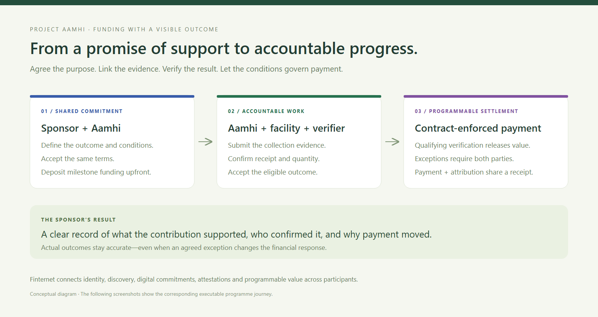

*Explanatory diagram: the responsibilities that connect a shared commitment to evidence, acceptance and payment.*

## Reading this walkthrough

Sections 1–16 tell the programme story in business language. Sections 17–25 explain the underlying Finternet mechanisms, including Beckn, without requiring blockchain expertise. The final appendix contains actual capture-state and transaction references for readers who want to inspect the proof.

Every application screenshot belongs to one continuous programme journey. No prepared chapter is loaded between those stages. The two explanatory diagrams are clearly distinguished from application screenshots.

The programme parameters are illustrative: a fictional Horizon Foundation supports two Aamhi recovery milestones in Raigad, each targeting 500 kg of LDPE collection and confirmed facility receipt. Each milestone allocates 10,000 dINR. dINR is sandbox programmable value, not redeemable INR. The outcome and financial conditions execute in the application; the supporting field records are synthetic. Implementation boundaries are collected near the end so the main story remains easy to follow.

### Four participants, four responsibilities

| Participant | Visual identity | Responsibility |
|---|---|---|
| Sponsor | Indigo | Commit funding, inspect outcomes and approve commercial exceptions |
| Aamhi team | Green | Deliver the work, submit evidence and agree exceptions |
| Receiving facility | Teal | Confirm the material and quantity received |
| Independent verifier | Purple | Assess whether evidence supports the eligible outcome |

The colour changes make the perspective visible; the role names and responsibility text also remain explicit. Different views represent different authorities, not merely different dashboard preferences.

### The programme at a glance

| Item | Milestone 1 | Milestone 2 |
|---|---:|---:|
| Route | Village collection | Coastal aggregation |
| Target | 500 kg | 500 kg |
| Funding allocation | 10,000 dINR | 10,000 dINR |
| Outcome eventually accepted | 500 kg | 450 kg |
| Financial response | Fixed payment under original terms | Fixed payment under a jointly approved exception |

The completed story therefore records **950 kg**, not 1,000 kg, even though both fixed milestone payments are released.

## 1. Start with a purpose everyone can understand

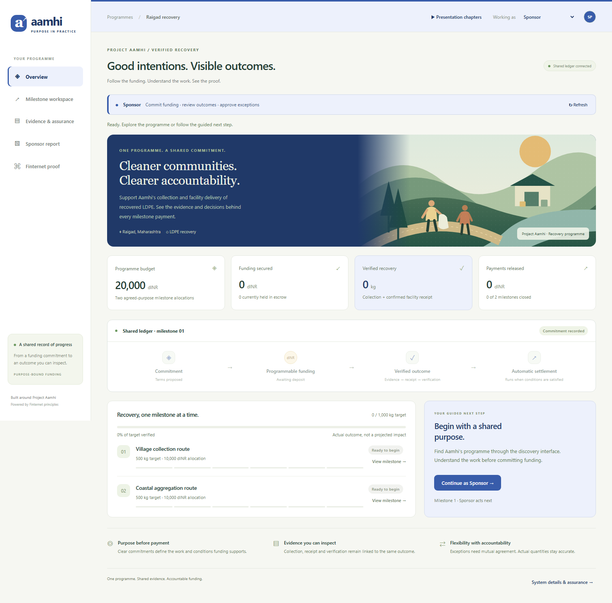

**What is happening.** The sponsor sees the programme's recovery purpose, geography and material stream. The overview distinguishes the planned budget from deposited funding, verified recovery and payments released. At the beginning, no milestone outcome has been verified and no funding has been paid to Aamhi.

**Finternet connection.** The interface starts with the user's purpose, while the underlying system connects the participants, obligations and value needed to achieve it. The technology serves the programme rather than requiring the sponsor to begin with a wallet or token explorer.

**Why it matters.** Aamhi can explain what support is being sought and what success will mean. A funder can understand the intended contribution without confusing a target with an accomplished impact.

## 2. Discover Aamhi's recovery offering

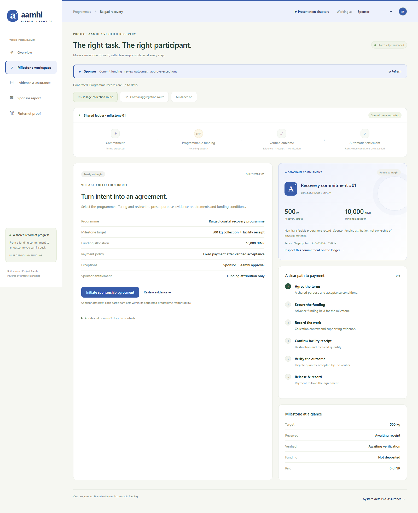

**What is happening.** The sponsor searches for an eligible recovery programme. The application retrieves Aamhi's offering through a separate provider catalogue interface, then presents the programme context for agreement initiation.

**Beckn connection.** This is the discovery responsibility: match a consumer's intent with a provider's offering. In the intended Beckn interaction, different applications can discover and engage with published offerings using shared protocol and domain definitions. The sponsor should not need to belong to a single closed marketplace to find relevant work.

**Why it matters.** Discoverability can help an organisation present a structured, fundable proposition: the work, place, material and expected outcome. It gives the funding relationship a reference that can remain connected to the later agreement and evidence.

**Technical distinction.** The current executable path uses a custom HTTP catalogue adapter to demonstrate that interface boundary. It does not establish external Beckn-network conformance. Section 25 explains both the intended role and the integration work still required.

## 3. Review a shared definition of success

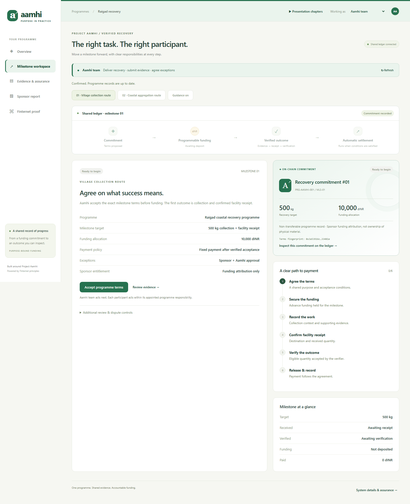

**What is happening.** Aamhi reviews the milestone: 500 kg of collection and confirmed facility receipt, a 10,000 dINR allocation, a fixed-payment policy and the requirement for joint approval of exceptions. The sponsor's entitlement is funding attribution, not automatic ownership of the physical material.

**Finternet connection.** The milestone is a digital commitment with an identifiable set of terms. A cryptographic fingerprint connects the agreement presented to the participants with the version recorded on-chain. A fingerprint detects a changed document; the agreement still needs understandable terms and authorised acceptance.

**Why it matters.** Both sides can point to the same definition of the funded purpose. This reduces the ambiguity that arises when the intended outcome, evidence expectations and payment basis live in separate conversations.

## 4. Accept the exact terms before funding

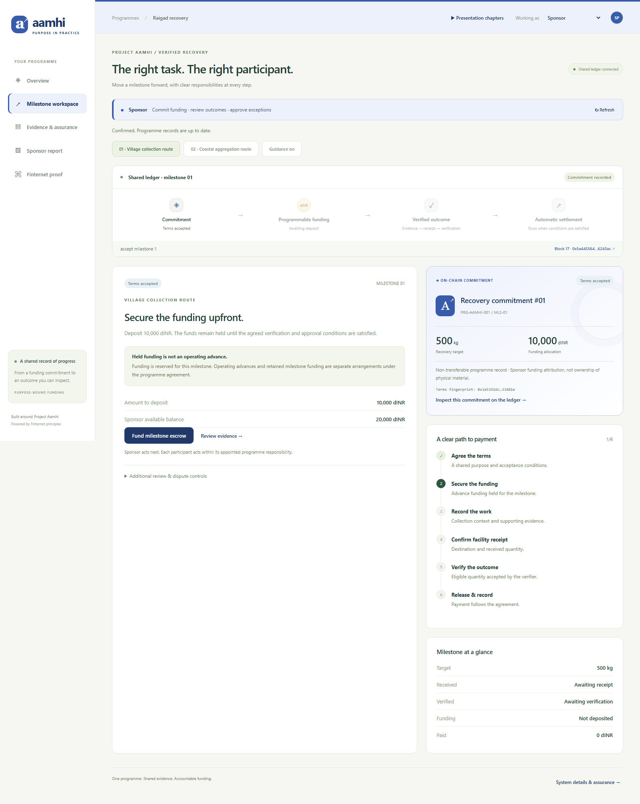

**What is happening.** Aamhi accepts the proposed terms. The sponsor is now the next actor and can fund the milestone. The contract will not accept milestone funding before the required acceptance.

**Finternet connection.** Authority and consent are part of the transaction state. The system distinguishes a proposed commitment from an accepted one. Acceptance is bound to the same terms fingerprint rather than an unversioned approval label.

**Why it matters.** The sponsor does not fund an undefined obligation, and Aamhi is not silently assigned conditions it has never accepted. Programmability begins with a mutually understood agreement, not with an arbitrary rule imposed after delivery.

## 5. Secure the funding upfront

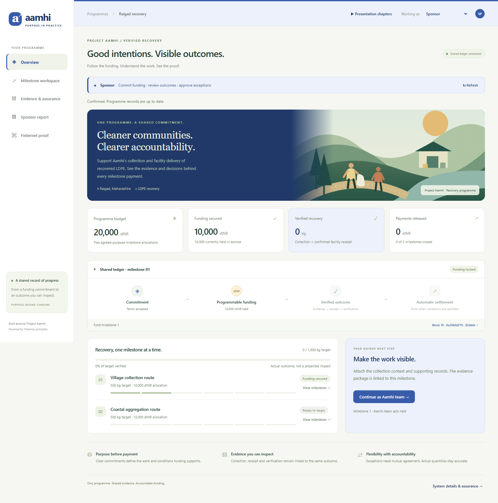

**What is happening.** The sponsor deposits 10,000 dINR for milestone 1. The sponsor's available balance falls from 20,000 to 10,000; escrow holds 10,000; Aamhi's received balance remains zero. No physical outcome has yet been accepted.

**Finternet connection.** Programmable value and programme conditions share an execution environment. The funds are held by the settlement contract and can move only under the implemented rules. This is more than attaching a payment reference to a report: the payment conditions govern the held token value.

**Why it matters.** The parties can distinguish intended support, committed funding, value currently held and value actually paid. The sponsor has an inspectable commitment; Aamhi can see that the allocation is secured.

**Operational consideration.** Held escrow is not available working capital. Real programmes may need operating advances, smaller tranches or advance-plus-reconciliation arrangements. Those policies belong in the agreement and future implementation; this journey demonstrates the conditional-escrow case.

## 6. Make the work inspectable

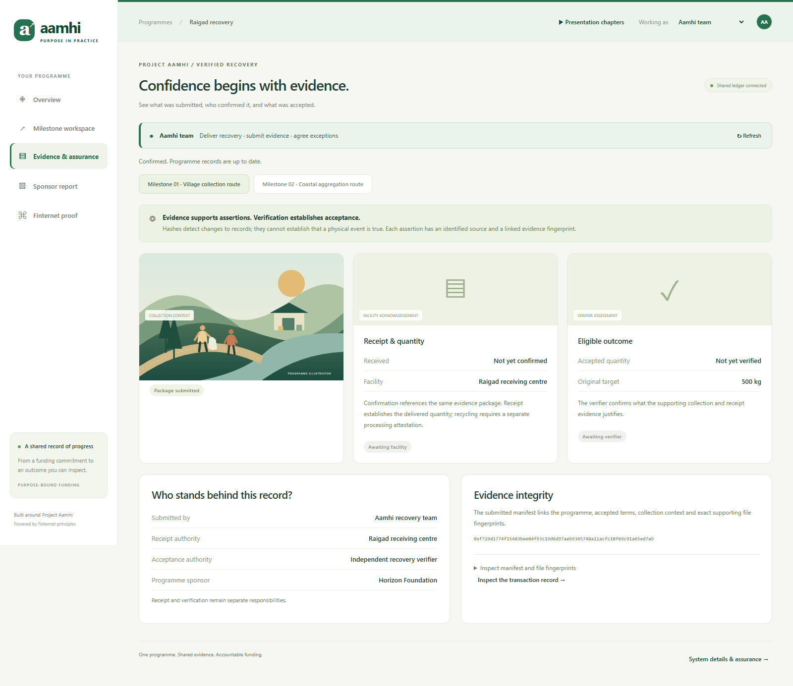

**What is happening.** Aamhi submits the collection context and evidence package. The manifest connects the programme, milestone, accepted terms, collection note and fingerprints of the supporting records.

**Finternet connection.** Physical-world information remains off-chain, while the shared record carries a fingerprint that later assertions reference. A manifest makes it possible to identify which package the facility and verifier are referring to, and detect a subsequent change in its bytes.

**Why it matters.** Aamhi has a structured basis for demonstrating its work. The sponsor and reviewer can follow an evidence trail rather than receiving an isolated outcome number with no supporting context.

**Trust distinction.** Hashing does not make a record true. Genuine proof of work requires reliable capture, accountable sources, appropriate verification and checks against duplicate reporting. The application connects those responsibilities; it does not replace them.

## 7. Confirm receipt at the facility

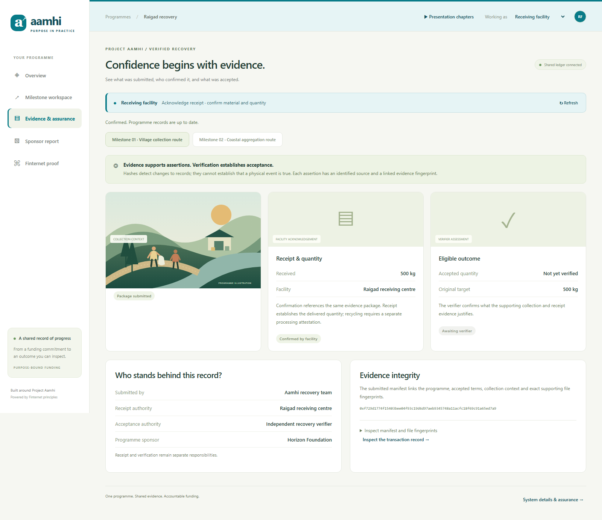

**What is happening.** The receiving facility acknowledges 500 kg against the submitted evidence package. Its assertion is separate from Aamhi's submission. The accepted-outcome field still awaits the verifier.

**Finternet connection.** An appointed participant makes an attributable assertion about a physical event. The evidence fingerprint ties the facility's acknowledgement to the milestone and its records. The contract enforces which account may make that assertion.

**Why it matters.** Collection and delivery are no longer represented by a single self-reported number. A separate checkpoint identifies what reached a receiving organisation and provides a quantity boundary for verification.

**Claim boundary.** Facility receipt is not completed recycling. A later processing claim needs its own evidence and authorised assessment.

## 8. Review the eligible outcome

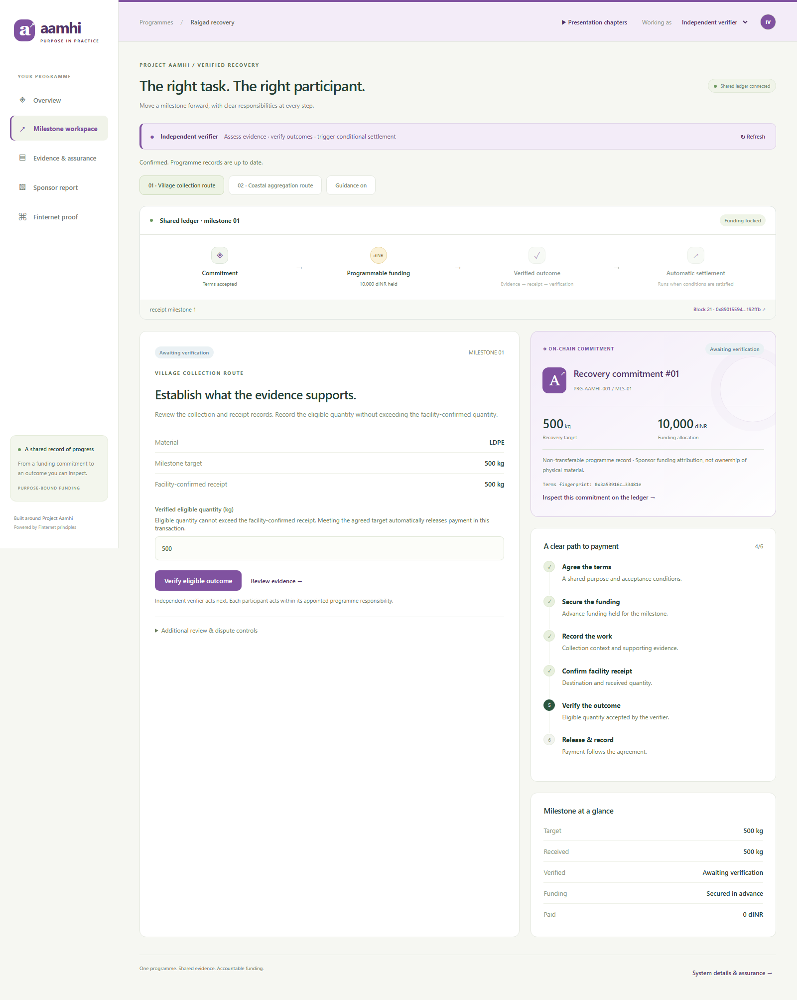

**What is happening.** The verifier reviews the linked collection and facility evidence. The quantity it accepts cannot exceed the quantity confirmed by the facility. The interface explains that satisfying the agreed conditions will also release payment.

**Finternet connection.** The verifier's attestation is the explicit bridge from evidence about physical work to programmable financial action. Authority, evidence reference, quantity and financial consequence remain linked.

**Why it matters.** The sponsor can distinguish evidence submission from acceptance. Aamhi can see which decision remains outstanding and which criteria govern it. The verifier must understand that accepting a qualifying outcome is also a settlement-triggering action.

## 9. Let qualifying verification settle the payment

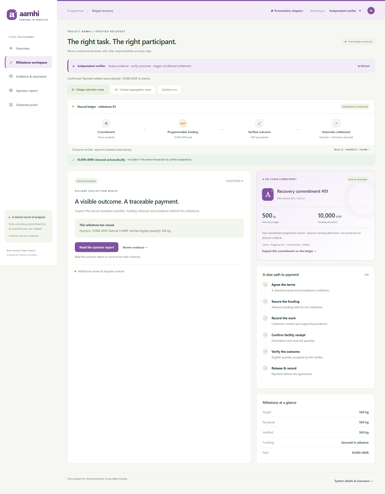

**What is happening.** The verifier accepts 500 kg. Because this meets the original milestone conditions, the same transaction transfers 10,000 dINR to Aamhi and creates the outcome-attribution reference. There is no subsequent administrator release button.

**Finternet connection.** This demonstrates atomic, conditional settlement within one execution environment. The authorised acceptance, token transfer and resulting attribution complete together. If the required transfer fails, the transaction reverts rather than leaving the on-chain acceptance recorded as successfully settled.

**Why it matters.** Once the agreed condition is met, another operator cannot introduce an additional discretionary payment step. Both parties can inspect the same settlement result and its acceptance basis.

This does not mean contracts act without any transaction input. The verifier submits the authorised attestation; the contract executes the pre-agreed financial consequence inside that transaction.

## 10. Inspect the actual settlement receipt

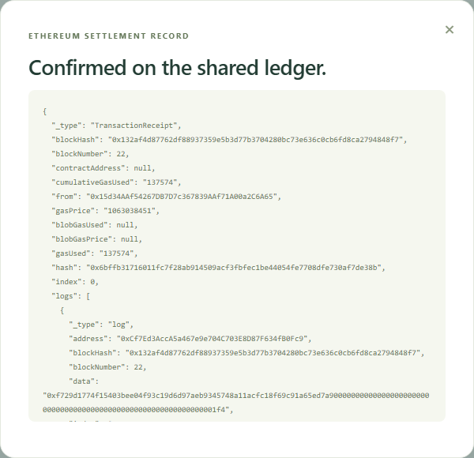

The receipt is the underlying ledger result, not a screenshot-only animation. Its successful status, transaction hash, block and contract logs allow the application state to be checked against execution.

The decoded events establish the important sequence:

| Event | Meaning |
|---|---|
| `Verified` | The appointed verifier recorded the eligible quantity against the evidence |
| `Transfer` | The dINR contract moved the required value from escrow to Aamhi |
| `Released` | The escrow recorded the paid/refunded amounts and attribution reference |

The full event values and transaction reference are included in the capture appendix. The receipt establishes what the contracts executed; it does not independently establish the truth of the original field observation.

## 11. Handle an outcome that differs from the plan

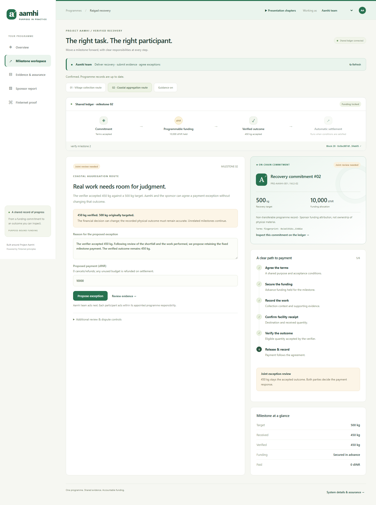

**What is happening.** The second milestone has been accepted, funded and supported with evidence. The facility confirms 450 kg, and the verifier accepts 450 kg against a 500 kg target. The original threshold is not satisfied, so the remaining 10,000 dINR stays held.

Milestone 1 remains closed and paid. Aamhi has received 10,000 dINR; another 10,000 is reserved for milestone 2. The recorded shortfall does not freeze the entire programme.

**Finternet connection.** Conditions and exception authority are explicit. Programmability does not require treating every operational variation as a permanent failure. The system can preserve the actual outcome while requiring an accountable decision about the financial response.

**Why it matters.** This is a practical funding relationship rather than an inflexible quantity calculator. The parties can consider the work and evidence without inventing an outcome to satisfy software.

## 12. Propose a specific exception

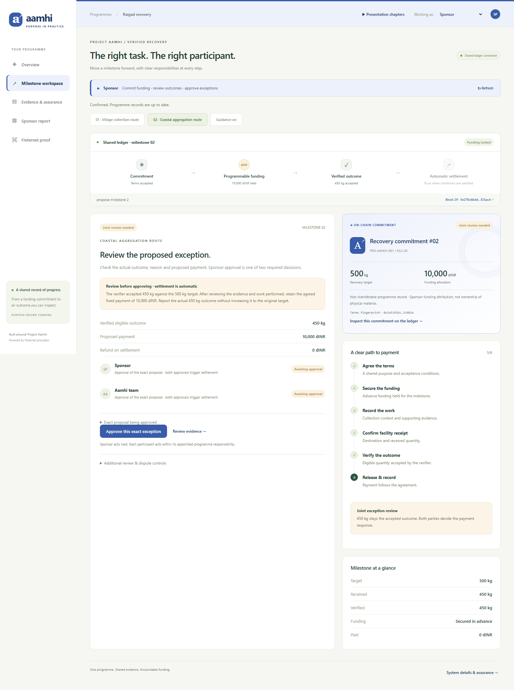

**What is happening.** Aamhi proposes retaining the fixed 10,000 dINR payment for the actual 450 kg outcome. The sponsor sees the reason, accepted quantity, proposed payment and any refund. Both parties must approve the same proposal.

**Finternet connection.** The proposal is bound to the milestone, terms, evidence, outcome and financial amount. Its fingerprint identifies exactly what is being approved. Changing the proposal invalidates earlier approvals rather than silently carrying consent to different terms.

**Why it matters.** Operational flexibility becomes an inspectable agreement. Aamhi can explain the variation, and the sponsor can explicitly accept the proposed response. The verifier does not unilaterally decide a commercial exception.

The system does not automatically assume that a shortfall warrants full payment. That is the joint decision illustrated here; a different agreement could authorise a smaller payment or cancellation/refund.

## 13. Require both parties—not just one—to agree

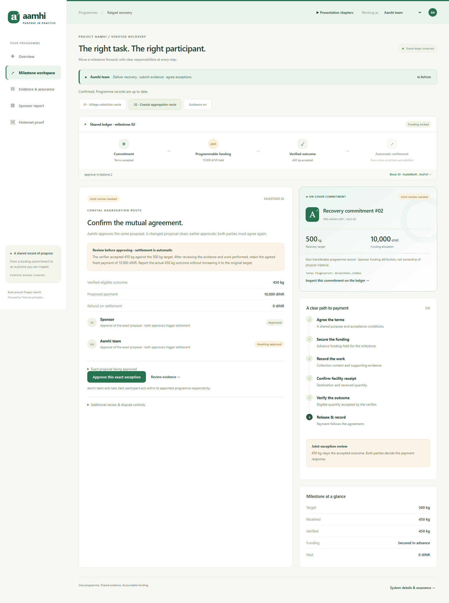

**What is happening.** The sponsor approves the exact proposal. The screenshot still shows Aamhi's approval as pending. The milestone is not closed, and its funding remains in escrow.

**Finternet connection.** Shared authority is enforced in state transitions. Neither Aamhi nor the sponsor alone can turn a proposed exception into an effective financial instruction. An administrator cannot substitute for the missing party.

**Why it matters.** The system gives both sides agency and a common record of consent. It supports a negotiated funding relationship without allowing an informal change to disappear from the audit trail.

## 14. Settle when the final required approval arrives

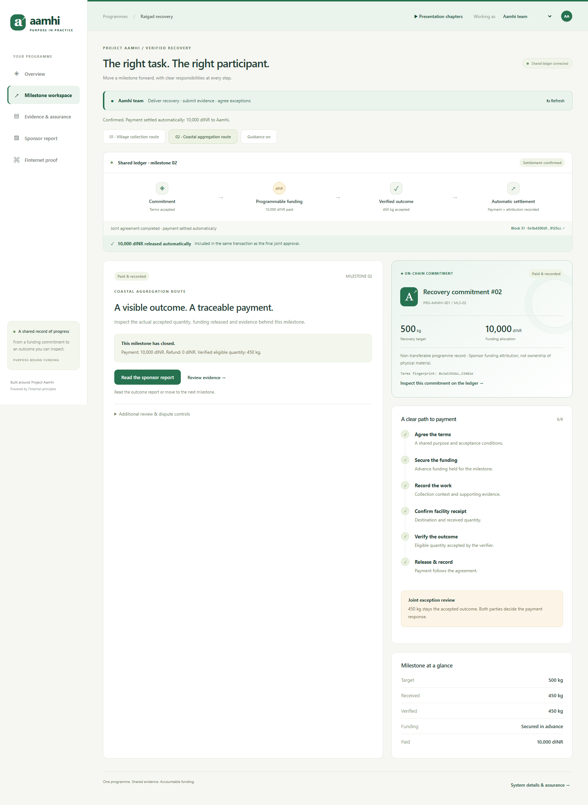

**What is happening.** Aamhi approves the same proposal. This final required approval automatically transfers the agreed 10,000 dINR and records attribution in the same transaction. The milestone closes with **450 kg** still recorded as its accepted outcome.

**Finternet connection.** Conditional execution is not restricted to the original threshold. The contract also recognises an explicitly authorised exception path. Consent and financial execution stay linked without a second human release step.

**Why it matters.** The parties can accommodate reality while maintaining truthful reporting. Paying a fixed amount does not rewrite the quantity, erase the exception or imply that the original target was fully achieved.

The relevant receipt contains `ExceptionApproved`, token `Transfer` and `Released` events. The application does not submit a separate release operation after the approval.

## 15. See the programme outcome as a whole

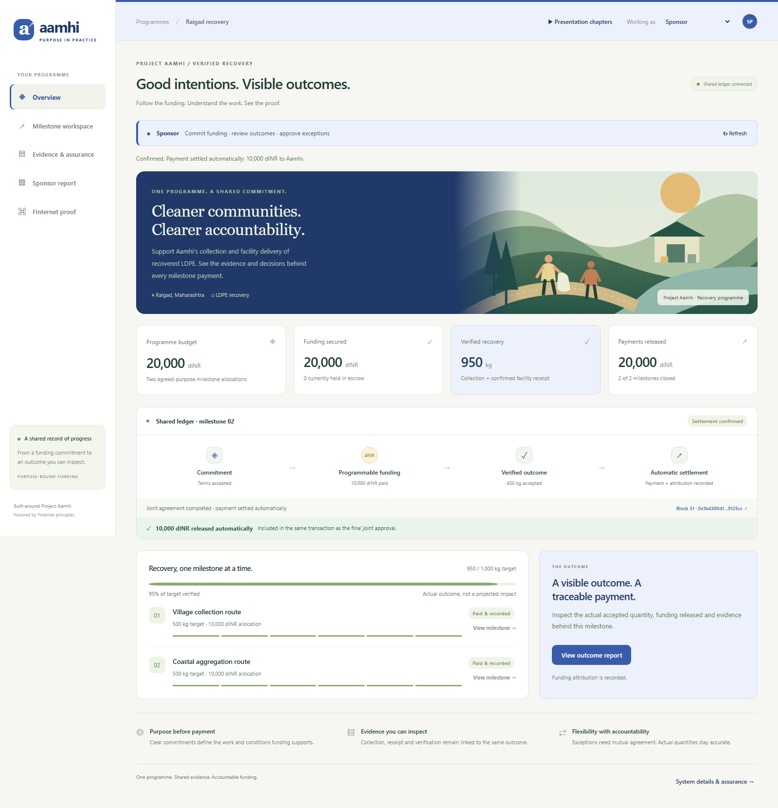

The overview now brings the story together:

- Programme allocation: 20,000 dINR.
- Funding deposited: 20,000 dINR.
- Funding held: zero.
- Funding paid to Aamhi: 20,000 dINR.
- Verified eligible collection and facility receipt: **950 kg**.
- Milestones closed: two, including one jointly approved exception.

**Why it matters.** The sponsor sees contribution and outcome together, while target, funding and actual quantity retain their distinct meanings. Aamhi can present delivery progress with its qualifications visible rather than assembling an unsupported headline number.

The outcome is not “1,000 kg recycled.” The system records a target of 1,000 kg, an accepted collection-and-receipt outcome of 950 kg, and the financial decisions attached to it.

## 16. Give the sponsor a report it can explain

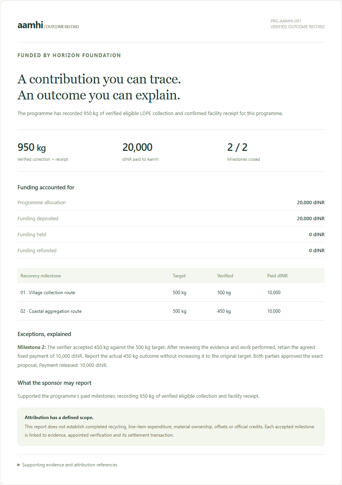

**What is happening.** The sponsor receives a readable report containing the programme, verified quantity, paid and held amounts, milestone results and exception explanation. Supporting references remain available for inspection. The application also offers Markdown download and print.

**Finternet connection.** The report is a human-readable view of linked commitments, attestations and settlement. Its value comes from those references and governance rules—not from presenting an attractive report as independent proof.

**Value for Aamhi.** A completed funding cycle can become a clearer evidence package for sponsor updates, programme reviews and future funding discussions. The work is easier to describe and substantiate. Whether that improves funding outcomes must be validated with actual sponsors.

**Value for sponsors.** They can identify what was supported, inspect acceptance and understand deviations from the plan. Their entitlement is an acknowledgement of funding contribution to the agreed outcome, not automatic ownership of material or official environmental credits.

## 17. Understand the three digital objects

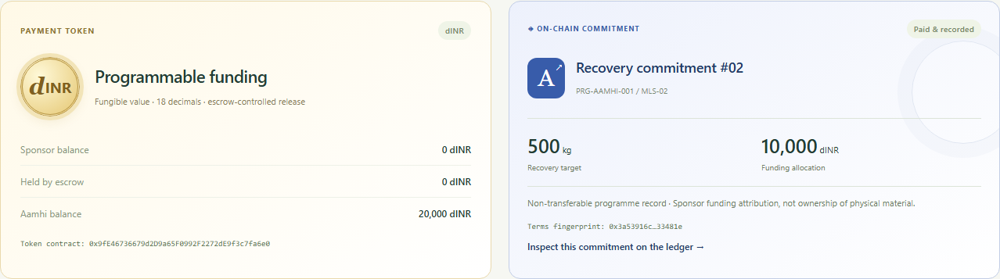

The product makes three objects distinguishable:

| Object | What it represents | What it does not automatically represent |
|---|---|---|
| **dINR payment token** | Fungible sandbox value held and transferred by the contract | Legal tender, CBDC or redeemable INR |
| **Recovery commitment** | An identified milestone obligation, target, funding allocation and terms reference | Ownership of a physical waste lot or a tradable environmental credit |
| **Outcome attribution** | A bounded record connecting sponsor support to the paid, verified outcome | Exclusive ownership of every environmental benefit or future credit |

The commitment is a non-transferable contract record. It is not an ERC-1155 token minted by the sponsorship journey. The separate material-sale reference in the repository explores material entitlements; those rights should not be confused with sponsorship.

**Why this is a considered design.** Tokenisation begins by defining the right, not by choosing a tradable token format. A sponsorship acknowledgement need not become a speculative or transferable asset to be useful. The payment token, commercial material entitlement and sponsor attribution can have different lifecycles and rules.

## 18. Finternet capability: participant identity and authority

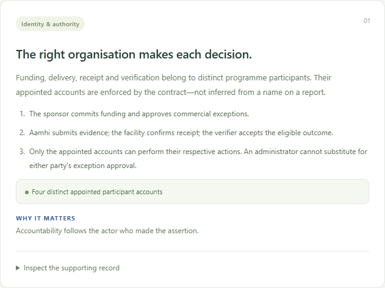

The account making an assertion matters. The contract appoints separate sponsor, Aamhi, facility and verifier addresses. Actions outside an account's authority are rejected. Token-holder eligibility is represented through participant and credential registries.

This provides a concrete authority boundary: “who can accept an outcome?” is an enforceable question rather than merely a name on a screen. The full pilot still needs genuine organisational onboarding, user membership, credential verification, secure signing and replacement/revocation procedures. Separate controlled accounts alone do not prove that organisations are independent or that an issuer is trustworthy.

## 19. Finternet capability: open discovery and agreement linkage

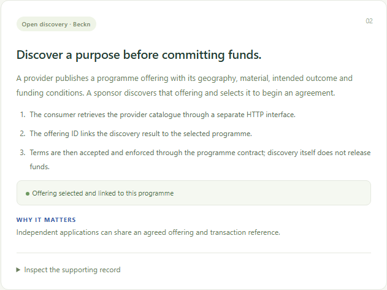

The offering has an identity and a provider. The discovery result should remain connected to selection, agreement and fulfilment, rather than disappearing once the parties begin exchanging evidence.

Beckn is relevant because a fundable purpose can be expressed as a discoverable offering with expected performance and consideration. In this use case the sponsor seeks recovery work, not necessarily ownership of the resulting material. Domain definitions must express that distinction clearly.

The eventual network integration must validate the selected Beckn profile, participant identity, signatures, message correlation and applicable agreement/status flows. The present separate HTTP catalogue demonstrates the architectural boundary, not those external guarantees.

## 20. Finternet capability: persistent digital commitments

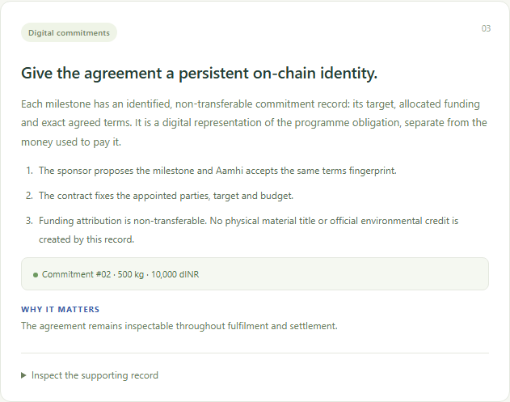

The milestone's terms fingerprint, target, budget and appointed parties persist as shared state. That record gives evidence and payment a common subject. A sponsor can ask whether the work and financial response refer to the same accepted commitment.

This does not automatically make every sentence of an agreement executable. The implemented contract enforces specific parameters and transitions: acceptance, funding, evidence linkage, quantity conditions, authority and joint exceptions. Human-readable obligations and legal interpretation still require an agreed operating model.

## 21. Finternet capability: programmable value

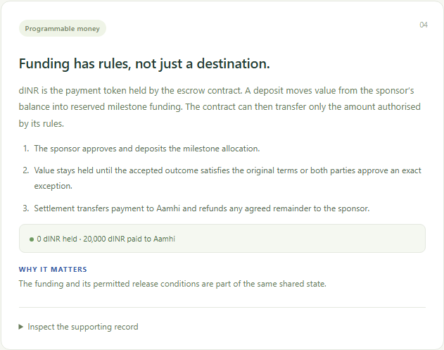

The dINR balance is held under settlement rules. Funding cannot be treated as already paid merely because it was deposited, and the beneficiary cannot bypass verification by changing the interface.

For the sponsor, this connects reserved funding to a defined purpose. For Aamhi, it makes the release basis inspectable. For both, it creates a shared financial state to reconcile against programme progress.

Future bank, authorised CBDC and permitted stablecoin integrations would need their own providers, access permissions, custody and confirmation semantics. The same authorisation model may be reusable, but same-chain atomicity cannot be assumed across arbitrary payment systems.

## 22. Finternet capability: accountable attestations

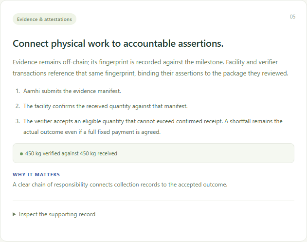

The physical world does not automatically update a ledger. A facility and verifier must make explicit assertions tied to the evidence and programme. Their scope should remain precise: receipt, eligibility and processing are different assertions.

This is the trust bridge on which conditional settlement depends. Its quality requires operational controls—sound measurement, credible sources, independence, sampling and duplicate-activity checks. The architecture makes assertions attributable and inspectable; it does not eliminate the possibility of false evidence or collusion.

## 23. Finternet capability: automatic, atomic settlement

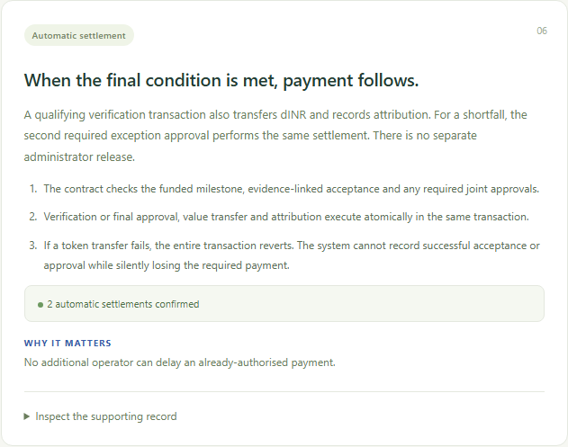

The decisive feature is the absence of an extra release decision after all agreed conditions are satisfied. Qualifying verification or final required exception approval performs the financial consequence in the same transaction.

“Atomic” means the relevant on-chain changes succeed together or revert together. A failed required token transfer does not leave a successfully recorded on-chain acceptance/approval paired with a silently missing payment. It does not undo physical work; it rejects that attempted transaction until the financial execution problem is resolved.

The financial rules remain enforceable even when exceptions are flexible: no unilateral exception approval, no payment above the funded budget, and no paid-outcome attribution without the required verification.

## 24. Follow the connected event trail

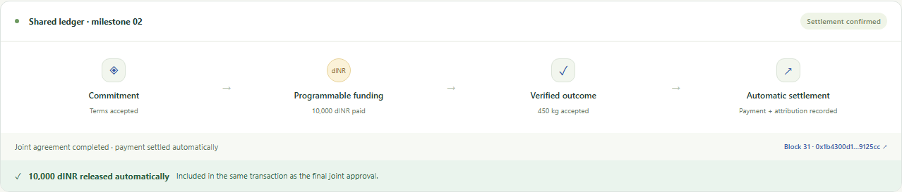

The event flow is a concise product view of the underlying ledger. It connects the agreed obligation, held value, accepted quantity and settlement receipt. The transaction references remain available for deeper inspection.

For a technically curious reader, this is the distinction between a workflow animation and an executed financial rule. The appendix identifies the actual transactions and decoded events captured for this walkthrough. A reviewer can check that the 450 kg outcome remains intact and that the final approval—not a later administrative release—contains the transfer.

## 25. Beckn and blockchain: complementary responsibilities

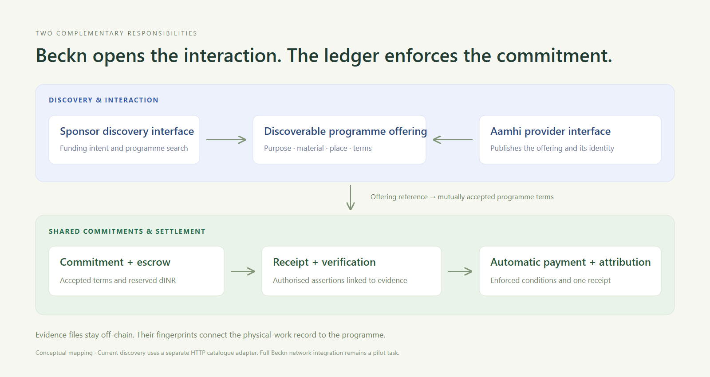

*Explanatory diagram: a responsibility map, not a claim that every external integration is already connected.*

| Responsibility | Beckn / interaction layer | Programme / ledger layer |
|---|---|---|
| Find a suitable programme | Publish and discover structured offerings | Not the ledger's primary job |
| Identify the selected offering | Carry provider and offering references | Link those references to the programme |
| Agree what will be delivered | Support interaction and agreement exchange under the selected profile | Record accepted commitment and enforce implemented conditions |
| Demonstrate physical performance | Communicate relevant performance/status information | Record authorised evidence-linked assertions |
| Move programme funding | May carry consideration/payment references | Enforce held-token conditions and settlement in the current implementation |
| Report the outcome | Make relevant status/records available to counterparties | Supply commitment, attestation, attribution and payment evidence |

Beckn is not the token contract, a substitute for verifier authority or an environmental-certification mechanism. Blockchain is not the programme-search engine and does not independently inspect collection photographs. Their combined value comes from clear interfaces and shared references across responsibilities.

The complete external interaction requires a selected domain/network profile and independently validated participants. The current custom catalogue endpoint is the starting adapter, not a network certification. This distinction helps an implementation team see precisely what has been demonstrated and what remains to connect.

## Why this is a strong use case

The use case brings together parties whose information and authority are naturally distributed. The sponsor controls funding intent; Aamhi controls delivery records; a facility observes receipt; a verifier determines eligibility. None should silently stand in for all the others.

Its sophistication is visible in the connections:

1. **One subject across the journey.** The offering, commitment, evidence, acceptance, exception and settlement refer to an identifiable programme milestone.
2. **Authority is explicit.** Different actors have different powers, including a mutual-consent boundary for exceptions.
3. **Physical and financial truth remain distinct.** An accepted payment exception changes the financial response without increasing the reported recovered quantity.
4. **Value follows agreed conditions.** Automatic execution removes an unnecessary discretionary release step.
5. **The report is supported by a trace.** Readers can move from the human summary to evidence references and actual settlement events.
6. **The pattern can extend.** Programme commitments, milestones, evidence, acceptance and payment authorisation can support other funded purposes with domain-specific outcome criteria.

These are demonstrated design qualities, not measured claims about cost reduction, fraud elimination or increased fundraising. Those benefits should be evaluated during a real pilot.

## How this can help Aamhi and similar organisations

An organisation seeking funding can present a structured proposal, identify measurable milestones, explain who will verify delivery and show how completed work will be evidenced. After a funded cycle, it can present an accountable outcome record that includes exceptions rather than hiding them.

That can support a stronger conversation: “Here is what you funded; here is the evidence; here is what was independently accepted under the programme rules; here is the financial response; here is what we propose next.”

The system should reduce the burden of assembling that account, but field practicality must lead. Evidence requirements must be feasible, verifiers must be credible, and funding arrangements must leave enough working capital to carry out the work. A rigid escrow that prevents operations would fail the product objective even if its code is correct.

## The next lifecycle stages

Collection and facility receipt are the first payable outcome in this story. Later milestones may establish completed recycling or treatment, processing yields and losses, material sale/handover and authorised credit-related submissions.

Those stages must preserve lot lineage and rights boundaries. Received mass need not equal recycled output. Selling material does not automatically transfer sponsor attribution. An official credit requires an authorised methodology, issuer and registry; no credit is created merely because sponsorship was paid.

Likewise, future CBDC or stablecoin use is an integration direction. Provider access, permitted funding routes, denomination/FX, custody and reconciliation need separate validation. The local dINR path illustrates conditional value execution; it does not establish that an external payment provider supports identical escrow or atomicity.

## Implementation boundary and appropriate claims

The screenshots show real browser interactions and Solidity execution on an owned local Ethereum chain. Participants use controlled accounts, programme terms are preset, field files are synthetic, and the catalogue transport is a custom HTTP adapter. The report is generated from programme state; it is not an independently certified or digitally signed statement of actual recovery.

The material-sale reference, real DID/VC infrastructure, production authentication/signing, persistent evidence storage, reliable duplicate-activity allocation, public deployment, external Beckn integration and additional payment rails have their own implementation requirements. A contract fingerprint proves record consistency, not physical truth or legal title.

Outcome verification also differs from expenditure auditing. This journey links accepted work and payment; it does not prove every cost paid from an operating advance. Financial reconciliation can be added as a distinct assurance capability.

The intended claim is therefore precise: **the reference demonstrates how purpose-bound funding, linked evidence, accountable acceptance and automatic settlement can work together for a recovery programme.**

## Small technical glossary

| Term | Plain-language meaning |
|---|---|
| On-chain | Recorded or enforced by the blockchain contracts |
| Off-chain | Stored outside the ledger, such as supporting evidence files |
| Fingerprint / hash | A value that changes if the represented bytes change |
| Attestation | An identifiable actor's assertion about an event or outcome |
| Escrow | Funding held subject to agreed release conditions |
| Commitment record | An identified digital representation of programme obligations |
| Atomic settlement | Relevant on-chain decisions and value movement complete together or revert |
| Attribution | A defined acknowledgement of the sponsor's contribution |
| Beckn | An open protocol approach to discovery and economic interaction across applications |
| Adapter | A boundary connecting the programme model to a particular service or network |

## Using and refreshing this visual package

Keep this Markdown file and the `images/` folder together; all image references are relative. Read the programme journey for a business presentation, then choose the relevant proof close-ups for a Finternet discussion. The PNGs are ready to reuse in a presentation; the two SVGs preserve editable diagram sources.

To regenerate all images and the evidence appendix from the current application, stop any manually running demo and run from the repository root:

```powershell
npx --yes pnpm@10.16.1 demo:capture
```

The capture runner owns its temporary application/chain, takes the screenshots, validates the financial states and stops the services afterward. It does not change programme rules or publish anything. Re-capture changes the local session and transaction references; keep a complete set together rather than mixing screenshots from separate runs.

<!-- CAPTURE_RECORD_START -->
## Appendix: capture and transaction evidence

Captured: 2026-11-11T11:51:45.310Z. All application screenshots follow one programme session, without loading prepared chapters between stages. The two diagrams are explanatory illustrations, not application screenshots.

- Programme: `PRG-AAMHI-001`
- Session: `a9e2986e-af04-436e-a9ca-35892beb9b0a`
- Chain ID: `31337`
- Escrow contract: `0xCf7Ed3AccA5a467e9e704C703E8D87F634fB0Fc9`
- dINR contract: `0x9fE46736679d2D9a65F0992F2272dE9f3c7fa6e0`
- Agreed terms fingerprint: `0x3a53916c9c916adf2b60bc560e03942d875538cbf2a2fb29c7857bacff33481e`
- Standard milestone: verification and settlement in transaction `0x6bffb31716011fc7f28ab914509acf3fbfec1be44054fe7708dfe730af7de38b`, block 22.
- Exception milestone: final approval and settlement in transaction `0x1b4300d1cf1fc508deb7070b65d6a50e648c04d8d7ebff14d8561a69c69125cc`, block 31.

### Financial and outcome state at each screenshot

All balances below are dINR. The final column shows accepted quantity for milestones 1 / 2 in kg.

| Image | Active participant | Sponsor balance | Held in escrow | Aamhi balance | Verified kg M1 / M2 |
|---|---|---:|---:|---:|---:|
| 01_programme_purpose_and_participants.png | Sponsor | 20000.0 | 0.0 | 0.0 | 0 / 0 |
| 02_sponsor_discovers_aamhi_offering.png | Sponsor | 20000.0 | 0.0 | 0.0 | 0 / 0 |
| 03_aamhi_reviews_shared_programme_terms.png | Aamhi team | 20000.0 | 0.0 | 0.0 | 0 / 0 |
| 04_terms_accepted_funding_authorised.png | Sponsor | 20000.0 | 0.0 | 0.0 | 0 / 0 |
| 05_funding_secured_in_programmable_escrow.png | Sponsor | 10000.0 | 10000.0 | 0.0 | 0 / 0 |
| 06_aamhi_submits_linked_collection_evidence.png | Aamhi team | 10000.0 | 10000.0 | 0.0 | 0 / 0 |
| 07_facility_confirms_500kg_receipt.png | Receiving facility | 10000.0 | 10000.0 | 0.0 | 0 / 0 |
| 08_verifier_reviews_eligible_outcome.png | Independent verifier | 10000.0 | 10000.0 | 0.0 | 0 / 0 |
| 09_verification_automatically_releases_payment.png | Independent verifier | 10000.0 | 0.0 | 10000.0 | 500 / 0 |
| 10_same_transaction_verification_and_settlement_receipt.png | Independent verifier | 10000.0 | 0.0 | 10000.0 | 500 / 0 |
| 11_450kg_shortfall_enters_joint_review.png | Aamhi team | 0.0 | 10000.0 | 10000.0 | 500 / 450 |
| 12_sponsor_reviews_exact_exception_proposal.png | Sponsor | 0.0 | 10000.0 | 10000.0 | 500 / 450 |
| 13_one_approval_does_not_release_funding.png | Aamhi team | 0.0 | 10000.0 | 10000.0 | 500 / 450 |
| 14_final_joint_approval_automatically_settles.png | Aamhi team | 0.0 | 0.0 | 20000.0 | 500 / 450 |
| 15_programme_outcome_950kg_and_20000_dinr.png | Sponsor | 0.0 | 0.0 | 20000.0 | 500 / 450 |
| 16_sponsor_receives_explainable_outcome_report.png | Sponsor | 0.0 | 0.0 | 20000.0 | 500 / 450 |
| 17_payment_token_and_recovery_commitment.png | Sponsor | 0.0 | 0.0 | 20000.0 | 500 / 450 |
| 18_participant_identity_and_authority.png | Sponsor | 0.0 | 0.0 | 20000.0 | 500 / 450 |
| 19_beckn_discovery_and_agreement_link.png | Sponsor | 0.0 | 0.0 | 20000.0 | 500 / 450 |
| 20_nontransferable_digital_commitment.png | Sponsor | 0.0 | 0.0 | 20000.0 | 500 / 450 |
| 21_programmable_money_and_escrow.png | Sponsor | 0.0 | 0.0 | 20000.0 | 500 / 450 |
| 22_evidence_and_accountable_attestations.png | Sponsor | 0.0 | 0.0 | 20000.0 | 500 / 450 |
| 23_atomic_automatic_settlement.png | Sponsor | 0.0 | 0.0 | 20000.0 | 500 / 450 |
| 24_confirmed_settlement_event_flow.png | Sponsor | 0.0 | 0.0 | 20000.0 | 500 / 450 |

### Actual settlement events

**verify milestone 1** — `0x6bffb31716011fc7f28ab914509acf3fbfec1be44054fe7708dfe730af7de38b`

- `Verified`: id=`1`, evidenceHash=`0xf729d1774f15403bee04f93c19d6d97aeb9345748a11acfc18f69c91a65ed7a9`, quantityKg=`500`
- `Transfer`: from=`0xCf7Ed3AccA5a467e9e704C703E8D87F634fB0Fc9`, to=`0x3C44CdDdB6a900fa2b585dd299e03d12FA4293BC`, value=`10000000000000000000000`
- `Released`: id=`1`, paid=`10000000000000000000000`, refunded=`0`, attribution=`0xf3c456ac7d79ac4a61b2cbb6c4115f6eaf01974bd9ad2b4b5fb17d39ea416847`

**approve milestone 2** — `0x1b4300d1cf1fc508deb7070b65d6a50e648c04d8d7ebff14d8561a69c69125cc`

- `ExceptionApproved`: id=`2`, proposalHash=`0x978705de28a875c3440a6420739e37c138dd8d53cdb205b49cd1b178bdc0c988`, approver=`0x3C44CdDdB6a900fa2b585dd299e03d12FA4293BC`
- `Transfer`: from=`0xCf7Ed3AccA5a467e9e704C703E8D87F634fB0Fc9`, to=`0x3C44CdDdB6a900fa2b585dd299e03d12FA4293BC`, value=`10000000000000000000000`
- `Released`: id=`2`, paid=`10000000000000000000000`, refunded=`0`, attribution=`0x02f1e861232c5313fbd747d5f1a8717467ed2001bc1673d0fd14f2ca882c41ab`

Token event amounts use the contract's 18-decimal base units: `10000000000000000000000` means 10,000 dINR.
<!-- CAPTURE_RECORD_END -->
