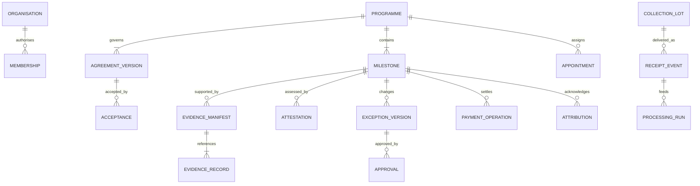

# Domain model and data dictionary

## 1. Model boundaries

This is the target pilot model. The local contract/API implements a smaller subset, as identified below. Canonical business IDs remain stable across databases, protocol messages and ledger adapters. Ethereum addresses, token IDs and provider transaction references are bindings, not substitutes for business identity.



The final processing relationship is conceptually many-to-many: input/output allocation tables are required for splits and merged lots. The diagram simplifies that relationship for readability.

## 2. Core aggregate dictionary

| Aggregate | Required fields | Authority / lifecycle |
|---|---|---|
| Organisation | `participantId`, legal name/reference, DID, status, account bindings | Onboarding authority; active/suspended/retired |
| Membership | person/service ID, participant ID, roles, validity, issuer | Authentication and organisation administration |
| Programme | `programmeId`, provider, sponsor, purpose, profile, scope, dates, status | Parties through accepted agreement |
| AgreementVersion | ID, version, programme, structured terms, document hash, predecessor, effective scope | Immutable accepted version |
| Acceptance | agreement version, party, actor, signature/transaction, time | Party's recorded consent |
| Appointment | programme, role, organisation/account, scope, validity, approval references | Joint programme governance |
| Milestone | ID, agreement version, outcome criteria, target/unit, budget, policy, dates, states | Agreement plus attested events |
| FundingCommitment | sponsor, milestone/programme, amount, instrument, deposit/advance policy | Financial agreement |
| EvidenceRecord | ID, source event, type, storage/version, hash algorithm/value, classification, capture/submission times | Source plus immutable stored bytes |
| EvidenceManifest | ID/version, milestone, record IDs/versions, canonical hash, predecessor | Submitted package; append superseding versions |
| Attestation | ID/type, subject event, manifest version, issuer/appointment, quantity/unit, findings, signature/status | Authorised issuer assertion |
| ExceptionVersion | ID/version, affected milestone, reason, proposed changes, outcome/evidence snapshot, hash | Proposal, not effective until approvals |
| Approval | proposal version/hash, party, actor, decision, signature/reference, time | Approving party |
| PaymentOperation | business ID, authorisation, amount, instrument, beneficiary, idempotency, provider/chain references, state | Provider/ledger confirmation |
| Attribution | ID/type, sponsor, outcome, quantity, contribution/payment references, scope, exclusions, status | Defined agreement and accepted outcome |
| AuditEvent | actor, action, entity/version, correlation, time, previous/new reference | Immutable application audit |

Use explicit metadata such as `createdAt`, `updatedAt`, `dependencyMode`, schema version, correlation ID and revision where applicable. Retain original capture time and later submission time separately; a server receipt timestamp must not masquerade as a field capture timestamp.

## 3. Identifiers

Recommended prefixes: `ORG-` participant, `PRG-` programme, `AGR-` agreement, `MLS-` milestone, `EVD-` evidence, `EVM-` manifest, `ATT-` attestation, `EXC-` exception, `APR-` approval, `PAY-` payment and `ATR-` attribution. Existing reference modules use other IDs such as `RWA-`, `STL-`, `CLM-` and agent `AGR-` runs. Resolve the `AGR-` ambiguity before migration; do not silently reuse an existing agent ID namespace for agreements.

Use type-qualified IDs or UUID-backed values internally. A chain binding is `(chainId, contractAddress, localId)`. A provider binding is `(providerId, environment, reference)`. Namespace external references so identical strings from different providers cannot collide.

## 4. Money and measurement

Store money as integer minor units plus instrument metadata, never binary floating-point. Currency denomination and payment instrument are separate: an INR budget paid through a USD-denominated token requires an explicit conversion agreement.

Quantities need a unit, precision, measurement method, measured time and uncertainty/tolerance policy. The current demo uses whole kilograms and whole dINR input, while the token has 18 decimals. A pilot may require grams and fractional payments; version the scale explicitly.

Example target amount representation:

```json
{
  "amountMinor": "1000000",
  "currency": "INR",
  "scale": 2,
  "instrument": { "kind": "BANK_ADAPTER", "providerId": "selected-provider" }
}
```

The example is a data shape, not a connected bank instruction. For dINR, use its actual 18-decimal token amount and chain identity instead of pretending its value is redeemable INR.

## 5. Independent state dimensions

| Dimension | Suggested target states |
|---|---|
| Agreement | DRAFT, PROPOSED, PARTIALLY_ACCEPTED, ACCEPTED, SUPERSEDED |
| Work | NOT_STARTED, IN_PROGRESS, SUBMITTED, REMEDIATION, COMPLETED, CANCELLED |
| Verification | NOT_REQUESTED, PENDING, MORE_EVIDENCE, ACCEPTED, REJECTED, SUPERSEDED |
| Exception | DRAFT, PROPOSED, PARTIALLY_APPROVED, APPROVED, REJECTED, SUPERSEDED, EXECUTED |
| Payment | NOT_AUTHORISED, AUTHORISED, SUBMITTED, CONFIRMED, FAILED, UNKNOWN, REFUNDED |
| Dispute | NONE, OPEN, UNDER_REVIEW, RESOLVED |
| Attribution | PROVISIONAL, ACTIVE, CORRECTED, REVOKED |

These states require explicit transition guards. Do not collapse them into a single `COMPLETE` flag. The local contract uses booleans and quantities; migration must map meaning rather than copy flags into an overgeneralised enum.

## 6. Hashes, signatures and versions

Every hash reference should declare the algorithm, canonicalisation rules, content type and schema version. Preserve canonical bytes or a reconstructible representation. The local manifest uses sorted-key JSON and SHA-256; contract proposal binding uses Solidity ABI encoding and Keccak-256. They serve different purposes and are not interchangeable.

The current sorted-key helper is application-specific, not a claim of RFC-canonical JSON compliance. For cross-language production use, select and test a published canonicalisation profile, especially Unicode, numbers and date representations.

A hash proves byte consistency under its assumptions. A signature binds an assertion to a key. A valid credential/appointment binds that key to authorised scope. None alone proves the physical event.

## 7. Recovery lineage and quantity allocations

Collection events create identified lots. Receipt events reference those lots and reconcile dispatch versus receipt. Processing runs consume allocated inputs and produce outputs plus recorded losses. Sale/handover events refer to output lots and custody/ownership changes.

Maintain allocation rows with input ID, output/event ID, quantity, unit, stage and methodology. Validate balances with documented tolerance rather than assume exact physical conservation under every measurement condition. Never count input plus recycled output as additive recovered mass in one impact total.

Exclusive claim allocations of a given claim type cannot exceed the eligible source outcome. A funding acknowledgement may reference the same lot as a material sale because it conveys a different right; the report must disclose the distinction.

## 8. Privacy classification

| Classification | Examples | Storage/access |
|---|---|---|
| Public-approved | Programme summary, permitted aggregate outcome | Catalogue/public report |
| Programme restricted | Detailed terms, receipt references, findings | Authorised programme parties |
| Sensitive | People/location photos, identity or payment records | Restricted object store and audited access |
| Ledger minimal | Commitments, approved hashes, payment state | Public/permissioned chain according to deployment decision |

Avoid raw private storage URLs or personal data in public metadata. A hash may correlate a sensitive record and is not automatically anonymous.

## 9. Persistence constraints

Enforce unique business operation/idempotency keys, immutable accepted versions, one effective appointment per role/scope/time where required, and nonnegative amounts/quantities. Use database transactions for local consistency and an outbox for external execution. Cross-system completion is reconciled, not assumed transactional.

The local snapshot is an inspection export. It does not implement these tables, constraints, correction histories or restart recovery.
