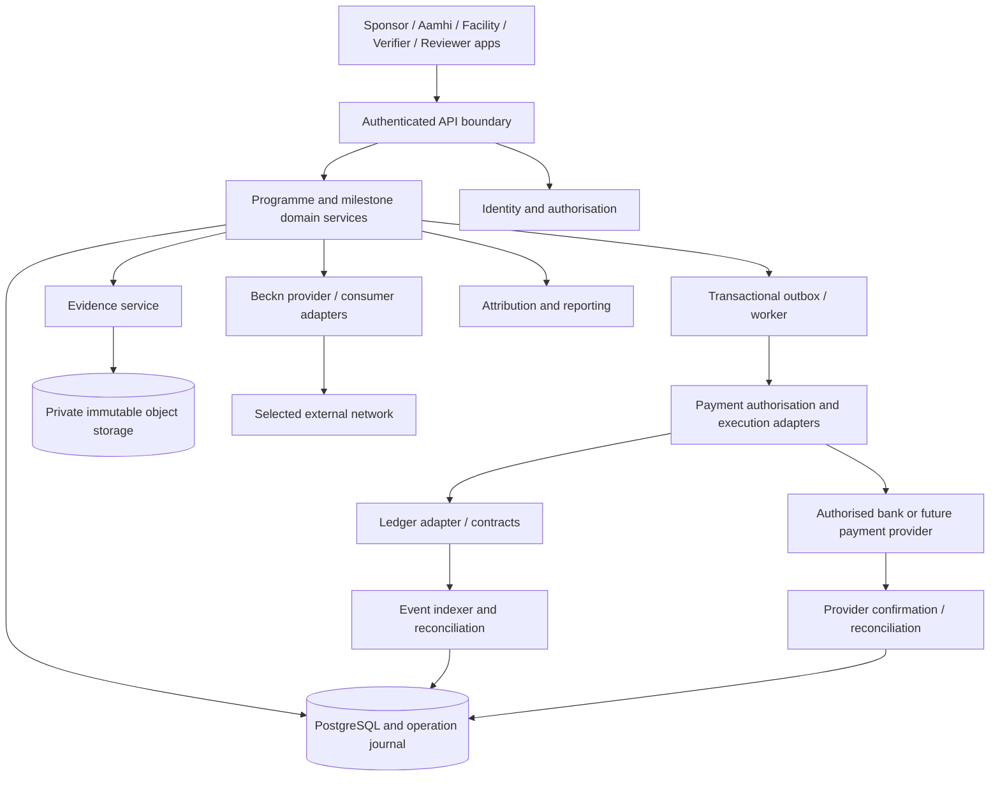

# Target architecture and integration contracts

## 1. Architecture requirements

Support purpose-bound commitments across independent organisations, protect private evidence, enforce agreed authority and payment conditions, tolerate retries/outages, and preserve a reconstructible record. Product/domain policy must remain independent of a particular UI, wallet, blockchain or discovery provider.

The target is an implementation blueprint. The local API/runtime is a compact demonstration adapter, not the target production service architecture.

## 2. Logical components



These are logical boundaries; a small pilot can deploy a modular monolith plus workers. Do not introduce microservices merely to match the diagram. Separate ownership and interfaces before choosing deployment units.

## 3. Domain service contracts

| Service | Commands | Queries / invariants |
|---|---|---|
| Programme | Propose/accept agreement, activate/close programme | Current effective version and outstanding obligations |
| Milestone | Define, start, submit, remediate, close | Separate work/verification/payment state |
| Evidence | Create record, upload version, submit manifest | Authorised retrieval and immutable fingerprints |
| Verification | Appoint authority, request review, attest, supersede | Evidence version and eligible quantity |
| Exception | Propose, approve/reject, supersede, execute | Exact proposal and required-party approvals |
| Payment | Authorise, submit, confirm, reconcile, refund | Funded/held/paid/refunded conservation |
| Attribution | Issue scoped record, correct/revoke, generate report | Supported quantity, rights and exclusions |

Commands accept an authenticated actor context, business ID, expected version and idempotency key. Return operation IDs and state rather than misleading synchronous success for pending external effects.

## 4. Identity and authorisation contract

Resolve identity, organisation membership, role, account binding, credential validity and programme appointment. Policy checks use all relevant dimensions. Return an auditable authorisation decision with policy/version and reason.

An `ActorContext` includes subject ID, participant ID, authenticated session/service identity, granted roles and assurance/source. A client cannot supply its own trusted roles. Transaction signers must enforce the same scope, not act as an unrestricted administrator for API callers.

Define a policy for credential expiry during active work: new actions may pause while previously valid historical attestations remain inspectable. Key compromise may require suspension and a jointly authorised replacement. Neither behavior should be improvised after funds are locked.

## 5. Evidence adapter contract

Operations: initiate upload, validate metadata, complete immutable version, hash/scan bytes, submit manifest, obtain scoped read access, verify integrity and apply retention/deletion policy.

An upload acknowledgement is not a verified outcome. An inaccessible object must remain an explicit review problem. Capture/source time, upload time and verification time are separate. Offline clients generate unique capture IDs and synchronise with duplicate/conflict handling; they must not overwrite an accepted manifest.

## 6. Payment adapter contract

```ts
interface PaymentAdapter {
  capabilities(): {
    escrow: boolean; conditionalRelease: boolean; refund: boolean;
    partialRelease: boolean; confirmationModel: string;
  };
  createFundingReference(input: FundingRequest): Promise<OperationReference>;
  submitAuthorisedPayment(input: AuthorisedPayment): Promise<OperationReference>;
  getStatus(reference: OperationReference): Promise<PaymentStatus>;
  refund(input: AuthorisedRefund): Promise<OperationReference>;
  reconcile(input: ReconciliationScope): Promise<ReconciliationResult>;
}
```

These are conceptual types to implement, not exported repository interfaces. Capability flags prevent an agreement from depending on provider behavior that does not exist. A non-escrow bank adapter cannot silently claim contract-custodied conditional funds.

Keep authorisation separate from submission and confirmation. A timeout after submission produces `UNKNOWN` until status lookup/reconciliation resolves it. Never blindly resubmit an uncertain payment. Persist provider references and idempotency keys before acknowledging the operation to clients.

CBDC and permitted stablecoin flows require selected providers, custody, network/instrument identity, fees, amount precision, possible FX and jurisdiction-specific review. Cross-system payment is asynchronous; atomicity on one local chain does not extend to arbitrary banks, wallets or bridges.

## 7. Chain adapter and contracts

Use typed deployment manifests containing chain identity, contract addresses, bytecode/build references, constructor parties, transaction hashes and confirmation policy. Verify deployed code and configured roles, not just address formatting.

A chain operation returns submitted hash and business operation ID, followed by confirmation state. Record replacements, reverted transactions and finality thresholds. An indexer consumes logs with checkpoints and detects reorgs; projections can be rebuilt and reconciled against contract reads.

Pilot contracts should support agreed appointment/account recovery, pause scope, migration/upgrade policy and versioned amendments without arbitrary seizure or silent beneficiary changes. Select these controls through governance review. The current escrow is immutable, narrow and unaudited; it is not suitable for live custody solely because local tests pass.

## 8. Beckn adapter and correlation

Maintain internal business IDs separately from protocol transaction/message IDs. Map offering selection to an agreement reference; map confirmed agreement to programme/milestones; link performance updates to domain events. Validate replay, signatures, acknowledgement versus business completion, callback retry and errors against the selected version/network profile.

The current `/catalogue` endpoint has none of those conformance guarantees. A pilot should implement contract tests against a pinned normative specification and an independently deployed counterparty. Avoid assuming older draft terminology or schemas remain valid.

## 9. API design principles

Use resource-oriented endpoints such as programmes, agreement versions, milestones, evidence manifests, attestations, exceptions, approvals and payment operations. Query views may aggregate these for user tasks. Preserve an API contract even if the frontend changes.

Mutation requests include an idempotency key and expected resource version. Return 202 for accepted asynchronous work, explicit operation status, correlation ID and stable error code. Use structured errors such as `ROLE_NOT_AUTHORISED`, `AGREEMENT_VERSION_CONFLICT`, `EVIDENCE_UNAVAILABLE`, `QUANTITY_EXCEEDS_RECEIPT`, `APPROVAL_VERSION_MISMATCH` and `PAYMENT_STATUS_UNKNOWN`.

Distinguish transport success from domain acceptance and external financial confirmation. The present local API's 200/400 responses are intentionally simpler; the target contract must not inherit them uncritically.

## 10. Reliability patterns

| Failure | Required behavior |
|---|---|
| Duplicate button/retry | Same operation result under idempotency key |
| API dies after submitting payment | Recover from operation journal/provider reference |
| Evidence store unavailable | Mark review blocked; preserve submissions and other work |
| Signer unavailable | Queue authorised action; do not claim payment completion |
| Chain reorg | Revert/replay affected projections and reconsider confirmation |
| Callback duplicated/out of order | Deduplicate and enforce valid state/version ordering |
| Approval arrives for superseded proposal | Reject with current version reference |
| Programme party loses access | Follow governed replacement, preserving history |

Use database transactions, outbox/inbox patterns, bounded retry and reconciliation queues. Do not rely on a single-process busy flag for distributed correctness.

## 11. Security and privacy boundaries

Threat-model false evidence, collusion, impersonation, unauthorised approvals, signer compromise, public-data correlation, duplicate funding attribution, replay and provider misreporting. Controls include least privilege, appointment scope, evidence integrity/access, immutable versions, audit events, secure signing and independent verification.

Expose only approved offering/report fields publicly. Protect exact locations, people, documents and financial records. Establish retention and deletion behavior without promising deletion of immutable public-chain history.

## 12. Environments and operations

Local: owned Anvil, controlled roles, synthetic evidence, presentation snapshots. Integration: test database/storage, independently deployed network peers, provider sandboxes. Pilot: capped agreed scope with real authenticated participants, selected chain/payment provider and recoverable state. Production: audited custody, resilience, support, incident procedures and validated governance.

Monitor operation age, unknown payments, reconciliation discrepancies, verifier queue, evidence retrieval failures, approval failures, indexer lag and blocked milestones. Set alerts with named owners. Rehearse backup restoration, evidence recovery, signer failure, dispute escalation and programme closeout before pilot expansion.
