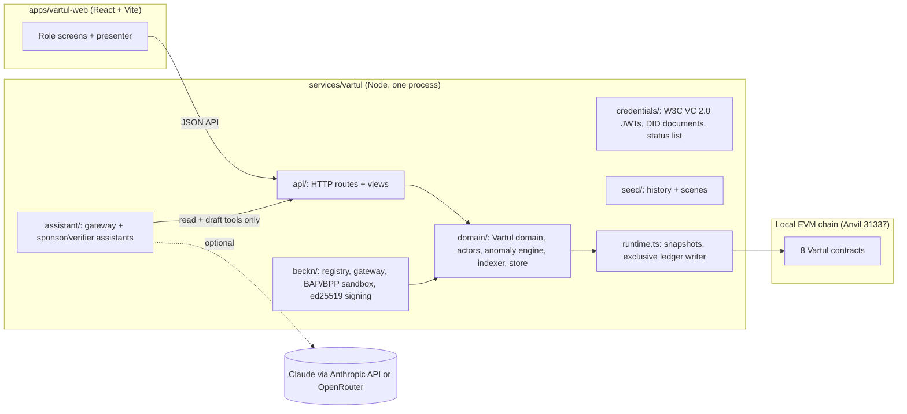

# Vartul by Suma — Handover and status

| | |
|---|---|
| Build | Vartul demonstration v0.3.0, branch `vartul-build` |
| Status date | 13 November 2026 |
| Audience | Whoever runs, presents, extends or reviews this build |
| Companion documents | [Product document](product/Vartul_Product_Document.md) (what Vartul is and why) · [Demo dataset](product/Vartul_Demo_Dataset.md) (the seeded Murud history) |

This document is the "separate status document" that the product document (§19) refers to. The product document defines Vartul. This document says what has been built, how to run and present it, what is real and what is simulated, what is not built yet, and what comes next.

---

## 1. Summary

Vartul is a Proof-of-Recovery network. It turns recovered waste into a verified, tokenised asset. It links that asset to the sponsor funding that paid for its recovery, pays the collectors who did the work, and issues exclusive impact claims that anyone can check.

The build is a **complete, working demonstration** of the product story in product document §19:

- **The ledger is real.** Every financial and claim outcome is a real transaction on a dedicated local EVM chain, run by eight Vartul contracts.
- **The rest of the system is real too.** It also includes a domain API, an indexer, an anomaly engine, W3C verifiable credentials, a Beckn-aligned open-network sandbox, AI assistants and a web app with one screen for every role.
- **The history is seeded.** It covers six months of activity across Project Aamhi's ten Murud villages: 322 recovery lots, 51,158 kg verified, 39.9% of funds reaching collectors, and zero over-claimed lots.
- **The demonstration is scripted.** Eleven scenes run live from a presenter panel. Each scene resets in seconds to its exact starting state.
- **It runs anywhere with the prerequisites.** One command on a clean machine; no accounts, keys or network services needed.

It is **not** a pilot system. It has no authentication, no database, no real money, no real identities and no field hardware. §8 lists the gates from product document §20 that stand between this build and live use.

---

## 2. Run it

**Prerequisites:**
- Node 24.11.1
- pnpm 10.16.1 (`corepack enable`, or `npx --yes pnpm@10.16.1`)
- Foundry 1.8.3, with `forge` and `anvil` on PATH

```powershell
pnpm install --frozen-lockfile
pnpm demo                 # builds the web app, then serves http://127.0.0.1:4300
```

**What happens on first start:**
1. The contracts compile.
2. The six-month history is seeded as real transactions.
3. A snapshot is saved at the start of each of the eleven scenes.

This takes about two minutes. Snapshots go to `.vartul/snapshots/` (about 270 MB, git-ignored). Later starts load them in seconds. The snapshots carry a fingerprint of the contract bytecode and the dataset, history, scene and domain code. Changing any of those triggers a reseed automatically at the next start.

**Other commands:**

| Command | Purpose |
|---|---|
| `pnpm vartul:start` | Start the server without rebuilding the web app |
| `pnpm vartul:seed` | Force a reseed of the history and scene snapshots |
| `pnpm web:dev` | Vite dev server for front-end work (proxies the API on :4300) |
| `pnpm typecheck` | TypeScript, server and web |
| `pnpm check:docs` | Local Markdown link check |
| `pnpm test:contracts` | Foundry tests only |
| `pnpm test:vartul` | Service suites only |
| `pnpm test:acceptance` | Contracts, service suites and testnet simulation |
| `pnpm test:demo` | Browser acceptance (Playwright); starts its own server |
| `pnpm testnet plan \| simulate \| deploy` | Public test-network tooling (§6) |

**Ports:**
- Web and API: 4300 (`VARTUL_PORT`)
- Local chain: 18545 (`VARTUL_CHAIN_PORT`)
- Tests use their own ports (4393–4397, 18613–18616), so they can run alongside a demo server.

### 2.1 Windows notes

- If a run is killed abruptly, an `anvil` process can keep holding port 18545. Free it with:
  ```powershell
  Get-NetTCPConnection -LocalPort 18545,4300 -State Listen | ForEach-Object { Stop-Process -Id $_.OwningProcess -Force }
  ```
  The server now kills its chain on a normal exit.
- Headless Chromium can hang when launched from inside some sandboxed shells. Run `pnpm test:demo` from a normal PowerShell or terminal.

---

## 3. Presenting the demonstration

Open the app, then click **Presenter** in the top bar.

- **Choosing a scene:** pick a scene number. The ledger, the indexer and the domain store reset to that scene's starting snapshot, in about 3–4 seconds.
- **Running steps:** click **Run** on each step in order. Each step is a real API call or ledger transaction, and its result appears under the step.
- **Opening the screen:** **Open the scene's view** opens the screen that tells the scene's story.
- **Order is enforced:** steps run in order, and re-running a step needs a scene reset.

| # | Scene | The question it answers | What to point at |
|---|---|---|---|
| 1 | The network at a glance | What does trusted recovery look like across a whole coast? | Network overview: verified kg, last-mile share, zero duplicate claims, money split from settlement events |
| 2 | A sponsor discovers and commits | How does a funder find a credible programme without a closed marketplace? | Beckn search → select → init → confirm, all signed; Coastline funds PRG-MRD-NETS-2027 with ₹3,00,000 into escrow. The sponsor assistant can be shown here (§5) |
| 3 | Follow one bag | Can a bag of plastic on Korlai shore become a trusted, fundable asset? | Sunanda's field capture → MRC lot minted with mass balance → recycler receipt → verifier sampling → atomic settlement: ₹21,240 released, 11 collectors paid ₹8,496, a 1,180 kg claim to Tidewell Foods |
| 4 | Sunanda gets paid | What does the worker see? | Field app earnings; her portable work record credential |
| 5 | A stranger scans the certificate | Can anyone check the claim without trusting Vartul? | Public verification of FRC-00247: issuer signature checked again in the browser against the issuer's DID document, status list, live ledger claim |
| 6 | Fraud caught | What happens when someone games the system? | SS-MRD-0009: weight outlier, duplicate photo and off-route location flagged; 67.4 kg excluded; payout skips only the flagged grams. The verifier assistant drafts the same exclusion |
| 7 | When reality differs | What if the monsoon makes the target impossible? | The beach programme verifies about 9,300 kg against a 10,000 kg target. A pro-rata exception is proposed with its exact terms and needs approval from both sponsors; nothing pays until the last approval. Paid ₹1,85,700; refunded ₹14,300; the recorded quantity is unchanged |
| 8 | Unbundled rights | Who owns what once the recycler buys the material? | The recycler buys the hero lot over Beckn by delivery versus payment (₹16,520); the sponsor keeps attribution; an EPR-ready supply claim is disclosed |
| 9 | Revocation cascade | What if we learn later that something was false? | Ghatmatha's October receipts are revoked: 11 receipts, 11 lots under review, 16 claims contested; certificates turn "Contested" |
| 10 | The Panchayat view | Is the village a partner or a bystander? | Village summary; Panchayat co-signature recorded on the ledger; "मराठी coming soon" |
| 11 | Under the hood | What is actually on the ledger? | Ledger explorer: token managers, transactions with decoded events, Beckn messages, the simulated public end state |

The demo clock is fixed: the seeded history runs from 1 May to 13 November 2026, and each scene advances the sandbox clock in small, labelled steps. The **Sandbox** badge, the **Simulated** labels and the footer note mark everything that stands in for a real-world system.

**Role screens** are in the sidebar, each with an **Acting as** selector in place of a login:
- sponsor portal
- Aamhi operations (originator)
- field app
- verifier console
- recycler console
- Gram Panchayat
- public verification
- anomaly register
- programme and lot pages
- ledger explorer

---

## 4. What is in the build



| Area | Location | Notes |
|---|---|---|
| Contracts | `contracts/src/vartul/` | `VartulRegistry` (participants, role accounts) · `VartulAttestations` (EIP-712 statements, revocation) · `RecoveryLotRegistry` (ERC-1155 lots in grams, mass balance, state machine) · `ProgrammeEscrow` (per-kg capped and fixed-on-target policies, deadlines, exact-proposal exceptions, disputes) · `PayoutRouter` (pro-rata collector payouts) · `VartulClaims` (exclusive non-transferable claims with a compatibility policy) · `MaterialSettlement` (delivery versus payment) · `SandboxINR` (dINR, registered holders only). Solidity 0.8.24 |
| Contract tests | `contracts/test/vartul/` | 45 tests: unit, lifecycle, programme policies, fuzz, and invariants (funds conservation, claim exclusivity, escrow books) |
| Chain runtime | `services/vartul/chain/chain.ts`, `runtime.ts` | Starts and stops Anvil, deploys, decodes reverts. One exclusive writer serialises ledger changes. Snapshots are chain state + indexer projections + domain store |
| Domain | `services/vartul/domain/` | Business operations that become transactions; the indexer projects events into read models; the anomaly engine flags but never decides |
| API | `services/vartul/api/` | Read views and write routes. Every write runs through the exclusive writer and returns the transaction |
| Beckn sandbox | `services/vartul/beckn/` | Registry, gateway, two buyer-side apps (sponsor desk, recycler app) and three NGO provider apps. Messages are signed with ed25519 over BLAKE-512 digests and verified on receipt; orders link to ledger commitments |
| Credentials | `services/vartul/credentials/` | Participant (PC), verification report (VR), funded-recovery certificate (FRC), material supply certificate (MSC), work record (WR). EdDSA JWTs with Bitstring Status List revocation and QR codes |
| Assistants | `services/vartul/assistant/` | See §5 |
| Seeder | `services/vartul/seed/` | `history.ts` (deterministic six-month history), `scenes.ts` (eleven scenes and their steps), `seed.ts` (orchestration and snapshots) |
| Dataset | `services/vartul/dataset/murud.ts` | Villages, routes, collectors, participants, programmes, materials, the calendar |
| Web app | `apps/vartul-web/` | Suma design system ("Vartul by Suma"): Spectral, Archivo and IBM Plex Mono; teal for actions, navy for authority. A no-dependency router, lazy-loaded pages |

---

## 5. AI assistants

**What exists:** a sponsor assistant (sponsor portal, **Assistant** tab) and a verifier assistant (top of the verifier console). This is product document §18.

**Guardrails as built:**
- **No authority.** Assistants reach the system only through `assistant/gateway.ts`. Its tools are reads (Beckn programme search, programme records, verifier queue, lot proof chain) and drafts (`draft_commitment`, `draft_exclusion`). Nothing signs, funds, approves or decides.
- **Human review of every draft.** A draft opens in the product UI for a person to review: a commitment opens in Discover, already selected and quoted; an exclusion loads into the verifier's decision form.
- **Checks outside the model.** Each tool belongs to a role, its input is checked against its schema, and drafts are only possible for records the assistant actually read in the same answer. A verifier can only read lots it is appointed to.
- **Untrusted text is marked.** Catalogue descriptions, reasons and evidence notes reach the model wrapped as `untrusted_text`.
- **Audit and citations.** Every call is logged (`GET /api/assistant/log`), and answers cite the records they used.
- **No ledger writes.** A test confirms that assistant activity adds no transactions.

**Modes:**

| Mode | When | Behaviour |
|---|---|---|
| Scripted | No key set (default), or `VARTUL_AI_DISABLE=1` | Deterministic answers built from the same gateway tools and real registry data; labelled "Scripted mode" |
| Live, OpenRouter | `OPENROUTER_API_KEY` set | Anthropic SDK pointed at `https://openrouter.ai/api`. **Set `VARTUL_AI_MODEL` to the model slug OpenRouter lists**; the default `anthropic/claude-opus-5.5` is an assumption |
| Live, Anthropic | `ANTHROPIC_API_KEY` set | `claude-opus-5-5` at medium effort, with the server-side refusal fallback enabled |
| Fallback | Live model unreachable or key rejected | The scripted answer, with a visible notice |

The live tool loop is tested against a mock Messages endpoint. **It has not yet been exercised against a real model**, because no key was available during the build. Do this first when the OpenRouter key arrives (§9).

**Not built:** the originator assistant and the Panchayat summariser from §18, and the assistant evaluation suites beyond the gateway and refusal tests.

---

## 6. Public test network

Product document V18 decides that public deployment tooling is built but not executed. The demonstration simulates the public end state instead.

- **`pnpm testnet plan`:** offline. Lists contract sizes, deployment order and constructor wiring.
- **`pnpm testnet simulate`:** deploys all eight contracts to a local chain that uses Base Sepolia's chain ID (84532). It runs 17 wiring checks and writes `deployment/testnet/base-sepolia.simulated.json`; fees are pinned, so the output is identical on every run. The ledger explorer's **Public end state** tab shows these addresses with public-explorer links, labelled "Simulated, not deployed".
- **`pnpm testnet deploy --network base-sepolia --confirm-public`:** a real deployment, guarded.
  - Needs `VARTUL_TESTNET_RPC_URL` and a funded `VARTUL_DEPLOYER_KEY`.
  - Checks the RPC's chain ID and the deployer balance, deploys, re-runs the wiring checks, and writes `<network>.deployed.json`.
  - **It has never been run.** The deployed contracts would be empty; the demonstration's history lives on the local chain only.

Polygon Amoy is also configured in `deployment/testnet/networks.json`.

---

## 7. Real and simulated

| Executed for real | Simulated (and labelled) |
|---|---|
| All contract logic and every transaction, including the seeded history | Field devices, scales and GPS: phone-frame screens submit real signed records |
| Mass balance, attestations and their revocation | Bank escrow and e₹: the dINR sandbox token |
| Escrow policies, exceptions, disputes, payout splits, DvP | UPI payouts: payout references from a simulated adapter |
| Exclusive claims and the compatibility policy | Legal identity, KYC and CPCB registration: fictional credentials from a demo issuer |
| Indexer projections (every number in the UI is derived from events) | Evidence photos: deterministic illustrative SVGs, never real people |
| Beckn messages, signatures, registry lookups | Gram Panchayat screens: built over real aggregate data |
| Credential issuance, revocation and public verification, including the in-browser signature check | Public test-network deployment (§6) |
| Anomaly engine over seeded and live records | Organisations other than Project Aamhi, all people and all quantities |

No personal data is written to the ledger; records carry pseudonymous collector codes and fingerprints.

---

## 8. Status against the product document

| Area (product document) | Status | Notes |
|---|---|---|
| §19.1 contract families | Built | All eight, with fuzz and invariant tests |
| §19.1 domain API, indexer, projections | Built | |
| §19.1 Beckn sandbox (registry, 2 BAPs, 3 BPPs) | Built | Programme, material and verification domains; signed and verified messages |
| §19.1 credentials, status lists, QR verification | Built | |
| §19.1 anomaly engine | Built | Six rules; flags route to human review |
| §19.1 role screens | Built | Sponsor, originator, verifier, recycler, public verification, explorer, plus field app and Panchayat |
| §19.1 sponsor AI assistant | Built | Verifier assistant also built |
| §19.3 eleven scenes | Built | All run through the presenter; covered by browser tests |
| §19.4 acceptance criteria | Met | Outcomes reproducible from events; invariants tested across the seeded history and the live scenes; one command on a clean machine (verified from a fresh clone); scene reset; no personal data in public views; simulated elements labelled |
| §18 originator assistant, Panchayat summariser | Not built | |
| Marathi interface | Not built | Shown as "coming soon" (V17) |
| §20 readiness for live value | Not started | See §10 |

### 8.1 Known limitations

- **No authentication.** Anyone with the URL can act as any participant through **Acting as**. This is deliberate for a demonstration and unacceptable beyond it.
- **No database.** Domain state lives in memory and is persisted only as scene snapshots. A server restart reloads scene 1.
- **Single process, single ledger writer.** Fine for a presenter; not designed for concurrent users.
- **Snapshot size.** About 270 MB on disk. Reseeding takes about two minutes and is triggered by any change to the contracts or to `murud.ts`, `history.ts`, `scenes.ts` or `vartul.ts`.
- **Live assistant mode is unproven** against a real model (§5).
- **The product name is unconfirmed.** "Vartul" passed a web search only; the formal trademark search is pending (V01).

---

## 9. Immediate next steps

1. **Push `vartul-build` and confirm CI.** `.github/workflows/acceptance.yml` runs typecheck, docs, acceptance and Playwright on Ubuntu, then a `git diff --check` whitespace check. It has not run yet; the first run seeds the history, so allow about 15 minutes.
2. **Record the walkthrough video** of the eleven scenes.
3. **Connect the OpenRouter key:** set `OPENROUTER_API_KEY` and the correct `VARTUL_AI_MODEL` slug, run both assistants live and review the answers for claim language and citations.
4. **Run the formal trademark search** for "Vartul" (V01).
5. **Review with Project Aamhi:** payment policies and splits (Q1), village data and wording, before anything is shown publicly.

## 10. Path to a pilot

Product document §20.1 lists the gates before live funds or real worker data. For this codebase, the engineering work they imply is:

| Gate | What this build needs |
|---|---|
| Contracts | Independent audit; emergency pause and recovery procedures; multi-party control of facilitator keys |
| Persistence | A database for the domain store; event replay from the ledger; backups and restore drill |
| Security | Authentication and role-bound sessions in place of **Acting as**; key management (HSM or custody provider) in place of seeded keys; penetration test |
| Custody | Replace dINR with a bank escrow or tokenised-deposit adapter; reconciliation |
| Identity | Real role credentials from providers with KYC; Panchayat co-attestation process |
| Field | Offline-first field app on real devices and scales, in Marathi, with a grievance channel |
| Operations | Monitoring, alerting and the dispute and incident runbooks |

The pilot itself (§20.2) is scoped as one taluka, one NGO, two sponsors, one recycler and one verifier, for three months under a value cap.

---

## 11. Build history

| Milestone | Commit | Content |
|---|---|---|
| M0 | `57c8511` | Dataset specification, web scaffold, scripts |
| M1 | `e561801` | Vartul contracts and Foundry tests |
| M2, M3 | `087eac9` | Domain API, snapshot runtime, credentials and public verification |
| M4 | `eb27de9` | Beckn-aligned network sandbox |
| M5 | `0a255e7` | Deterministic six-month seeder, eleven scene snapshots, scene API |
| M6 | `719f1f9` | Web app with every role screen and the presenter |
| M7 | `545c937` | Sponsor and verifier assistants behind a policy gateway |
| M8 | `ceb192b` | Browser acceptance per scene, CI, testnet tooling |
| Cleanup | `bbac77e` | Repository reduced to the Vartul build; previously untracked `lib/` folders committed |

Earlier work, the v0.2 sponsorship demonstration, is preserved only in git history at the `v0.2.0-handover` and `v0.2.1-handover` tags.
