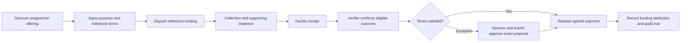

# Aamhi Finternet — business, product and pilot blueprint

## Executive proposition

This document defines the business and product independently of the local demonstration. Read the [foundational context](08_Context_and_Finternet_Foundations.md), [product requirements](09_Product_Requirements_and_Operating_Model.md) and [policy specification](10_Policy_and_Rights_Specification.md) as detailed companion specifications. Demo examples illustrate these requirements; they do not define their full scope.

Connect a funding commitment to its intended tangible purpose, verify the resulting outcome, and preserve a shared record of the evidence, approvals and payment.

Project Aamhi is the first application: a sponsor funds a recovery programme, Aamhi carries out collection, a receiving facility acknowledges receipt, and an appointed verifier confirms the eligible outcome. Agreed milestone conditions govern release of the sponsor's funding.

The project has two objectives. It should address Aamhi's need to demonstrate credible work to funders, and it should demonstrate reusable Finternet capabilities: independent identity, discoverable commitments, digital representations of rights, programmable value, attestations, settlement and inspectable records. Success requires an understandable operational benefit and observable technical proof.

## Product strategy and value proposition

The immediate product promise is evidence-backed accountability for a funded purpose. The sponsor should be able to explain what was funded and what was accepted. Aamhi should have a manageable way to demonstrate delivery, resolve exceptions and maintain funding continuity. Facilities and verifiers should make specific accountable assertions without inheriting responsibility for every claim in the programme.

The broader platform promise is a reusable coordination pattern across organisations. Shared identifiers, discoverable offerings, explicit authority, digital commitments and instrument-aware payment authorisation should allow independent participants to transact without giving one private application's database unilateral authority over economic state.

This is a product hypothesis to validate, not a claim that all organisations need blockchain or that every use case has identical evidence requirements. A recovery programme supplies concrete requirements against which the reusable capabilities can be judged.

## Existing workflow and proposed change

| Activity | Common coordination challenge to validate | Proposed product behavior |
|---|---|---|
| Agree purpose | Expectations and reporting criteria can be dispersed | One accepted agreement with versioned conditions |
| Fund work | Deposit, operating cash and retained balance can be confused | Explicit funding arrangement and visible value states |
| Record delivery | Evidence sits with different participants | Linked collection, receipt and verifier records |
| Handle shortfalls | Informal decisions may not reach every report | Exact jointly approved exception with rationale |
| Release payment | Acceptance and financial execution lack correlation | Authorisation linked to evidence and confirmed settlement |
| Report impact | Targets or repeated stages can be overstated | Actual eligible outcome with bounded attribution |

These are design hypotheses, not measured findings about Aamhi. Validate them through interviews, existing report samples and a supervised operating cycle.

## Why these technologies fit the product

Blockchain supplies shared commitment/approval/payment state. Tokenisation requires precise digital rights; sponsorship currently needs a non-transferable record, while material commerce may need transferable lot entitlements. Beckn supplies the intended open discovery and interaction boundary. Credentials and appointments govern authority. Attestations connect physical observations to conditional execution.

None substitutes for reliable weighing, field controls, verifier independence or legal agreements. The product earns trust by connecting those responsibilities and records rather than claiming the ledger itself validates physical reality.

## Adoption and sustainability

Adoption should start with one sponsor and an achievable reporting cycle. Test whether evidence capture and verification effort is proportionate to the assurance sponsors value. Preserve access to working capital; a technically correct escrow that prevents collection teams from operating would fail the product objective.

No platform fee, credit revenue or cost-saving estimate is committed here. Potential operating costs include field capture, verification, hosting/storage, signing/custody, ledger transactions, support and reconciliation. Business owners should choose who pays these costs and validate willingness to fund them before scaling. Official-credit revenue must not be assumed in the initial business case.

## Evidence and assumptions

The repository's [Aamhi context](../00_project/02_Aamhi_Rural_SWM_and_OBP_Context.md) supplies the rural recovery setting. The project owner has agreed to sponsorship as the initial product direction. This is not a field study or an endorsement by Aamhi, a sponsor, a facility or a certification body.

Raigad, LDPE, a 500 kg target and 10,000 dINR milestone budget are illustrative demonstration parameters. They are not actual prices, contract commitments, verified recoveries or impact measurements.

Assumptions to validate include the actual legal recipient of funding, available field evidence, who controls the material, facility independence, verifier availability, sponsor reporting requirements and how working capital reaches collection teams.

## Problem and intended users

Funders need an understandable account of what a commitment supported. Delivery organisations need a practical way to assemble evidence and obtain milestone acceptance. Facilities and verifiers need explicit responsibilities, while reviewers need to inspect the chain of assertions without relying on a single presentation slide or spreadsheet.

The initial product is a sponsored recovery programme with one sponsor. A sponsor can fund several programmes, and Aamhi can deliver several programmes. Shared funding of the same programme is deferred to avoid premature attribution-allocation complexity.

| Actor | Responsibility | Boundary |
|---|---|---|
| Sponsor | Select programme, accept terms, deposit funding, approve exceptions | Does not acquire material or credits automatically |
| Aamhi | Accept terms, perform work, submit evidence, approve exceptions | Does not self-authorise independent verification |
| Facility | Confirm receipt and measured quantity | Receipt is not proof of completed recycling |
| Verifier | Assess eligible outcome against agreed conditions | Cannot unilaterally change commercial terms |
| Administrator | Onboard participants and configure the demo | Cannot bypass the escrow's party approvals |
| Reviewer | Inspect permitted records and payment trail | Sensitive evidence requires controlled access in a pilot |

## Product journey

The first payable outcome is collection plus confirmed facility receipt. Quantity is recorded accurately even when both parties accept a shortfall and retain a fixed payment. The system must never increase the reported recovery quantity merely because the full payment was released.

## Funding and payment policy

Actual programmes may receive money in advance. The local demo places advance funding in conditional escrow to demonstrate programmable release. Money deposited in escrow is not yet operating cash available to Aamhi.

The target architecture supports an operating advance with later reconciliation, fixed milestone payments, quantity-based payments, progress-review tranches and combinations specified in the programme agreement. Only the fixed-payment escrow policy is implemented in the browser demo. Programme configuration is a target capability; the demo uses preset terms.

Before deposit, the sponsor proposes the terms and Aamhi accepts their exact hash. Terms identify purpose, parties, material, geography, budget, acceptance conditions, evidence requirements, verifier and exceptions. The verifier confirms the outcome. Anyone permitted to submit an execution transaction may then trigger release, but the contract enforces the conditions.

In the current implementation, a qualifying verifier transaction automatically settles payment and attribution. For an agreed exception, the final required party approval does so. There is no additional administrator release decision. Broader payment adapters may need an automated submission/confirmation process rather than same-chain atomic settlement.

Exceptions require both sponsor and Aamhi approval of the same proposal, including its reason and financial result. A verifier's assessment does not substitute for either approval. A new proposal invalidates earlier approvals.

Disputes affect only the milestone's unreleased funds. Other milestones can continue. Completed payments are not automatically reversed. The human programme agreement defines escalation and resolution; the demo has no unilateral adjudicator or deadline-based automatic refund. Joint resolution can authorise full payment, partial payment with the remainder refunded, or cancellation and refund. Advances, scope amendments, extensions and separate correction payments require further pilot implementation.

## Sponsor entitlement and attribution

The sponsor receives a non-transferable record that its funding supported the specified verified collection-and-receipt outcome. This does not automatically convey physical material ownership, an exclusive environmental benefit, recycling certification, offset rights or future credits.

The programme commitment and outcome attribution are non-transferable by default. Reassignment is outside the initial scope. Material ownership remains governed by the parties' actual custody and commercial arrangements.

Avoid ambiguous reporting. An acceptable demonstration statement is: “This sponsor funded a milestone recording 450 kg of verified eligible collection and facility receipt.” It is not “500 kg recycled” merely because 500 kg was the target or a full fixed payment was accepted.

## What the evidence proves

| Assertion | Required basis |
|---|---|
| Funding was committed | Programme agreement and deposit record |
| Payment followed agreed conditions | Contract state, verification and applicable approvals |
| Physical work occurred | Reliable field evidence, facility confirmation and verifier assessment |
| Funds were spent on specific costs | Expenditure records and financial reconciliation, beyond the first demo |
| Material was recycled | Separate processing evidence, beyond facility receipt |
| An official credit exists | Authorised methodology, issuer and registry evidence |

Hashes make records tamper-evident; they do not establish that a photographed or measured event is true. Verification quality depends on evidence controls, participant accountability and independent checks. The local sample evidence demonstrates linkage, not actual physical recovery.

The baseline package includes collection context, photographs, receipt/weighment documentation, facility acknowledgement and verifier attestation. Requirements vary by programme. Field capture may occur offline with later submission in the target system; the current browser demo requires the local server and implements no offline queue.

## Full lifecycle and future business events

Collection and receipt begin a longer chain. Later capabilities must support processing, output quantity reconciliation, material sale or handover, and authorised credit-related submission or transfer.

Processing can split or combine lots and create contamination, moisture and process losses. The architecture must track lineage and measured inputs/outputs rather than assume that received mass becomes equal recycled output. A material sale is a separate commercial transaction. Credit eligibility and ownership require an explicit agreement and the relevant scheme's rules.

OBP-ready evidence is a potential future use of the recovery records. The sponsorship demo makes no official OBP/EPR or government-credit claim and does not automatically generate an OBP-ready claim from sponsorship payment.

## Finternet capability proof

| Capability | Local demonstration | Further proof required |
|---|---|---|
| Identity and authority | Distinct controlled accounts and appointed contract roles | Real onboarding, DID resolution, VC verification and rotation |
| Open discovery | Sponsor consumer fetches a separate HTTP catalogue | Selected Beckn profile, signatures, callbacks and independent deployment |
| Digital representation | Identified non-transferable commitment and attribution records | Agreed interoperable representation if external portability is required |
| Programmable money | Actual local-chain sandbox dINR escrow | Permitted live payment instrument and custody arrangement |
| Attestations | Facility and verifier transactions bound to evidence | Production verification operations and credential lifecycle |
| Settlement | Conditional release and joint exception | Live deployment, recovery controls and audit |
| Auditability | Linked terms, evidence, approvals and receipts | Persistent indexing, evidence access and independent replay |
| Bounded agent | Existing material-sale agent tests remain available | Sponsorship-specific proposal workflow and approval policy |

The sponsorship commitment is a contract record, not a newly minted ERC-1155 token. The original material-sale PoC separately demonstrates ERC-1155 entitlement transfer. Keeping these rights distinct is intentional. Demonstrating both does not establish a standard for non-transferable programme tokens.

## Success measures and pilot scope

Before pilot launch, stakeholders should baseline time spent preparing sponsor reports, missing evidence, verification turnaround, payment turnaround and correction rates. Agree numerical targets after observing actual operations rather than inventing them here.

Pilot acceptance should measure: traceable paid milestones; completeness of required evidence; verifier turnaround; proportion of exceptions resolved with both approvals; payment reconciliation; duplicate/conflicting attribution findings; user completion rate; and staff effort per milestone.

A useful first pilot has one identified sponsor, one legal delivery organisation, a limited material stream and geography, a nominated facility and verifier, and a capped funding budget. The incoming team should validate one complete cycle before introducing shared funding, transferable rights, automated credit issuance or multiple currencies.

## Business decisions requiring stakeholder validation

Validate funding classification, contracting entities, material ownership, verifier independence and compensation, evidence retention, consent, operating advances, dispute escalation, sponsor reporting language and applicable foreign-funding requirements. These are bounded decision gates in the [decision register](06_Decisions_Risks_and_Open_Questions.md), not unresolved reasons to delay the local demonstration.
