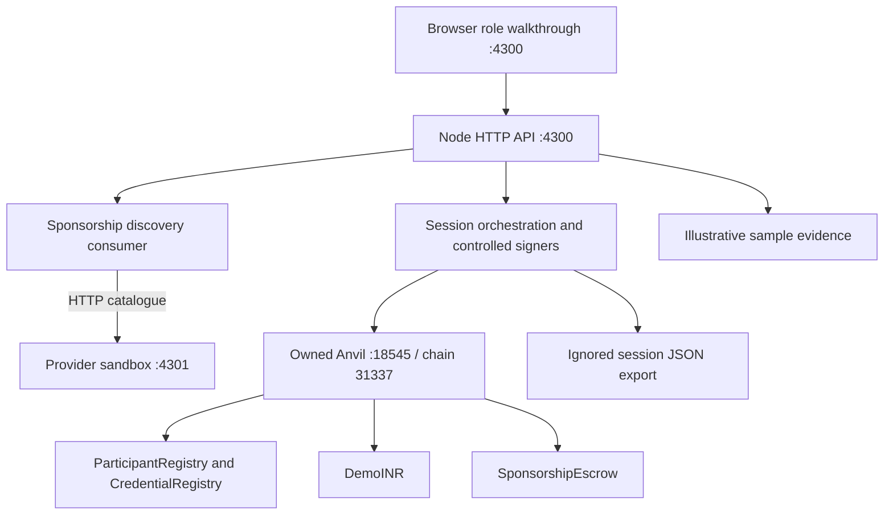

# Aamhi Finternet — technology architecture and engineering blueprint

## Architecture intent

This document covers the system foundation as well as the delivered local implementation. Use the [domain model](11_Domain_Model_and_Data_Dictionary.md), [target service and adapter contracts](12_Target_Architecture_and_Integration_Contracts.md), [policy specification](10_Policy_and_Rights_Specification.md) and [requirements traceability](14_Requirements_Traceability_and_Test_Strategy.md) for detailed implementation guidance. The [Finternet foundations](08_Context_and_Finternet_Foundations.md) explain the rationale and limits of the selected primitives.

Implement a purpose-bound funding workflow whose commitments, evidence references, authority, payment conditions and attribution can be inspected independently. Use the Aamhi programme as the first domain profile; reuse the commitment–milestone–evidence–attestation–payment pattern for later domains only after validating their distinct outcome definitions.

The primary handover flow is sponsorship. Preserve the existing material-sale services and contracts as a separate reference capability. Reuse components where semantics match; do not reinterpret a buyer's material token as a sponsor's outcome attribution.

## Foundational architecture decisions

Use a modular domain core with adapters for identity, evidence, discovery, payment and ledger execution. A small pilot can use a modular monolith plus workers; service boundaries do not require independent microservices. Separate agreement consent, outcome verification, financial authorisation, financial execution and attribution.

Choose a database for private workflow and durable operation state; a ledger for shared commitments and selected economic state; private object storage for evidence; and protocol interfaces for independent discovery/interaction. Each has an explicit source-of-authority boundary. Do not make the indexer or UI cache authoritative for balances.

The programme kernel is generic; eligible outcomes and evidence policies belong to domain profiles. Payment adapters declare capabilities, allowing policies to be validated against what a provider actually supports. A bank's asynchronous confirmation cannot be represented as atomic smart-contract escrow.

Production identity and governance include organisation membership, credentials, programme appointment, secure signing and recovery. A fixed account or a valid signature alone is insufficient to establish all those properties.

## Four architecture views

| View | Meaning |
|---|---|
| Conceptual | Parties agree purpose; evidence supports an outcome; authorised acceptance enables payment |
| Current local implementation | Browser, Node API, separate HTTP catalogue, controlled accounts, local Anvil, actual contracts, sample evidence and memory state |
| Target pilot | Persistent API, authenticated users, secure signers, real evidence storage, deployed chain adapters, independent verifier operations and reconciliation |
| Production direction | Audited contracts, operational resilience, recovery governance, permitted payment providers, legal agreements and external networks |

Only the current local view is delivered here. The production view is an engineering direction, not a certification or proven performance claim.

## Local component architecture



The launcher compiles contracts and starts its own loopback Anvil process. It refuses to attach to a node already using port 18545. It deploys registries, dINR and escrow; registers local participants; issues demo eligibility; authorises the escrow as a system token holder; seeds 20,000 dINR; and proposes two 10,000 dINR milestones. Aamhi acceptance and funding occur through the browser.

The enhanced browser provides overview, guided milestone workspace, evidence/assurance, sponsor report and Finternet proof views. Presentation chapters restore a snapshot of this owned chain and execute new transactions to prepare funded, review or completed states. They are labelled synthetic local scenarios, not imported historical evidence. A fresh chapter clears session projections and retains only baseline setup state.

Each restored session receives a new UUID in its API export and generated Markdown report. This distinguishes local presentations that reuse the same deterministic contract addresses. It is a presentation identifier, not a signed financial identifier or a substitute for production deployment manifests.

The separate catalogue endpoint provides process/interface separation within one Node process. It does not establish multi-organisation independence, Beckn compliance, remote participant identity or network certification.

## Repository responsibilities

| Module | Responsibility |
|---|---|
| `services/sponsorship-demo/server.ts` | Loopback API, route validation, role dispatch, static hosting and discovery endpoint |
| `services/sponsorship-demo/runtime.ts` | Local deployment, controlled accounts, transactions, evidence manifests and projections |
| `beckn/sponsorship-sandbox/catalogue.ts` | Programme offering and HTTP consumer adapter |
| `apps/sponsorship-demo/` | Functional role walkthrough and transaction inspector |
| `contracts/src/SponsorshipEscrow.sol` | Commitments, acceptance, escrow, verification, disputes, exact joint approvals and release |
| `contracts/src/DemoINR.sol` | Permissioned sandbox token, treasury and eligible holders |
| `services/core-api/src/modules/` | Existing in-memory material-sale domain reference |
| `services/blockchain-indexer/` | Existing simulated token read model, not the sponsorship chain indexer |

## Trust boundaries and identity

The browser selects a role through `x-demo-role`. The server signs with the corresponding unlocked Anvil account. This is explicitly a local presentation mechanism; it is not authentication, user-held signing or proof of organisational consent outside the demonstration.

Sponsor, Aamhi, facility and verifier addresses are distinct and fixed in the escrow constructor. The verifier and facility are agreed appointments for that programme. Their addresses cannot be rotated by the current contract. The escrow enforces appointed addresses directly; it does not check live VC revocation on each action. The dINR contract separately checks registry eligibility for token holders, with the escrow designated a system account.

Pilot requirements include OIDC or another selected authentication mechanism; server-side participant membership and role checks; DID/account bindings; issuer and credential verification; revocation policy for active agreements; secure signing; and jointly governed account or verifier replacement. A login role must never be accepted solely from a client header in a hosted deployment.

## Digital rights and tokenisation

There are three separate records:

1. Physical material: existing recovery assets and potential ERC-1155 commercial entitlement.
2. Sponsorship commitment: an identified milestone under one sponsor and programme, represented by contract state and agreed terms hash.
3. Outcome attribution: a non-transferable hash-linked acknowledgement created only on a paid, verified milestone.

The sponsorship record is not an ERC-721/ERC-1155 token and exposes no transfer function. That is sufficient for this local proof of identified on-chain commitments, but external token interoperability is not demonstrated. Do not market it as standards-compliant soulbound token issuance.

An attribution does not convey title, an offset, an official credit or an independently tradable environmental benefit. A future material or credit transfer must use a separately defined right and contract path.

## Local transaction sequence

```mermaid
sequenceDiagram
    participant S as Sponsor
    participant A as Aamhi
    participant F as Facility
    participant V as Verifier
    participant E as Escrow
    S->>S: Discover separate provider catalogue and select offering
    Note over S,E: Launcher proposes preset milestone terms using sponsor account
    A->>E: Accept exact termsHash
    S->>E: Approve dINR and fund milestone
    A->>E: Submit evidence manifest hash
    F->>E: Confirm receipt quantity against evidence hash
    V->>E: Verify eligible quantity, bounded by receipt
    alt Default conditions satisfied
      Note over V,E: Qualifying verification settles in the same transaction
    else Shortfall or disputed milestone
      A->>E: Propose exception with reason and payment
      S->>E: Approve exact exception hash
      A->>E: Approve exact exception hash and automatically settle
    end
    E->>A: Transfer approved dINR
    Note over E: Record paid-outcome attribution; refund unused amount if agreed
```

Qualifying verification calls settlement inside the same contract transaction. For an exception, the second required approval settles once the verified-outcome requirements are satisfied; a joint zero-payment cancellation can refund without verification. No administrator or keeper submits a later release. Token transfer failure reverts the triggering verification/approval as well as settlement. The permissionless `release` function remains a guarded compatibility entry point, but the browser does not expose a separate release action.

## State model and invariants

The contract uses flags plus quantities rather than a single linear enum. A milestone progresses from proposed terms through accepted, funded, evidence submitted, received, verified and closed. A dispute can overlay an open funded milestone. A proposed exception places it in review until both parties approve the exact proposal.

Required invariants implemented locally:

- One sponsor and fixed programme parties per contract.
- Nonzero milestone budget/target and unique milestone ID.
- Terms accepted by Aamhi before sponsor funding.
- Exactly one deposit and at most one close per milestone.
- Evidence is nonzero, tied to accepted terms and immutable after submission.
- The same manifest hash cannot be reused within that programme contract.
- Facility receipt references the submitted evidence; verifier quantity is positive and no greater than received quantity.
- Default fixed payment requires verification at or above the target.
- An exception cannot exceed the funded budget and requires sponsor and Aamhi approvals.
- The proposal binds contract, chain, milestone, original terms, evidence, verified quantity, reason document hash and payment.
- Changing the proposal or opening a new dispute clears prior approvals.
- A paid outcome requires verification even under exception; a zero-payment joint cancellation may refund without claiming an outcome.
- Paid amount plus refund equals the milestone's funded budget on closure.
- Closure is recorded before token transfers; token failure reverts the whole transaction.
- Qualifying verification or final exception approval emits acceptance, transfer and release events in one atomic transaction.
- A dispute does not alter other milestones.

The hash reuse check is limited: changing a note or using a second contract produces a new hash. It is not physical double-count prevention. A pilot requires canonical event/lot identities, evidence fingerprinting, quantity allocations and cross-programme claim reconciliation.

## Terms and exceptions

`terms` is a preset, canonicalised JSON object. SHA-256 over recursively key-sorted JSON produces `termsHash`. Only selected terms have executable representations in the contract: roles, target, budget and fixed-payment/exception mechanics. Hashing a policy does not make every sentence executable.

The local exception document contains reason, milestone, payment, evidence and verified quantity. Its SHA-256 is passed into a contract-level Keccak-256 proposal binding. Both parties approve that exact on-chain proposal hash. The UI requires an explicit current proposal hash and rejects stale approval input.

Current exceptions support agreed payment/refund outcomes. They do not edit the immutable evidence or verified quantity, change parties, replace the verifier, extend a deadline or revise programme scope. Versioned amendments, prospective applicability and credential replacement are pilot work. Corrections must preserve prior records and link replacement attestations rather than silently overwrite history.

The local dispute walkthrough concerns an already verified outcome. A dispute raised before verification currently permits joint cancellation/refund, but has no resume-work transition to unblock that same milestone. Other milestones remain unaffected. A jointly approved resume/remediation transition is required in the pilot; the local implementation must not be presented as covering all dispute operations.

## Evidence, privacy and source authority

The local manifest contains sample file hashes, material, demo route, note, capture time, milestone and terms hash. Files are illustrative; the SVG is not a field photograph. Facility and verifier account transactions provide the acknowledgements in this demo. The sample receipt JSON itself asserts no actual weighment.

The API holds evidence documents in memory and exports them to an ignored session snapshot. The snapshot is an inspection aid, not a database or recoverable deployment manifest. Restart creates a new deployment and overwrites the last export. Neither the export nor memory is a production evidence repository.

| Fact | Authority in target system |
|---|---|
| Organisational identity | Validated onboarding, DID and account bindings |
| Permission to act | Programme appointment plus current credential policy |
| Recorded commitment and escrow balance | Contract state |
| Actual physical collection | Field records and accountable independent verification |
| Received quantity | Facility assertion with measured evidence |
| Eligible quantity | Verifier assertion referencing evidence |
| Payment result on local chain | Successful transaction receipt and contract state |
| External payment result | Provider confirmation reconciled with bank/wallet records |
| Private evidence bytes | Access-controlled object store with immutable versions |
| Official credit | Authorised issuer/registry |

Keep PII, photographs, exact sensitive locations, invoices, bank details and confidential agreements off public ledgers. Hashes can remain linkable or sensitive and require a privacy review too. Store evidence under scoped access, encryption, retention and consent rules. Public programme discovery must expose only approved offering fields.

## API contract

All mutation requests require JSON and a local `x-demo-role`. Unknown roles, cross-origin browser writes, oversized bodies, unknown routes and concurrent actions are rejected. The browser is served only on the documented `127.0.0.1` host. These controls reduce accidental exposure; they do not make the server safe for network hosting.

| Method and path | Behavior |
|---|---|
| `GET /api/health` | Ready state after bootstrap |
| `GET /api/state` | Chain-derived balances/milestones plus session evidence and audit |
| `GET /api/export` | Same inspectable session snapshot |
| `GET /api/receipt?hash=...` | Actual chain receipt for a transaction in this session |
| `POST /api/discover` | Sponsor fetches catalogue through separate HTTP provider endpoint |
| `POST /api/select` | Select known `resourceId`; records local agreement initiation |
| `POST /api/presentation/reset` | Restore the owned local baseline and clear presentation/session progress |
| `POST /api/presentation/chapter` | Reset and execute new transactions for `funded`, `review` or `complete` chapter |
| `POST /api/milestones/:id/accept` | Aamhi accepts preset terms |
| `POST /api/milestones/:id/fund` | Sponsor approves and deposits dINR |
| `POST /api/milestones/:id/evidence` | Aamhi submits `note` and sample manifest |
| `POST /api/milestones/:id/receipt` | Facility submits integer `quantityKg` |
| `POST /api/milestones/:id/verify` | Verifier submits integer eligible `quantityKg` |
| `POST /api/milestones/:id/dispute` | Sponsor, Aamhi or verifier submits `reason` |
| `POST /api/milestones/:id/propose` | Sponsor or Aamhi submits `reason`, integer `paymentDinr` |
| `POST /api/milestones/:id/approve` | Sponsor or Aamhi submits reviewed `proposalHash` |
| `POST /api/milestones/:id/release` | Trigger settlement after conditions are met |

Only milestones 1 and 2 and whole-kg quantities are supported locally. API errors use JSON `{ error }`; validation and contract rejection return 400, role/origin rejection 403, unsupported media 415, busy state 409 and unknown path 404. Full machine-readable API specifications, durable idempotency and production-grade error classification are pilot work.

## Payment architecture and future instruments

Keep the programme policy engine separate from payment execution. A target payment adapter should expose capability discovery, funding reference creation, funding confirmation, authorised release, status lookup, refund where supported and reconciliation events.

Store agreement currency, payment instrument, instrument/network identifier, amount in integer minor units, provider reference, idempotency key, fees, FX quote/rate timestamp where applicable, confirmation policy and reconciliation status. Never equate an INR programme amount with a USD stablecoin quantity. Never silently convert currencies.

| Instrument | Future integration boundary |
|---|---|
| Local dINR | Actual ERC-20-style escrow on the owned local chain; implemented |
| Bank rails | Authorised payment provider/bank, asynchronous confirmation and reconciliation |
| India digital rupee | Authorised provider access and supported wallet/programming features |
| Stablecoin, potentially USDT | Permitted jurisdiction, recipient, instrument/network, custody and cross-border route |

The [RBI digital rupee FAQ](https://www.rbi.org.in/commonman/Upload/English/FAQs/PDFs/DigitalRupee09012025.pdf) describes designated-purpose programmability. This is a product alignment reference, not evidence of an available API, permission to integrate, or equivalent smart-contract escrow. Stablecoin availability likewise does not establish permission for a particular foreign contribution or payment.

For external rails, acceptance produces a payment authorisation; a provider executes it; confirmation completes the payment state. Use `AUTHORISED → SUBMITTED → CONFIRMED` with `FAILED`, `UNKNOWN` and reconciliation paths. Do not claim cross-system atomicity. Provider timeouts require status lookup before retry to avoid duplicate payments. No bank/CBDC/stablecoin adapter, FX engine, bridge or live foreign-funding path is implemented.

## Pilot persistence and event indexing

Use PostgreSQL for application records, not as an alternative authority for escrow balances. Suggested aggregates: programmes, versioned agreements, milestones, funding commitments, evidence records, manifests, appointments, attestations, exceptions, approvals, payment instructions, attribution records and audit events.

Every transaction operation needs a business ID, actor, idempotency key, chain/provider reference and explicit pending/confirmed/failed state. Use a transactional outbox for durable work dispatch, uniqueness constraints for business operations and optimistic locking for agreement revisions. Blockchain confirmation must update projections through an event indexer with replay, checkpoints, reorg handling and reconciliation.

The current API serialises mutation requests only within one process. This is not distributed concurrency control. If RPC succeeds but the response or snapshot write fails, an operator must inspect chain state before repeating the action. Durable operation recovery is not implemented.

## Full recovery lifecycle design

Future events must link collection lots, receipt lots, processing runs, output lots, sale/handover contracts and claim submissions. Model many-to-many inputs/outputs and measured loss categories. Track custody separately from ownership and sponsor attribution.

Quantities allocated to active exclusive claims must not exceed the eligible quantity under the relevant methodology. Funding attribution and material ownership may coexist, but the system must disclose overlapping claims and their distinct meaning. Credit transfer needs an authoritative registry reference, entitlement owner and scheme-specific retirement/cancellation semantics.

Do not connect existing `OBP_READY_RECOVERY_CLAIM` creation automatically to sponsorship payment. Its eligibility requires its own evidence and policy review.

## Security, operations and limits

The local launcher binds loopback ports, uses a dedicated chain, waits for receipts, limits API input and serves a fixed static-file allowlist. Controlled unlocked accounts, readable sample evidence, fixed parties and temporary state make this a demonstration environment only.

Before pilot deployment: threat-model collusion and false evidence; introduce secure signing and authentication; implement account recovery and appointment changes; audit funds conservation and token integration; review token pause/revocation consequences; establish monitoring, backups, evidence retention and dispute escalation. The current treasury can pause or burn demo tokens, which is incompatible with assuming immutable commercial custody guarantees.

The sponsorship contract is designed for the bundled dINR behavior. It has not been audited for arbitrary third-party tokens, fee-on-transfer tokens, callback-bearing tokens or live funds. Native token amounts use 18 decimals; browser input currently restricts payments to whole dINR. Transferability, co-funding, automatic deadlines and arbitrary policy execution are deliberately absent.

## Validation and implementation path

TypeScript checks, existing domain tests, Solidity tests and browser/API acceptance cover the local proof. Browser acceptance executes real escrow payments, checks a rejected unapproved shortfall, checks both approvals, inspects receipts and verifies a narrow viewport. Contract tests additionally cover dispute isolation, duplicate manifest rejection, stale/revised approvals and refund scenarios.

Use the [gap register](03_Current_State_and_Gap_Register.md) and [roadmap](05_Engineering_Roadmap.md) for implementation sequencing. Current test success does not establish contract audit, actual recovery validity, network certification, independent operational governance or production readiness.
