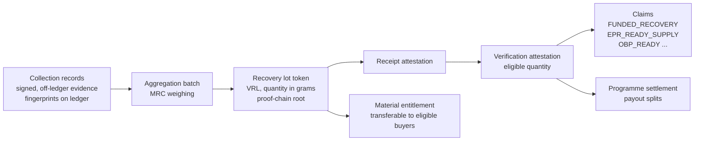
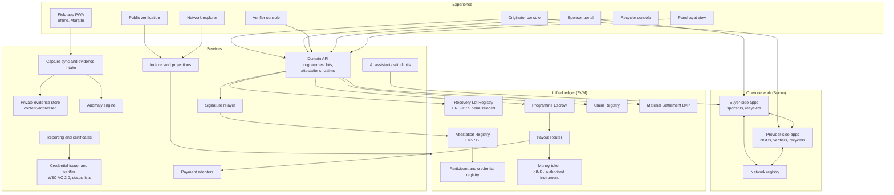

# Vartul — Product Document

**Vartul (वर्तुळ, "circle") — a Proof-of-Recovery network for the circular economy**

> Every rupee linked to a verified kilo. Every kilo linked to the person who collected it. Every claim made only once.

| | |
|---|---|
| Document | Vartul product document — the authoritative business, product, policy, legal, technical and governance reference |
| Version | 1.0 (first complete edition) |
| Date | 13 November 2026 |
| Partner context | Project Aamhi (rural and coastal solid-waste recovery, Konkan, Maharashtra) |
| Product developer | Suma (Finternet programme team) |
| Supersedes | The v0.2.1 handover specifications and earlier sponsorship/material-sale specifications (archived in `archive/`, scheduled for deletion) |
| Companion document | A separate implementation-status and handover document will be produced at the end of the build |

**How to read this document.** This document describes the complete Vartul product: what it is, why it exists, who uses it, the rules it enforces, how it is built and governed, and the legal and regulatory conditions under which it can operate. It deliberately describes the full product rather than a phase plan. What is built, simulated or pending at any moment is recorded in the separate status document, not here. Section 19 defines the demonstration scope only so that a reader of this document alone is never misled about what a demonstration shows.

**Fictional setting.** Project Aamhi is a real organisation and is named with its role as the anchor partner. All places, sponsors, recyclers, verifiers, other NGOs, Gram Panchayats and individuals used in examples are **fictional**, set in an invented coastal taluka of the Konkan. Any resemblance to real places, companies or people is coincidental. Quantities, rates and amounts in examples are illustrative design values, not operating data or valuations.

**Not legal advice.** Section 15 identifies the laws and regulations that shape the product and the positions the product takes. It is a design analysis for counsel to confirm, not a legal opinion.

---

## Contents

1. [Executive summary](#1-executive-summary)
2. [The problem: trust in recovered waste and the money that pays for it](#2-the-problem-trust-in-recovered-waste-and-the-money-that-pays-for-it)
3. [Foundations: Finternet, DPI and open networks](#3-foundations-finternet-dpi-and-open-networks)
4. [Product vision, principles and boundaries](#4-product-vision-principles-and-boundaries)
5. [The setting and the participants](#5-the-setting-and-the-participants)
6. [End-to-end journeys](#6-end-to-end-journeys)
7. [Product surfaces and functional specification](#7-product-surfaces-and-functional-specification)
8. [The asset, token and claim model](#8-the-asset-token-and-claim-model)
9. [Programmes, money and payment policy](#9-programmes-money-and-payment-policy)
10. [Trust, verification and fraud controls](#10-trust-verification-and-fraud-controls)
11. [Technical architecture](#11-technical-architecture)
12. [Data model and data dictionary](#12-data-model-and-data-dictionary)
13. [Open network design (Beckn)](#13-open-network-design-beckn)
14. [Identity, credentials, privacy and security](#14-identity-credentials-privacy-and-security)
15. [Legal and regulatory analysis](#15-legal-and-regulatory-analysis)
16. [Business model and economics](#16-business-model-and-economics)
17. [Governance of the network](#17-governance-of-the-network)
18. [AI assistance within limits](#18-ai-assistance-within-limits)
19. [Demonstration specification](#19-demonstration-specification)
20. [Operations and readiness for live value](#20-operations-and-readiness-for-live-value)
21. [Risks, decisions and open questions](#21-risks-decisions-and-open-questions)
22. [Glossary](#22-glossary)
23. [Sources and references](#23-sources-and-references)

---

## 1. Executive summary

### 1.1 What Vartul is

Vartul is a network and product that turns recovered waste into a **verifiable digital asset** and connects that asset to the money that funded its recovery. It records each kilogram from the moment a field worker collects it, through aggregation, dispatch, facility receipt and independent verification, and represents the verified result as a tokenised **recovery lot** carrying its complete *proof chain*. Sponsors fund recovery programmes through programmable escrow. When an agreed, verified outcome is reached, payment settles automatically. In the same transaction, collection incentives reach the workers who did the work, and the sponsor receives an exclusive, non-transferable claim to the outcome it funded, so that the same kilogram can never be claimed twice.

### 1.2 Why it matters

The waste and recovery sector has a documented trust deficit. India's plastic Extended Producer Responsibility (EPR) system has seen hundreds of thousands of fraudulent recycling certificates, backed by fabricated invoices, photographs and videos. International plastic-credit schemes have drawn criticism for weak additionality, backdated projects, double counting and unsubstantiated claims of benefit to waste pickers. NGOs that do real work struggle to prove it beyond self-reported totals, while corporate CSR funders and the Social Stock Exchange increasingly require independently assessed impact. Every participant needs the same thing: **a verified, single-use, provenance-backed unit of recovered material, connected to the money that paid for it.** Vartul provides it.

### 1.3 Who benefits

| Participant | Value |
|---|---|
| **Safai saathis** (field collectors) | Faster, traceable, conditional incentive payments per verified kilogram; a portable record of their work |
| **Project Aamhi and similar NGOs** | Credible, independently verifiable evidence of outcomes; faster release of funding; a fundable, discoverable programme on an open network |
| **Sponsors** (CSR, foundations, philanthropy) | Funding released only against verified outcomes; an exclusive claim that cannot be double counted; reports that support CSR and impact-assessment obligations |
| **Recyclers and processors** | Traceable, documented supply; provenance that strengthens their own compliance |
| **Independent verifiers and impact assessors** | Reusable proof chains instead of re-collecting evidence; sampling guided by anomaly signals |
| **Gram Panchayats** | Visibility of waste recovered in their village and of local livelihoods supported; a governance role rather than displacement |
| **Regulators and the public** | Verifiable claims; aggregated transparency without exposure of personal data |

### 1.4 What makes it a Finternet showcase

Vartul applies the Finternet design described by Agustín Carstens and Nandan Nilekani (BIS, 2024) and by Nilekani, Varma and Shetty in *Finternet: technology vision and architecture* (2024) to a social-sector asset:

- **Tokenisation of an attested physical asset.** A recovery lot is a user-created asset whose credibility comes from third-party attestations, the paper's "attested asset" category.
- **Proof chains.** Tokens, credentials, attestations and event metadata are chained so that "subsequent actors have all the information to decide without having to capture and verify all over again."
- **Token managers and a unified ledger.** Separate issuers for recovery lots, claims and money interoperate on one shared execution environment.
- **Programmability and atomic settlement.** Verification, payment, worker incentives and attribution complete together or not at all.
- **Authorisation chains.** Multi-party approvals such as joint exceptions are enforced in state transitions.
- **Unbundling of rights.** Material title, impact attribution, compliance eligibility and worker earnings derived from one physical lot are held and governed separately.
- **Open networks.** Programmes, lots, recyclers and verifiers are discovered through Beckn-protocol interactions rather than a closed marketplace.
- **Conditional benefit transfer.** Purpose-bound payments reach individuals in the spirit of India's direct-benefit-transfer and programmable digital-rupee experience.

### 1.5 The one-paragraph story

A safai saathi in the fictional village of Ambeghar Bandar collects a 12 kg bag of mixed plastic and records it on the Vartul field app, offline, with a photo and a scale reading. At the Shingrewadi material recovery centre the batch is weighed and becomes recovery lot `VRL-KH-2026-0042`. A registered recycler confirms receipt, and an independent verifier samples and accepts 1,180 kg. That acceptance transaction releases the sponsor's escrowed funding: incentives to the eleven collectors who contributed, Aamhi's operating share, the verifier's fee, and an exclusive impact claim to the sponsor. The sponsor receives a signed impact certificate with a QR code. A journalist who scans the QR sees the complete proof chain: who collected, where, when, who received, who verified, and that no one else has claimed those kilograms.

---

## 2. The problem: trust in recovered waste and the money that pays for it

### 2.1 Rural and coastal waste

Rural India generates growing volumes of non-biodegradable waste, especially low-value plastics, multi-layer packaging, glass and textiles, without the collection density or market prices that sustain urban recycling. Coastal villages add tourist waste, fishing debris and the risk that plastic becomes ocean-bound. Swachh Bharat Mission (Grameen) Phase II promotes block-level Plastic Waste Management Units and the engagement of Safai Mitras and self-help groups, but the economics of rural collection usually need external funding.

Project Aamhi works in this gap. Since its pilot in 2020 it has built a model of village-level collection and segregation by locally employed safai saathis, a sorting centre, partnerships with Gram Panchayats and the Zilla Parishad, upcycling and dispatch to recyclers. It reports more than 370 tonnes of waste diverted from landfills and water bodies. That figure is self-reported, which is precisely the kind of claim Vartul is designed to make independently verifiable.

### 2.2 The trust deficit

**Fraud in compliance markets.** Under India's EPR framework, producers, importers and brand owners meet obligations by purchasing EPR certificates generated by registered plastic-waste processors on the Central Pollution Control Board (CPCB) portal. In 2023–2024 CPCB and state boards uncovered recyclers generating several hundred thousand fake certificates; published estimates range from about 600,000 to 700,000. Inspections found recyclers that could not prove they had processed or sold the material, and others uploading fabricated invoices, photographs and videos. CPCB began an audit of about 800 recyclers, and the National Green Tribunal took up the matter. Research by the Centre for Science and Environment argues that the problem is structural: certificates trade at prices too low to reflect real recovery.

**Credibility problems in voluntary markets.** Plastic-credit schemes such as Verra's Plastic Program and PCX have been criticised by advocacy groups for weak additionality, projects operating for years before certification, reliance on co-processing in cement kilns, unsubstantiated claims of benefit to informal workers, and the risk of double counting. These criticisms are contested, but they show that a claim is only as strong as its evidence and its exclusivity.

**Self-reporting by implementers.** NGOs typically report aggregate outcomes from internal records. Funders cannot independently verify them without costly field audits, and the evidence is rarely reusable by the next funder or assessor.

**Rising assurance requirements.** Companies with large CSR obligations must commission independent impact assessments for significant projects (Companies CSR Rules, Rule 8(3)). Not-for-profit organisations raising funds on SEBI's Social Stock Exchange must publish Annual Impact Reports, and those for listed projects must be assessed by a Social Impact Assessment organisation. Both create demand for outcome data that is verifiable, attributable and reusable.

### 2.3 The money problem

Sponsorship of recovery work suffers from three gaps:

1. **Disconnection.** Funding agreements, field activity, evidence and payment live in separate documents, spreadsheets and bank transfers. Neither side can trace a rupee to a kilogram.
2. **Delay and opacity at the last mile.** Field workers are paid through the NGO's payroll or cash, often weeks after collection. Sponsors cannot see whether funding reached the people who did the work.
3. **Unclear exclusivity.** When a sponsor reports "we supported the recovery of 10 tonnes," nothing prevents the same tonnes being reported by another sponsor, by a recycler for EPR, or as a plastic credit.

### 2.4 The design question

Every feature in Vartul must help answer one question:

> **Can an independent party trust that this quantity of recovered material exists, came from the claimed place and people, was not counted twice, moved into the claimed outcome, and that the money attached to it went where it was promised?**

---

## 3. Foundations: Finternet, DPI and open networks

### 3.1 The Finternet

The Finternet is a vision, set out by Agustín Carstens and Nandan Nilekani in BIS Working Paper 1178 (April 2024), of "multiple financial ecosystems interconnected with each other — much like the internet," designed to place individuals and businesses "at the centre of their financial lives." It is described as **user-centric, unified and universal**. The companion paper by Nilekani, Pramod Varma and Siddharth Shetty, *Finternet: technology vision and architecture* (v1.1, April 2024), sets out the technical building blocks Vartul uses.

| Finternet concept | Meaning in the source papers | How Vartul applies it |
|---|---|---|
| **Unified ledger** | A shared programmable environment bringing tokenised money and assets together, reducing messaging and reconciliation | Recovery lots, claims, programme escrow and money share one execution environment, so verification and payment can be atomic |
| **Tokens** | "Programmable digital representations of claims on an asset, with each possessing a unique identifier that ensures traceability" | Each recovery lot is a token with a unique ID, a quantity and a lifecycle |
| **Token managers** | Entities that issue and maintain the integrity and compliance of particular asset types, potentially on their own ledgers synchronised with a unified ledger | The Recovery Lot Registry, the Claim Registry and the money issuer are distinct token managers with distinct rules |
| **Asset categories** | User-controlled, **attested**, registered and regulated assets | A recovery lot is an *attested asset*: created by the originator, made credible by facility and verifier attestations, and able to interoperate with registered (EPR) and regulated (money) systems |
| **Trusted proof chains** | Tokens incorporate third-party attestations and credentials; chaining tokens, credentials, attestations and event metadata creates portable proofs so later actors need not re-verify | The lot's proof chain links collection records, weighing, dispatch, receipt and verification, each signed by an accredited participant |
| **Authentication and authorisation chains** | Joint holdings and maker/checker workflows require chains of approvals converted into proofs | Joint exception approvals by sponsor and Aamhi; verifier-independence checks; multi-party revocation |
| **Programmability and composability** | Rules embedded in tokens and flows; workflows composed across asset types | One verification transaction composes lot state, escrow release, payout splits and claim allocation |
| **Finality** | The moment value legally and technically changes hands | Settlement and claim allocation are final in the same transaction; exceptions are explicit and recorded |
| **Tokenisation / de-tokenisation; on- and off-ramps** | Service providers bridge existing systems and the Finternet | Field capture is the on-ramp for the physical asset; UPI or bank payout is the off-ramp for worker incentives |
| **Addresses** | Human-friendly, QR-codeable, deep-linkable, revocable addresses independent of token managers | Worker payout addresses and certificate verification links are QR-based and deep-linkable |
| **Selecting use cases** | Leverage abundant data, align with existing habits and shared incentives, minimise habit disruption; "seeing is believing" | Aamhi already weighs, sorts, dispatches and reports; Vartul digitises existing habits and aligns NGO, sponsor, recycler and regulator incentives |

The architecture paper explicitly names "transparency in nonprofit operations," carbon-credit management, "tokenized vouchers" and "distribution of subsidies" among tokenisation's applications. In 2026 the Finternet effort presented pilots tokenising cattle, warehouse receipts and loan documents. In each, a real-world asset with attested quantity and quality unlocks finance. Recovered waste fits the same pattern, adds a direct social-benefit dimension, and does so without speculative trading.

### 3.2 Digital public infrastructure

India's DPI experience shows that reusable, interoperable building blocks (identity, payments, data sharing, verifiable credentials, open transaction networks) let many independent providers build services at low cost and population scale. The Finternet architecture paper highlights reusability, private innovation on public rails, ecosystem adoption, cost reduction, inclusion through multiple interfaces, and asynchronous adoption.

Vartul is designed DPI-style:

- **Reusable building blocks, not a closed platform.** The recovery-lot specification, attestation types, claim rules and Beckn domain definitions are open specifications that other NGOs, verifiers, recyclers and funders can implement.
- **Built on existing DPI.** Verifiable credentials follow the W3C model and can be issued with open-source digital public goods such as Sunbird RC or MOSIP Inji. Payouts use UPI or bank rails. Data sharing follows consent principles. Discovery uses Beckn.
- **Asynchronous adoption.** A recycler can start by only confirming receipts; a funder can start by only verifying certificates; a Gram Panchayat can start by only observing.
- **Inclusion by design.** The field app works offline, in Marathi, with large icons and voice prompts; a supervisor can capture on behalf of a worker with that worker's consent.

### 3.3 Open transaction networks and Beckn

Beckn is an open protocol for decentralised discovery, ordering, fulfilment and post-fulfilment between independent buyer-side and provider-side applications. It underpins networks such as ONDC (commerce), Namma Yatri (mobility), ONEST (skilling) and UEI (energy), and lists circular economy among its domains. Beckn v2 moves domain-specific models into separately versioned schemas, with records consumable as JSON-LD. Beckn has also been described as contracting infrastructure for AI agents.

In Vartul, Beckn lets:

- sponsors discover fundable **recovery programmes** published by many NGOs;
- recyclers discover verified **material lots** for purchase;
- NGOs discover **verifiers**, transport providers and recyclers;
- programmes, lots and claims carry **network-wide identifiers**, so exclusivity can be checked across implementers.

Section 13 specifies the domains, messages and trust model.

### 3.4 Programmable money and benefit transfer

India's Direct Benefit Transfer moved welfare payments to identified beneficiaries' accounts. The Reserve Bank of India's digital rupee (e₹) pilots have explored programmability, including purpose-bound and conditional payments, and reports from 2026 describe welfare and food-subsidy pilots. Tokenised deposits are also being trialled. Vartul applies the same idea to private social funding: a sponsor's money is bound to a purpose (verified recovery), released only when conditions are met, and split programmatically so that a defined share reaches individual workers. Vartul's own settlement token is a sandbox instrument (dINR). Live money would use an authorised bank, e₹ or tokenised-deposit provider through a payment adapter (Section 9.7).

### 3.5 What Vartul adds to the Finternet narrative

1. **A social-sector attested asset.** It shows that tokenisation is not only for financial assets, land or commodities, but for outcomes created by low-income workers.
2. **Exclusivity as a public good.** The claim registry demonstrates how a shared ledger can stop double counting, the root problem of impact and compliance markets.
3. **Rights unbundling with social purpose.** Material title can be sold while impact attribution stays with the funder and worker earnings remain traceable.
4. **Last-mile programmability.** Conditional payment reaches individuals, not only institutions.

## 4. Product vision, principles and boundaries

### 4.1 Vision

A circular-economy network in which any community recovery organisation can make its work verifiable, any funder can pay for outcomes it can trust, every field worker can see and receive what their work earned, and no recovered kilogram is ever claimed twice.

### 4.2 Product principles

1. **Purpose before payment.** Every rupee is attached to an agreed purpose and conditions before it moves.
2. **Evidence close to the event.** Capture data at the point and time of the physical activity, signed by the person who performed or witnessed it.
3. **Separate the people who assert.** Collection, receipt and verification are made by different accountable participants. No one verifies their own work.
4. **The physical truth stays true.** Financial flexibility (exceptions) never changes recorded quantities. 450 kg stays 450 kg even if full payment is jointly agreed.
5. **One kilogram, one claim of each kind.** Exclusive claim types are allocated once. Compatibility between claim types is an explicit, published policy.
6. **Pay the last mile.** Programmes that pay for recovery should show how much reached the workers who performed it.
7. **Privacy by default.** No personal data on a ledger. Public views show aggregates and proofs, not people.
8. **Honest language.** Never claim a certificate, credit, legal title or currency status the system has not established.
9. **Open and reusable.** Specifications, schemas and core components are open, so the network is not one vendor's platform.
10. **Field-first usability.** If a safai saathi cannot use it offline in Marathi in under a minute, it is not finished.

### 4.3 What Vartul is not

| Vartul does not | Instead it |
|---|---|
| Issue EPR certificates | Produces *EPR-ready traceability evidence* that a registered processor may use under the CPCB framework |
| Issue plastic or carbon credits or offsets | Records *funded-outcome attribution*, which is not an offset and is not tradeable |
| Create a tradeable or speculative token | Uses permissioned, purpose-specific tokens; impact claims are non-transferable and material lots move only between eligible participants |
| Act as a bank, escrow agent or payment system for live funds on its own | Executes programme logic; live custody and payout run through authorised providers (Section 15) |
| Determine legal title to material | Records a digital entitlement linked to a documented commercial agreement |
| Replace the verifier's judgement | Supplies evidence, sampling plans and anomaly signals; the accredited verifier decides |
| Employ field workers | Executes incentive payments that the implementing organisation authorises under its own arrangements |

### 4.4 Success measures

| Measure | Definition | Target direction |
|---|---|---|
| Verified kilograms | Quantity accepted by an accredited verifier with complete proof chain | Up |
| Collection-to-payment time | Median time from field capture to worker incentive payout | From weeks to under one day after verification |
| Last-mile share | Percentage of released programme funding paid to field workers | Visible and agreed per programme |
| Proof-chain completeness | Share of verified kg with every required attestation present | 100% |
| Duplicate-claim rate | Exclusive claims that conflict across programmes or implementers | 0 by construction |
| Verification cost per kg | Verifier fees and assessment cost per verified kg | Down as proof chains are reused |
| Anomaly precision | Share of flagged items confirmed as genuine issues | Up, without suppressing legitimate work |
| Sponsor renewal | Sponsors who fund a subsequent programme cycle | Up |

---

## 5. The setting and the participants

### 5.1 The fictional reference geography

All examples use an invented coastal taluka in the Konkan region of Maharashtra.

| Element | Fictional name | Description |
|---|---|---|
| District | **Varunagiri** | A coastal district with fishing villages, beaches and tourist traffic |
| Taluka | **Kharekinara** | Ten coastal and hinterland villages served by Aamhi |
| Material recovery centre | **Shingrewadi MRC** | Aamhi's aggregation, sorting, baling and dispatch centre with a calibrated platform scale |
| Coastal villages | Ambeghar Bandar, Tamarli, Nilwala, Sonkada, Undirwadi | High tourist and marine-debris load; beach clean-ups |
| Hinterland villages | Pimpalkhar, Mograwadi, Kesarwadi, Dhavalpeth, Shingrewadi | Household door-to-door segregation routes |
| Recycler | **Talvan Polymers Pvt Ltd** | Registered plastic-waste processor 140 km inland; operates a weighbridge |
| Second recycler | **Ghatmatha Recyclers LLP** | Glass and rigid-plastic buyer used for multi-stream examples |
| Verifier | **Nirikshan Assurance LLP** | Independent accredited verification firm |
| Sponsors | **Tidewell Foods Ltd (CSR)**, **Neelkanth Bank Foundation**, **Coastline Giving Circle** | A packaged-food brand owner, a bank's foundation, and a pooled philanthropy circle |
| Other NGOs on the network | **Sagar Swachh Sangh**, **Hirwai Collective** | Peer implementers publishing their own programmes |
| Gram Panchayats | e.g., Ambeghar Bandar Gram Panchayat | One per village, as observers and co-attestors |
| Impact assessor | **Pratibimb Impact Assessors** | Social Impact Assessment organisation for SSE and CSR assessments |

### 5.2 Participants and roles

Every participant holds one or more **role credentials** (Section 14). The ledger enforces actions by role, never by name.

| Role | Who | Core responsibilities | Cannot |
|---|---|---|---|
| **Safai saathi (collector)** | Local field worker employed or engaged by the NGO | Capture collection records; view earnings; receive incentive payouts | Verify, receive, or claim |
| **Collection supervisor** | Aamhi field lead | Assign routes; assisted capture; daily reconciliation; co-sign collections | Approve own team's verification |
| **Originator / implementing agency** | Project Aamhi | Publish programmes; accept terms; aggregate, tokenise and dispatch lots; propose exceptions; authorise payout policy | Verify its own lots; claim sponsor attribution |
| **MRC operator** | Aamhi staff at Shingrewadi MRC | Weigh aggregation batches; record sorting and contamination; prepare dispatch | Confirm receipt at the recycler |
| **Receiving facility / recycler** | Talvan Polymers | Confirm receipt (weighbridge); optionally attest processing; purchase material lots | Verify eligibility for sponsor payment |
| **Verifier** | Nirikshan Assurance | Review proof chains; perform sampling and site checks; accept eligible quantity; reject or flag | Hold any financial interest in the programme; approve exceptions |
| **Sponsor** | Tidewell Foods CSR, Neelkanth Bank Foundation, Coastline Giving Circle | Discover and fund programmes; approve exceptions; receive claims and certificates | Change recorded quantities; release funds without conditions |
| **Gram Panchayat observer** | Each village Panchayat | View village-level recovery and livelihood data; co-attest collector onboarding and collection points; raise concerns | Approve payments |
| **Impact assessor** | Pratibimb Impact Assessors | Read proof chains with consent; issue assessment credentials | Alter records |
| **Network facilitator** | Suma initially; intended to transition to a neutral network body | Operate the registry, publish specifications, accredit participants, run dispute escalation | Move funds or change participant records unilaterally |
| **Payment provider** | Authorised bank / e₹ / tokenised-deposit provider (live); sandbox dINR issuer (demo) | Custody, mint/burn, payout off-ramp, reconciliation | Override programme conditions |
| **Public** | Anyone | Verify certificates and view aggregate transparency pages | See personal data |

### 5.3 Separation of duties

The following combinations are prohibited by policy and enforced by credentials and contract checks:

- Originator and verifier for the same programme.
- Recycler and verifier for the same lot.
- Sponsor and verifier for the same programme.
- Any participant approving an exception it proposed without the counterparty's approval.
- A collector whose records are in a lot acting as that lot's MRC weigher (supervisors may co-sign but not weigh their own team's batch alone).

Verifiers declare conflicts through a signed conflict-of-interest credential per programme, and the network can rotate verifiers across cycles.

---

## 6. End-to-end journeys

Each journey lists actors, steps, system behaviour and outcome. Identifiers are illustrative.

### 6.1 Journey A — Follow one bag (core journey)

```mermaid
sequenceDiagram
  autonumber
  participant SS as Safai saathi
  participant FA as Field app
  participant MRC as Shingrewadi MRC
  participant RL as Recovery Lot Registry
  participant RC as Talvan Polymers
  participant VF as Nirikshan Assurance
  participant ES as Programme escrow
  participant CR as Claim Registry
  participant SP as Sponsor
  SS->>FA: Capture 12.4 kg mixed LDPE, photo, location, time (offline)
  FA-->>MRC: Sync signed collection record when connected
  MRC->>RL: Weigh batch 1,212 kg; mint lot VRL-KH-2026-0042 with proof root
  MRC->>RC: Dispatch with transport document hash
  RC->>RL: Attest receipt 1,196 kg (weighbridge slip hash)
  VF->>RL: Sample and accept 1,180 kg eligible
  RL->>ES: Verified quantity triggers programme condition
  ES->>SS: Incentive payouts to contributing collectors
  ES->>CR: Allocate 1,180 kg exclusive funded-outcome claim to sponsor
  CR->>SP: Signed impact certificate with QR
```

**Steps.**

1. **Capture.** Sunanda (pseudonymous ID `SS-KH-0017`) collects mixed LDPE on the Ambeghar Bandar beach route. In the field app she selects the material, places the bag on the route scale, takes the photo the app prompts for, and confirms. The record is signed by her device key (bound to her collector credential), stores the scale reading, GPS fix, timestamp and photo fingerprint, and queues offline.
2. **Supervisor reconciliation.** At day end, supervisor Rohan co-signs the route's 38 records. Sync uploads evidence to private storage and submits record fingerprints.
3. **Aggregation and tokenisation.** At the MRC, the operator weighs the sorted, baled batch: 1,212 kg of LDPE assembled from 214 collection records totalling 1,296 kg captured weight, with 84 kg removed as contamination. The registry checks mass balance (output ≤ inputs − recorded contamination, within tolerance) and mints lot `VRL-KH-2026-0042` with quantity 1,212,000 g, material `PLASTIC-LDPE`, grade, programme eligibility window, and the Merkle root of the 214 record fingerprints.
4. **Dispatch.** Aamhi dispatches the lot with a transport document fingerprint. The lot becomes `IN_TRANSIT`.
5. **Receipt.** Talvan Polymers weighs on its weighbridge: 1,196 kg. It attests receipt with the weighbridge slip fingerprint and its CPCB registration credential. The 1.3% variance is inside the programme's 2% tolerance, so the lot becomes `RECEIVED`.
6. **Verification.** Nirikshan's console shows the proof chain, the anomaly report (none material) and a sampling plan of 12 collection records to inspect. The verifier reviews them, checks the MRC log and receipt documents, and accepts 1,180 kg eligible, excluding 16 kg identified as non-eligible material. The lot becomes `VERIFIED` with eligible quantity 1,180,000 g.
7. **Automatic settlement.** The programme's per-kg policy is ₹18/kg eligible, capped by the milestone budget. The verification transaction executes:
   - releases ₹21,240 from escrow;
   - pays ₹8,496 (40%) to the collector incentive pool, distributed pro rata to the 11 collectors whose records form the lot (Sunanda receives ₹492 for her verified share);
   - pays ₹11,682 (55%) to Aamhi's programme account for operations;
   - pays ₹1,062 (5%) to the verifier's fee account;
   - allocates an exclusive `FUNDED_RECOVERY` claim of 1,180 kg to Tidewell Foods CSR.

   Any failure reverts everything.
8. **Payout.** Collector payouts are recorded on-chain against pseudonymous payout addresses. The payment adapter then executes UPI transfers off-chain and records the payout reference. Sunanda receives an SMS and sees the payout and the verified lot in her app.
9. **Certificate.** Tidewell Foods receives a W3C Verifiable Credential impact certificate referencing the claim, lot, verifier, programme and settlement transaction, with a QR code. Its CSR team downloads a report aligned to its CSR-2 and impact-assessment needs.
10. **Public verification.** Anyone scanning the QR sees: claim valid, 1,180 kg LDPE, Kharekinara taluka, collected 2–19 October 2026, received by a registered recycler, verified by an accredited verifier, 11 collectors paid, not claimed by any other party, and no personal data.

### 6.2 Journey B — Sponsor discovers and funds a programme

1. Tidewell Foods' CSR lead opens the Vartul sponsor portal, a Beckn buyer application, and searches for recovery programmes: Maharashtra coast, plastics, at least 20 tonnes, budget up to ₹6 lakh, verification required, last-mile share at least 30%.
2. The network returns programmes from Aamhi, Sagar Swachh Sangh and Hirwai Collective, each with geography, materials, targets, payment policy, verifier arrangements, track record (verified kg to date, from the claim registry, not self-reported) and credentials (CSR-1 registration, 12A/80G, NGO Darpan ID).
3. The sponsor selects Aamhi's *Kharekinara Coastal Recovery 2026–27* programme. Through `select` and `init` the terms are quoted: 30 tonnes, ₹18/kg eligible, payment splits, verifier, eligibility window, exception and dispute rules, and deadline policy.
4. Both parties review the terms document. Its fingerprint is what each signs. Aamhi accepts; the sponsor confirms (`confirm`). The programme commitment is recorded on the ledger.
5. The sponsor funds the first tranche into programme escrow, e.g., three milestones of ₹1.8 lakh each. Funding is visible as held, not paid.

### 6.3 Journey C — When reality differs (shortfall exception)

A milestone targeting 10,000 kg is verified at 9,000 kg because monsoon access cut two routes. Under a fixed-on-target policy, payment does not release. Aamhi proposes an exception, either full payment, a pro-rata payment or an extension, with a reason and attached evidence such as route-closure notices. The proposal is fingerprinted together with the terms, evidence, verified quantity and payment. The sponsor approves the exact proposal. Aamhi's approval completes the authorisation chain, and settlement executes automatically in that transaction. The recorded outcome remains 9,000 kg. A revised proposal invalidates earlier approvals. The verifier does not decide commercial exceptions.

### 6.4 Journey D — Dispute and challenge window

After verification, lots enter a **challenge window** (e.g., 72 hours for per-kg programmes) before final claim allocation, unless the programme opts for immediate finality with a post-settlement correction policy. During the window the sponsor, Aamhi, the verifier, a Gram Panchayat observer or the network facilitator may raise a challenge with a reason and evidence. A challenge holds only the affected lot's release and claim. Resolution paths are:

1. withdraw the challenge;
2. re-verification by the same or a second verifier;
3. jointly agreed adjustment;
4. escalation to the network ombudsperson and, failing that, the arbitration clause in the programme agreement.

Other lots and milestones continue.

### 6.5 Journey E — Fraud caught

A collector account submits 46 kg on a route whose recent per-trip median is 9 kg. Two of its photos match photos submitted three weeks earlier by another collector (perceptual-hash similarity), and the GPS fix lies on a road 2 km from the assigned beach.

- The anomaly engine flags the records, and the MRC sees the flags before aggregation.
- If the records are aggregated anyway, the lot carries visible flags, and the verifier's sampling plan includes all flagged records.
- The verifier excludes the records. The eligible quantity is reduced, and the incentive pool distribution excludes the flagged contributor pending review.
- The supervisor and the Gram Panchayat observer are notified, and the collector's credential may be suspended after due process.

### 6.6 Journey F — Revocation cascade

Three months later an audit finds that a recycler's receipts for October were fabricated. The network facilitator, acting on the regulator's finding and the verifier's re-assessment, records a **revocation attestation** against the affected receipts. Every lot whose proof chain depends on those receipts is marked `UNDER_REVIEW`, and every claim derived from those lots is marked `CONTESTED` automatically. Certificates show the changed status when scanned. Remedies follow the programme agreement: replacement lots, refund from future tranches, or recovery from the responsible party. The ledger never deletes history; it records the correction.

### 6.7 Journey G — Recycler purchase and unbundled rights

Talvan Polymers buys lot `VRL-KH-2026-0042`'s material at ₹14/kg. A delivery-versus-payment settlement transfers the lot's **material entitlement** to Talvan against payment to Aamhi atomically. The lot's **funded-outcome claim** remains with Tidewell Foods. The **EPR-eligibility marker** records that Talvan may use the documented supply in its own EPR reporting under the CPCB framework, subject to the claim-compatibility policy (Section 8.6). The worker incentives already paid remain linked. One physical lot now carries four separately governed rights, each held by the right party.

### 6.8 Journey H — Gram Panchayat oversight

The sarpanch of Ambeghar Bandar opens the Panchayat view, in Marathi, on a tablet or printed weekly summary. It shows:

- kg recovered from the village by month and material;
- collection points;
- the number of local collectors active and incentives paid in aggregate;
- open concerns.

The Panchayat co-attests new collector onboarding (that the person is a resident engaged in the work) and the location of collection points. It can raise a concern that enters the challenge process. This makes the Panchayat a visible partner in the programme rather than an outside party displaced by an NGO.

### 6.9 Journey I — Impact assessment and Social Stock Exchange reporting

Pratibimb Impact Assessors is engaged by Aamhi to assess its Annual Impact Report. With Aamhi's consent token, the assessor's console reads the proof chains for the period, samples them, and issues an **assessment credential** referencing the verified quantities, programme expenditure, and the share of programme expenditure covered. Tidewell Foods' CSR impact assessment for its larger projects reuses the same proof chains instead of commissioning a new field survey.

### 6.10 Journey J — Assisted discovery by an AI agent

The Coastline Giving Circle's coordinator tells the sponsor assistant: *"Find coastal plastic recovery programmes in Maharashtra we can fund with ₹3 lakh this quarter; we want at least a third reaching collectors and independent verification."* The agent issues Beckn searches, filters by credentials and policy, ranks programmes using registry-sourced track records, and drafts a comparison and a proposed agreement. It cannot sign or fund. A human approves each transaction (Section 18).

### 6.11 Journey K — The worker's view

Sunanda's app shows, in Marathi with icons:

- today's captures and their status (synced, in lot, received, verified, paid);
- this month's verified kg and incentives received;
- payout references;
- a simple explanation when a record was excluded and how to ask her supervisor about it.

She can export a personal work record, a verifiable credential summarising her verified contributions. It can support access to schemes or credit in future, at her choice, through consent-based sharing.

## 7. Product surfaces and functional specification

Vartul has eight surfaces. Each uses the participant's colour identity and states the acting role explicitly:

| Participant | Colour |
|---|---|
| Sponsor | Indigo |
| Aamhi / originator | Green |
| Facility / recycler | Teal |
| Verifier | Purple |
| Panchayat | Saffron |
| Public | Neutral |

Requirement identifiers (e.g., `FA-01`) are used for traceability in the status document.

### 7.1 Field app (safai saathi and supervisor)

A progressive web app installable on low-cost Android phones. It works fully offline, has a Marathi-first interface (Hindi and English available), large icons, voice prompts, and a minimal number of taps.

| ID | Requirement |
|---|---|
| FA-01 | Sign in with a device-bound key unlocked by PIN or biometric; the key is bound to the collector's role credential at onboarding |
| FA-02 | Capture a collection record: route or collection point, material category (icons), weight (manual or from a Bluetooth/USB scale), mandatory in-app photo (no gallery uploads), GPS fix, timestamp, optional voice note |
| FA-03 | Sign each record on device; store it in an encrypted local queue; sync opportunistically and show sync status per record |
| FA-04 | Local plausibility checks before submission: weight range per material, photo blur/darkness, GPS accuracy, duplicate-photo check against the device's recent captures |
| FA-05 | Assisted capture: a supervisor may capture on behalf of a collector who lacks a phone, with the collector's consent recorded (thumbprint on the supervisor's device, or OTP) |
| FA-06 | Supervisor day-close: review the route's records, co-sign, resolve flagged items, record handover quantity to the MRC |
| FA-07 | Earnings view: verified kg, incentives paid, pending, excluded with reason, payout references |
| FA-08 | Personal work-record credential export, only at the worker's request |
| FA-09 | Consent screens in plain Marathi explaining what is collected, why, who sees it, and how long it is kept; withdrawal path |
| FA-10 | Works for a full day offline with at least 200 records and photos compressed to under 150 KB each |

### 7.2 Originator operations console (Aamhi)

| ID | Requirement |
|---|---|
| OP-01 | Programme management: draft programmes and terms from templates; publish to the network catalogue; accept sponsor terms |
| OP-02 | Collector management: onboard collectors, request Panchayat co-attestation, issue and suspend credentials, assign routes |
| OP-03 | MRC workflow: receive route handovers, record sorting and contamination, weigh batches, run the mass-balance check, mint recovery lots |
| OP-04 | Lot lifecycle: dispatch with transport documents, track receipt, view verification outcomes, handle challenges |
| OP-05 | Anomaly inbox: flagged records with explanation, actions (exclude, request recapture, escalate) and an audit trail |
| OP-06 | Exceptions: propose an exception with reason, evidence and amount; see approval status |
| OP-07 | Payout policy: configure the collector incentive distribution rule within programme terms; view payout reconciliation against the payment adapter |
| OP-08 | Material sales: list verified lots for recycler purchase; settle by delivery versus payment |
| OP-09 | Reporting: programme reports; SSE Annual Impact Report support pack; CSR utilisation statements for each sponsor |

### 7.3 Sponsor portal

| ID | Requirement |
|---|---|
| SP-01 | Discover programmes through Beckn search with filters (geography, materials, budget, verifier, last-mile share, track record) |
| SP-02 | Compare programmes using registry-derived track records and implementer credentials |
| SP-03 | Review and confirm terms; see the terms fingerprint and which version was signed |
| SP-04 | Fund milestones or tranches; see held, released, refunded and remaining amounts |
| SP-05 | Live outcome dashboard: verified kg by material, village and period; last-mile share; open challenges; proof-chain drill-down |
| SP-06 | Review and approve exceptions (exact proposal) |
| SP-07 | Claims wallet: the sponsor's exclusive claims, certificates and their live status |
| SP-08 | Reports: CSR-oriented utilisation and outcome report, board-ready summary, machine-readable export, and assessor access grants |
| SP-09 | AI sponsor assistant within limits (Section 18) |

### 7.4 Verifier console

| ID | Requirement |
|---|---|
| VF-01 | Queue of received lots awaiting verification, with SLA timers |
| VF-02 | Proof-chain viewer: every record, attestation and credential in the lot, with evidence retrieval (time-limited, access-logged) |
| VF-03 | Anomaly report and a risk-weighted sampling plan generated per lot |
| VF-04 | Field-check scheduling and capture (the verifier's own app) for site visits |
| VF-05 | Decision: accept eligible quantity (≤ received), partially exclude with reasons, reject, or request information |
| VF-06 | Conflict-of-interest declaration per programme; recusal |
| VF-07 | Revocation and re-assessment workflow for later findings |

### 7.5 Recycler / facility console

| ID | Requirement |
|---|---|
| RC-01 | Expected inbound lots; confirm receipt with weighbridge reading and slip; record variance |
| RC-02 | Optional processing attestation (output, process type) where the facility participates |
| RC-03 | Discover and buy verified lots; delivery-versus-payment settlement |
| RC-04 | Downloadable supply provenance for its own compliance records |

### 7.6 Gram Panchayat observer view

| ID | Requirement |
|---|---|
| GP-01 | Village summary in Marathi: kg recovered by material and month, collection points, active local collectors, incentives paid in aggregate |
| GP-02 | Co-attest collector onboarding and collection points |
| GP-03 | Raise a concern that enters the challenge process |
| GP-04 | Printable monthly summary for the Gram Sabha |

### 7.7 Public verification and transparency

| ID | Requirement |
|---|---|
| PV-01 | Scan a certificate QR code, or paste a claim ID, to see validity, status (valid, contested, revoked), quantity, material, period, region (taluka level), recycler and verifier accreditation, exclusivity confirmation, and settlement reference |
| PV-02 | Cryptographic check of the certificate signature in the browser |
| PV-03 | Aggregate transparency pages per programme and per network: verified kg, funding released, last-mile share; no personal data |
| PV-04 | Machine-readable endpoints for auditors and researchers |

### 7.8 Network explorer (the "Finternet view")

| ID | Requirement |
|---|---|
| NX-01 | Show token managers, token classes (recovery lots, claims, money) and their supply and states |
| NX-02 | Follow a lot or claim through its proof chain and ledger transactions, including decoded events |
| NX-03 | Show Beckn transactions linked to ledger records (programme, order and fulfilment IDs) |
| NX-04 | Explain each concept in plain language beside the technical record |

---

## 8. The asset, token and claim model

### 8.1 Objects at a glance



### 8.2 Collection record

The atomic unit of field evidence. It is never tokenised individually, which avoids an unmanageable number of micro-tokens. Each record is a signed JSON document stored in private evidence storage. Its fingerprint, `sha256` over canonical JSON, enters a Merkle tree whose root is recorded on the lot.

| Field | Notes |
|---|---|
| `recordId` | Content-derived identifier |
| `collectorRef` | Pseudonymous collector ID, never a name or phone number |
| `supervisorRef` | Co-signer at day-close |
| `programmeId`, `routeId`, `collectionPointId` | Context |
| `materialCategory` | From the network material taxonomy (e.g., `PLASTIC-LDPE`, `PLASTIC-MLP`, `GLASS-MIXED`, `TEXTILE`) |
| `weightGrams`, `weightSource` | `SCALE_BT`, `SCALE_MANUAL`, `ESTIMATE` (estimates are ineligible for per-kg payment) |
| `capturedAt`, `geo` | Timestamp; location with accuracy; location coarsened in all non-private views |
| `photoFingerprints` | Cryptographic hash plus perceptual hash for duplicate detection |
| `deviceSignature`, `supervisorSignature` | EIP-712-style typed signatures |
| `consentRef` | The collector's consent record version |

### 8.3 Recovery lot token (VRL)

A **semi-fungible token**, implemented on the ERC-1155 multi-token standard with permissioned transfer. Each lot is a token ID. Units are **grams**, so all quantities stay integers.

| Attribute | Description |
|---|---|
| `lotId` | Network-wide identifier, e.g., `VRL-KH-2026-0042`, registered in the Beckn network registry namespace of the originator |
| `originator` | Participant ID of the implementing agency |
| `materialCategory`, `grade` | Taxonomy and grade |
| `aggregatedGrams` | MRC weighed quantity |
| `inputGrams`, `contaminationGrams` | Sum of collection records; removed contamination |
| `proofRoot` | Merkle root of collection-record fingerprints |
| `collectionWindow` | First and last capture times |
| `region` | Taluka and district codes (not villages, for public views) |
| `programmeIds` | Programmes for which the lot is eligible |
| `receivedGrams`, `eligibleGrams` | From attestations |
| `state` | Lifecycle state (Section 8.4) |
| `metadataURI` | Pointer to public, non-personal metadata |

**Mass-balance rule.** `aggregatedGrams ≤ inputGrams − contaminationGrams + tolerance`, with tolerance set by network policy (default 1%) to absorb moisture and scale variance. `eligibleGrams ≤ receivedGrams ≤ aggregatedGrams × (1 + receipt tolerance)`. A receipt above aggregated quantity beyond tolerance is rejected; one below is recorded and explained.

**Holding and transfer.** At mint, the material entitlement is held by the originator. It may transfer only to participants holding an eligible-buyer credential (registered processors), through delivery-versus-payment settlement. It can never move to an arbitrary address, and it is never listed on public exchanges. Transfer is a commercial entitlement linked to a sale agreement and does not by itself determine legal title (Section 15.8).

### 8.4 Lot lifecycle

```mermaid
stateDiagram-v2
  [*] --> MINTED: MRC weighing + mass balance
  MINTED --> IN_TRANSIT: dispatch attestation
  IN_TRANSIT --> RECEIVED: facility receipt within tolerance
  RECEIVED --> VERIFIED: verifier accepts eligible quantity
  RECEIVED --> REJECTED: verifier rejects
  VERIFIED --> SETTLED: programme settlement + claim allocation
  VERIFIED --> CHALLENGED: challenge within window
  CHALLENGED --> VERIFIED: resolved, unchanged
  CHALLENGED --> ADJUSTED: re-verified quantity
  ADJUSTED --> SETTLED
  SETTLED --> UNDER_REVIEW: revocation of an upstream attestation
  UNDER_REVIEW --> SETTLED: cleared
  UNDER_REVIEW --> VOIDED: confirmed invalid; claims contested, remedies apply
  SETTLED --> PROCESSED: optional processing attestation
```



### 8.5 Attestations

Typed, signed statements by credentialed participants. Each attestation includes:

- type, subject (record, batch or lot), quantity, evidence fingerprints;
- attester participant and credential reference;
- time and signature;
- a reference to any prior attestation it depends on.

Dependencies form the proof chain.

| Type | Attester role | Subject | Key content |
|---|---|---|---|
| `COLLECTION_DAYCLOSE` | Supervisor | Set of records | Record fingerprints, total weight, handover quantity |
| `AGGREGATION_WEIGH` | MRC operator | Batch / lot | Weighed grams, contamination, scale calibration certificate reference |
| `DISPATCH` | Originator | Lot | Transport document fingerprint, vehicle reference, expected receiver |
| `RECEIPT` | Facility | Lot | Weighbridge grams, slip fingerprint, facility registration credential |
| `VERIFICATION` | Verifier | Lot | Eligible grams, exclusions with reasons, sampling-plan fingerprint |
| `PROCESSING` | Facility | Lot | Output grams, process type |
| `ONBOARDING_COATTEST` | Gram Panchayat | Collector | Residence and engagement co-attestation |
| `CHALLENGE` / `RESOLUTION` | Permitted roles | Lot / claim | Reason fingerprint, outcome |
| `REVOCATION` | Issuer, verifier or facilitator | Any attestation | Reason, scope, authority reference |

Attestations are signed off-chain using typed-data signatures (EIP-712) and submitted by a relayer, so field participants never pay transaction fees or manage gas. The contract verifies signer authority against the credential registry. The Ethereum Attestation Service schema model is a compatible alternative where public interoperability is preferred.

### 8.6 Claims and exclusivity

A **claim** is a non-transferable record that a specific participant holds a specific right over a quantity of a specific lot. Claims are allocated by the **Claim Registry**, which enforces quantity limits per claim type.

| Claim type | Holder | Exclusive? | Meaning |
|---|---|---|---|
| `FUNDED_RECOVERY` | Sponsor | Yes, at most eligible grams in total across all sponsors | The sponsor funded the verified recovery of this quantity |
| `EPR_READY_SUPPLY` | Registered processor | Yes | Documented supply the processor may use in its own EPR reporting; not an EPR certificate |
| `OBP_READY_RECOVERY` | Originator, or sponsor by agreement | Yes | Evidence package supporting future ocean-bound-plastic certification; not a certified credit |
| `PROCESSING_CONFIRMED` | Facility | Yes | The facility processed this quantity |
| `WORKER_CONTRIBUTION` | Collector (in personal credential) | Per-person share | The individual's verified contribution |
| `ASSESSMENT_COVERAGE` | Impact assessor | No | The assessor reviewed this quantity in an assessment |

**Compatibility policy.** Whether two claim types may coexist on the same kilogram is a published network policy, versioned and visible on every certificate. Default positions:

- `FUNDED_RECOVERY` and `EPR_READY_SUPPLY` **may coexist** but must be **disclosed** on both certificates. The sponsor funded collection services; the processor's compliance concerns processing. Neither may present the other's outcome as its own.
- Two `FUNDED_RECOVERY` claims on the same gram **may not coexist**. Co-funding splits the quantity between sponsors explicitly.
- `OBP_READY_RECOVERY` sold or used toward any offset-like claim **excludes** `FUNDED_RECOVERY` presented as an offset. Vartul's funded-outcome claim is never an offset.

These defaults are a product position to validate with sponsors, processors, certification bodies and counsel (Section 21).

**Additionality and eligibility window.** A `FUNDED_RECOVERY` claim is allocated only for lots whose collection window starts on or after the programme commitment date. Earlier recovery cannot be claimed by a new sponsor, which addresses the backdating criticism of credit schemes.

### 8.7 Unbundled rights from one lot

| Right | Holder | Transferable | Governed by |
|---|---|---|---|
| Material entitlement | Originator → buyer | Yes, to eligible buyers through delivery versus payment | Sale agreement; lot token |
| Funded-outcome attribution | Sponsor | No | Programme agreement; Claim Registry |
| EPR-ready supply | Processor | No | Network policy; CPCB framework applies to any certificate |
| Worker contribution and earnings | Individual collectors | No | Implementing agency's arrangement; payout records |
| Evidence | Originator (custodian), with consented access | No | Data policy; consent records |

### 8.8 Money

Vartul uses a **settlement token** representing programme money inside the unified ledger.

- **Demonstration and sandbox: dINR.** An ERC-20-style permissioned token with eligibility-checked holders, pause control and system accounts. It is not legal tender, a deposit, a CBDC or a stablecoin.
- **Live operation.** Money is represented by an authorised instrument through a payment-provider token manager: tokenised bank deposits, e₹ where permitted, or a bank escrow mirrored to the ledger by an authorised provider. The programme logic is unchanged; the adapter, custody and reconciliation differ (Section 9.7).

### 8.9 Identifiers

| Object | Format | Example |
|---|---|---|
| Participant | `<type>-<region>-<seq>` with DID | `ORG-AAMHI-001`, `did:web:aamhi.example` |
| Collector | Pseudonymous | `SS-KH-0017` |
| Programme | `PRG-<originator>-<year>-<seq>` | `PRG-AAMHI-2026-003` |
| Lot | `VRL-<taluka>-<year>-<seq>` | `VRL-KH-2026-0042` |
| Claim | `CLM-<type>-<seq>` | `CLM-FR-000913` |
| Certificate | VC ID (URN) | `urn:vartul:cert:...` |

---

## 9. Programmes, money and payment policy

### 9.1 Programme structure

A **programme** is an agreement between one originator and one or more sponsors to fund recovery within a geography, material scope and period, under published terms.

| Term | Options |
|---|---|
| Scope | Geography (taluka/district), materials, eligibility window, target quantity |
| Funding structure | Milestones (fixed amount for a target) or a per-kg rate with a cap; tranches; co-funding shares |
| Payment policy | `FIXED_ON_TARGET`, `PER_KG_CAPPED`, `TIERED` (rate bands), or `PER_KG_WITH_MINIMUM` |
| Splits | Collector incentive pool %, originator operations %, verifier fee (% or fixed), optional network fee, optional reserve |
| Collector distribution rule | `PRO_RATA_VERIFIED`, `PRO_RATA_WITH_FLOOR`, or `EQUAL_SHARE_ACTIVE` (originator chooses within terms) |
| Verification | Appointed verifier(s), sampling minimums, SLA |
| Tolerances | Mass balance, receipt variance |
| Finality | Challenge window length, or immediate with correction policy |
| Exceptions | Joint approval by sponsor(s) and originator for exact proposals |
| Deadlines | Milestone deadlines; extension by joint approval; expiry handling (Section 9.5) |
| Advances | Optional operating advance, with reconciliation against verified outcomes |
| Reporting | Certificate type, report formats, assessor access |
| Governing law and dispute route | Contract law of India; ombudsperson; arbitration seat |

The full terms document is human-readable. Its canonical fingerprint is what parties sign, and parameters relevant to execution are recorded on the ledger. Execution enforces the parameters; it does not execute every sentence of the agreement.

### 9.2 Payment policies

- **FIXED_ON_TARGET.** Release the milestone amount when verified eligible quantity ≥ target. Below target requires a joint exception.
- **PER_KG_CAPPED.** Release `rate × eligible kg` per verified lot until the milestone or programme cap; remaining funds are refunded or rolled over on expiry by policy.
- **TIERED.** Different rates for quantity bands or material grades, e.g., a higher rate for low-value multi-layer plastics that would otherwise not be recovered.
- **PER_KG_WITH_MINIMUM.** A guaranteed minimum after a base quantity, supporting the NGO's fixed costs.

### 9.3 Settlement composition

On the qualifying verification (or final exception approval), one atomic transaction:

1. computes the payable amount under the policy and remaining cap;
2. transfers the collector pool amount and computes individual entitlements from the lot's collection records and the distribution rule;
3. transfers the originator share and the verifier fee;
4. records payout instructions for each collector's payout address;
5. allocates the claim(s) to the sponsor(s) in proportion to co-funding shares;
6. emits events for reconciliation.

If any step fails, nothing happens.

Individual collector entitlements are computed from verified records. Records excluded by the verifier earn nothing. Records in a lot partially excluded at lot level are scaled pro rata.

### 9.4 Advances and working capital

Escrowed funds are not working capital. Programmes may include an **operating advance**: a capped amount released at programme start or tranche start, reconciled against verified outcomes. If outcomes fall short at reconciliation, later releases are offset or the parties resolve it by exception. Advances and their reconciliation are visible to all parties.

### 9.5 Deadlines, expiry and deadlock

Every milestone has a deadline.

- **Before expiry,** the parties may agree an extension by joint approval.
- **At expiry,** unverified lots may still be verified during a grace period. After it, the unspent amount follows the programme's expiry rule: refund to the sponsor, roll-over to the next tranche, or transfer to a jointly named successor programme.
- **If a joint decision is required and the parties are deadlocked** past a further period, the dispute moves to the ombudsperson and arbitration. Funds stay held and can move only according to an arbitral award, recorded by an authorised resolution attestation. No unilateral administrator release exists.

### 9.6 Co-funding

Multiple sponsors can fund one programme with declared shares. Claims are allocated pro rata, and exceptions require approval by all sponsors with a share in the affected milestone (or by a lead sponsor if they have delegated that power in the agreement).

### 9.7 Payment adapters and payouts

| Adapter | Purpose | Notes |
|---|---|---|
| Sandbox dINR | Demonstration and testing | Mint, burn and pause by the sandbox treasury |
| Bank escrow mirror | Live funds held in a bank escrow account; the ledger mirrors balances | Provider confirms deposits; releases are instructions executed by the bank; reconciliation daily |
| Tokenised deposit / e₹ | Where an authorised provider offers programmable money | Instrument-specific custody, holder eligibility and reconciliation |
| UPI / bank payout | Off-ramp to collectors and originator | Payout status and reference recorded back on the ledger; failures retried and surfaced |

Collector payout addresses are bound to verified bank or UPI accounts held off-ledger by the payment provider. The ledger holds only pseudonymous references.

## 10. Trust, verification and fraud controls

### 10.1 Trust model

Vartul does not make a physical event true by hashing it. A fingerprint shows that a record has not changed. Trust comes from the combination of:

- **who** asserted it (accountable, credentialed, independent roles);
- **how close** to the event it was captured;
- **cross-checks** between independent assertions (collection vs aggregation vs receipt);
- **verification** by an accredited party using risk-based sampling;
- **exclusivity** of claims;
- **correction mechanisms** when something proves false.

### 10.2 Threats and controls

| # | Threat | Example | Controls |
|---|---|---|---|
| T1 | Fabricated photos | Reused or downloaded images | In-app capture only; perceptual-hash duplicate detection across the network; capture metadata consistency; random live-capture requests |
| T2 | Weight inflation | Over-reported bag weights | Scale integration; per-material plausibility ranges; per-collector daily and per-trip statistical bounds; MRC mass balance against inputs |
| T3 | Phantom collectors | Fake worker accounts to capture incentives | Onboarding with Panchayat co-attestation; one credential per verified person; payout account uniqueness checks by the provider; liveness check at onboarding |
| T4 | Location spoofing | Records claimed from wrong place | GPS accuracy thresholds; geofenced collection points; mock-location detection; route consistency |
| T5 | Fake receipts | Recycler confirms without material | Facility registration credential; weighbridge slip fingerprint; dispatch-receipt variance tolerance; transport document link; verifier sampling of receipts; revocation cascade |
| T6 | Double counting across programmes | Same material reported to two funders | Network-wide lot identifiers; exclusive claim allocation; mass balance; eligibility windows |
| T7 | Round-tripping | Recycled output re-collected as new waste | Material taxonomy distinguishes post-consumer collection; facility outputs never eligible as collection inputs; anomaly checks on repeated bale signatures |
| T8 | Backdating | Old recovery claimed for a new programme | Eligibility window from commitment date; capture timestamps anchored by sync receipts and lot minting time |
| T9 | Verifier collusion | Verifier approves without checks | Independence rules; conflict declarations; rotation; random second-verifier audits; verifier performance metrics; credential suspension |
| T10 | Contamination misreporting | Non-eligible material counted | MRC contamination records; verifier exclusions; grade attestations |
| T11 | Proposal substitution | Changed exception after approval | Proposal fingerprint binding; approvals invalidated on change |
| T12 | Key compromise | Stolen phone signs records | Device keys unlocked by PIN or biometric; credential suspension; anomaly detection on a sudden change in behaviour; supervisor co-signature |
| T13 | Coercion of workers | Supervisor diverts incentives | Direct payout to the individual's account; earnings visible to the worker; grievance channel to the Panchayat or network outside the line manager |
| T14 | Data misuse | Worker data used beyond purpose | Consent, purpose limitation, access logs, minimisation (Section 14) |

### 10.3 Anomaly engine

A rules-plus-statistics service that scores records, batches and lots. It covers:

- duplicate and near-duplicate photos;
- weight outliers by material and collector history;
- capture-rate anomalies (records per hour);
- location anomalies;
- mass-balance gaps;
- receipt variance trends by facility;
- unusual verifier acceptance patterns.

Every flag carries a human-readable explanation. Flags never block payment silently: they route items to human review (supervisor, MRC, verifier). The engine's thresholds are network policy, versioned and published. An AI assistant may summarise flags for reviewers (Section 18) but never decides.

### 10.4 Verification standard

For each lot, the verifier:

1. confirms the credentials and independence of all attesters;
2. reviews mass balance and receipt variance;
3. reviews all flagged records and a risk-weighted random sample of unflagged records (minimum sample size by lot size, e.g., √n with a floor of 10);
4. checks receipt documents;
5. performs periodic site visits (at least one per programme cycle per MRC);
6. records the eligible quantity and reasons for exclusions;
7. signs a verification attestation referencing the sampling plan.

The verifier's methodology is published and versioned. The network can adopt an external standard where one fits, such as relevant chain-of-custody principles in ISO 22095.

### 10.5 Correction and revocation

Records are never deleted. Corrections take three forms:

- **Superseding attestation:** the same attester corrects an error within a window.
- **Revocation attestation:** an attester or an authority withdraws a statement.
- **Resolution attestation:** the outcome of a challenge.

Dependency tracking propagates `UNDER_REVIEW` and `CONTESTED` statuses downstream automatically. Certificates are status-aware, through a credential status list.

---

## 11. Technical architecture

### 11.1 Architecture overview



### 11.2 Ledger and contracts

The unified-ledger concept is realised as an EVM environment hosting distinct contract families. Each acts as a **token manager** for its asset class:

| Contract | Responsibility | Key invariants |
|---|---|---|
| `ParticipantRegistry` | Participant accounts and status | One active account per participant role binding; suspension blocks actions |
| `CredentialRegistry` | Role eligibility mirrored from verifiable credentials; status and expiry | Only the issuer authority can set or revoke; checked on every privileged action |
| `RecoveryLotRegistry` | Mint, state and permissioned transfer of lot tokens (ERC-1155) | Mass balance; state machine; transfers only to eligible buyers through settlement |
| `AttestationRegistry` | Verify EIP-712 signatures, attester role and dependency links; store attestation fingerprints | Attester must hold a valid credential; separation-of-duties checks; revocation propagation markers |
| `ProgrammeEscrow` | Programme terms parameters, funding, policies, deadlines, exceptions, disputes, settlement | Funds conservation (funded = held + released + refunded); exact-proposal joint approvals; atomic settlement; no administrator release |
| `PayoutRouter` | Splits and per-collector entitlements, payout instructions, payout confirmations | Sum of payouts equals released amount; idempotent payout references |
| `ClaimRegistry` | Allocate, contest, revoke claims; compatibility policy; exclusivity | Σ exclusive claims per type ≤ eligible grams; non-transferable |
| `MaterialSettlement` | Delivery versus payment for lot purchases | Lot and money move together or not at all |
| `MoneyToken` (dINR) | Sandbox settlement token | Eligible holders; pause; system accounts |

**Upgrades and versions.** Contracts are deployed in versions with recorded addresses per environment. Programmes stay bound to the contract version they were agreed under. Migration of open programmes requires the parties' approval. Proxy upgradeability, if used, sits under multi-party control with timelocks.

**Ledger choice.** The demonstration runs a dedicated local EVM chain for reproducibility, and a public test network deployment allows anyone to verify certificates. Pilot ledger selection (a permissioned EVM consortium chain operated by network participants, a public layer-2, or a provider-operated unified ledger) is decided on custody, privacy, cost, finality, regulatory acceptability and alignment with emerging Finternet unified-ledger infrastructure. The application layer is designed to be ledger-portable. Cross-ledger interoperability follows the Finternet Unified Interledger Protocol direction (proof chains carried across ledgers via adapters and relayers) when it matures.

### 11.3 Off-ledger services

| Service | Responsibility |
|---|---|
| **Domain API** | Commands and queries for programmes, lots, attestations, claims and reports; authorisation; idempotency keys; operation journal |
| **Capture sync** | Receives signed field records, validates signatures and schema, stores evidence, triggers the anomaly engine, assembles Merkle trees for batches |
| **Evidence store** | Private object storage, content-addressed by hash, with encryption at rest, scoped time-limited access, access logs and retention policy; optional public metadata pinning for non-personal data |
| **Credential service** | Issue, present and verify W3C Verifiable Credentials 2.0 (role, accreditation, registration, worker contribution, impact certificate); status lists for revocation; issuer keys in HSM/KMS; implementable with Sunbird RC / Inji |
| **Signature relayer** | Submits EIP-712-signed attestations and pays gas; rate-limited; never alters payloads |
| **Indexer** | Event ingestion with confirmation policy, re-organisation handling and replay; projections for consoles and public pages |
| **Anomaly engine** | Section 10.3 |
| **Payment adapters** | Section 9.7, with reconciliation jobs and exception queues |
| **Reporting** | Certificates, sponsor reports, SSE and CSR support packs, Panchayat summaries; signed and versioned |
| **Beckn adapters** | Buyer-side and provider-side applications plus registry integration (Section 13) |
| **AI services** | Section 18 |

### 11.4 Consistency and reliability

- **Business operations are idempotent.** Each command carries an operation ID; replays return the prior result.
- **Outbox pattern.** Ledger submissions are journaled before sending and reconciled from confirmed events. The ledger is the source of truth for financial and claim state; databases hold projections and evidence.
- **Confirmation policy.** UI states distinguish *submitted*, *confirmed* and *final* according to the ledger's finality model.
- **Failure handling.** Ledger success followed by API failure is recovered from events. Payout failure leaves the on-ledger entitlement intact and retries off-ledger; it never reverses a confirmed settlement.
- **Offline-first field data.** Records are signed at capture, and the server accepts late sync. Record time is capture time, while eligibility checks also use sync and lot-mint times to stop backdating.

### 11.5 Technology choices

| Layer | Choice | Rationale |
|---|---|---|
| Contracts | Solidity 0.8.x, Foundry tests, property and invariant tests | Mature EVM tooling; formal invariants for funds conservation and exclusivity |
| Backend | TypeScript (Node), modular domain services | Continuity with existing code; one language across services |
| Ledger client | ethers v6 | Existing use |
| Database | PostgreSQL | Relational integrity for projections, journal and outbox |
| Evidence | S3-compatible object storage (MinIO locally) | Content addressing and access control |
| Frontends | Component-based web app (React or equivalent), PWA for the field | Multiple role surfaces; offline support |
| Credentials | W3C VC 2.0; Sunbird RC / Inji compatible | Open standards and DPGs |
| Network | Beckn v2-aligned schemas and signing | Open-network interoperability |
| Observability | OpenTelemetry, metrics and alerting | Operations |

---

## 12. Data model and data dictionary

### 12.1 Placement rule

| Data | Ledger | Private store | Public view |
|---|---|---|---|
| Personal data (names, phones, faces, exact homes, bank details) | Never | Encrypted, purpose-bound | Never |
| Collection record content | Fingerprint only (via Merkle root) | Full | Aggregates only |
| Photos and documents | Fingerprints | Full | Never (illustrative samples only in demos) |
| Lot quantities, states, region | Yes | Yes | Yes |
| Attestation fingerprints, attester participant, type, quantity | Yes | Full documents | Type, attester organisation, quantity |
| Programme parameters and terms fingerprint | Yes | Full terms | Summary |
| Money movements | Yes (pseudonymous addresses) | Bank or UPI references | Aggregates |
| Claims | Yes | Certificate VC | Validity and status |

### 12.2 Core entities

| Entity | Key fields |
|---|---|
| Participant | `participantId`, type, legal name (organisations only), DID, roles, status, credentials |
| Collector | `collectorRef`, originator, onboarding attestation refs, payout reference (provider-held), consent version, status |
| Credential | VC ID, issuer, subject, type, validity, status-list entry |
| Programme | `programmeId`, originator, sponsors and shares, scope, policy parameters, splits, tolerances, deadlines, terms fingerprint, contract version |
| Milestone / tranche | ID, target, budget, deadline, state, amounts funded, released, refunded |
| CollectionRecord | Section 8.2 |
| AggregationBatch | Batch ID, record IDs, Merkle root, weighed grams, contamination grams, scale calibration ref |
| RecoveryLot | Section 8.3 |
| Attestation | ID, type, subject, attester, credential ref, quantity, evidence fingerprints, dependencies, signature, status |
| Settlement | ID, lot, programme, payable, splits, payout instructions, transaction reference |
| Payout | ID, collector ref, amount, instruction ref, provider reference, status |
| Claim | ID, type, holder, lot, grams, programme, status, certificate ID |
| Challenge | ID, subject, raised by, reason fingerprint, state, resolution |
| AnomalyFlag | ID, subject, rule, score, explanation, reviewer action |
| Consent | Subject ref, purpose, version, granted/withdrawn times |

### 12.3 Quantities and money

- **Quantities** are integer **grams** on the ledger and in APIs, and displayed in kg with up to three decimals.
- **Money** uses the token's base units (18 decimals for dINR), displayed in rupees with two decimals. Rounding remainders from splits go to a defined account (the originator by default), so totals always conserve.
- **Times** are UTC ISO-8601 in APIs and displayed in IST.

### 12.4 Schemas

JSON Schemas are maintained for each entity and Beckn domain object, versioned semantically. Breaking changes require a new major version, with dual support for at least one programme cycle.

## 13. Open network design (Beckn)

### 13.1 Why an open network

A closed marketplace would make Vartul one more platform that NGOs and funders must join and trust. On an open network:

- any NGO's provider application can publish programmes and lots;
- any funder's or recycler's buyer application can discover them;
- verifiers and transporters are discoverable services;
- network-wide identifiers make exclusivity checks possible across implementers.

The network facilitator runs the registry and publishes the specifications but does not sit in every transaction.

### 13.2 Network roles

| Beckn role | Vartul participants |
|---|---|
| BAP (buyer-side application) | Sponsor portals, recycler buying apps, AI sponsor assistants operating through a BAP |
| BPP (provider-side application) | NGO originator platforms (Aamhi's, Sagar Swachh Sangh's), verifier service catalogues, recycler service catalogues |
| Registry | Vartul network registry: subscriber IDs, public signing keys, domains, status |
| Gateway | Optional broadcast of search to registered BPPs |

### 13.3 Domains

| Domain | Catalogue items | Order means |
|---|---|---|
| `circular:recovery-programme` | Programme offerings: geography, materials, targets, policy, splits, verifier, track record, implementer credentials | A sponsor's funding commitment under quoted terms |
| `circular:material-lot` | Verified lots: material, grade, quantity, region, proof-chain summary, price | A recycler's purchase of material entitlement |
| `circular:verification-service` | Verifier offerings: accreditation, methodology, regions, fees | An originator's engagement of a verifier for a programme |

Domain schemas follow the Beckn v2 approach: a small core and separately versioned domain schemas, expressible as JSON-LD.

### 13.4 Message flow for programme funding

| Beckn action | Vartul meaning |
|---|---|
| `search` / `on_search` | Sponsor intent (region, materials, budget, constraints) → programme catalogue |
| `select` / `on_select` | Choose a programme and funding size → quoted terms, splits, milestones |
| `init` / `on_init` | Provide sponsor identity and billing → final terms document and fingerprint |
| `confirm` / `on_confirm` | Sponsor confirms → programme commitment ID linked to the ledger record |
| `status` / `on_status` | Funding, verification and settlement status, with ledger references |
| `update` / `on_update` | Exceptions, extensions, co-funding changes |
| `track` | Live outcome view link |
| `rating` | Sponsor and originator feedback |
| `support` | Grievance channel |

The Beckn order ID, programme ID and ledger commitment ID are cross-referenced in every record.

### 13.5 Trust on the network

- Every message carries a signature: an Ed25519 signature over a BLAKE2b-512 digest of the body, in the Beckn authorisation header. Keys are looked up in the registry.
- Catalogue claims about track record (verified kg, programmes completed) are **references to ledger-verifiable claims**, not free text. A BAP can verify them independently.
- Implementer credentials (registration, CSR-1, 12A/80G, Darpan ID, accreditation) are presented as verifiable credentials.
- Catalogue text is untrusted data for any AI agent consuming it (Section 18).

### 13.6 Interoperability position

Vartul's network is designed to align with the Beckn specification and governance. Joining an existing network, or registering a circular-economy domain with a network operator, is a governance step to be taken with that operator. Until then, Vartul runs as its own network with published specifications and does not claim certification by any external network.

---

## 14. Identity, credentials, privacy and security

### 14.1 Identity layers

| Layer | Mechanism |
|---|---|
| Organisations | Decentralised identifiers (DID, e.g., `did:web`) bound to legal registrations presented as verifiable credentials: company/trust/society registration, CSR-1, 12A/12AB and 80G, NGO Darpan ID, CPCB processor registration, verifier accreditation |
| Individuals (collectors, supervisors, staff) | Pseudonymous participant references with device-bound keys; legal identity and KYC held by the implementing agency and payment provider, never on the ledger |
| Roles | Role credentials issued by the network facilitator or an accredited issuer, mirrored to the on-ledger credential registry for enforcement |
| Assertions | Attestations signed with keys bound to role credentials |

### 14.2 Credential catalogue

| Credential | Issuer | Holder |
|---|---|---|
| `ImplementingAgencyCredential` | Network facilitator, after checking registrations | NGO |
| `CollectorRoleCredential` | NGO, co-attested by Gram Panchayat | Collector (device wallet) |
| `MRCOperatorCredential` | NGO | Staff |
| `ProcessorRegistrationCredential` | Network facilitator, after verifying CPCB registration | Recycler |
| `VerifierAccreditationCredential` | Network facilitator or a recognised accreditation body | Verifier |
| `ConflictOfInterestDeclaration` | Verifier (self-signed, per programme) | Verifier |
| `SponsorCredential` | Network facilitator | Sponsor |
| `ImpactCertificate` | Network credential service on behalf of the programme | Sponsor |
| `WorkerContributionCredential` | NGO | Collector |
| `AssessmentCredential` | Impact assessor | NGO |

Credentials follow the W3C Verifiable Credentials Data Model 2.0, with status lists for revocation and suspension, and compact QR encodings for offline verification.

### 14.3 Privacy design

- **Data minimisation.** Collect only what the purpose needs. Photos are of material, not people (the capture guide and on-device face detection warn the user and can blur faces).
- **Pseudonymity.** The ledger and public views never contain personal data. Location is coarsened to taluka level in public views and to village level for Panchayat views.
- **Consent.** Plain-language notices in Marathi; explicit consent for each purpose (programme evidence, payout, optional work-record credential); withdrawal honoured going forward, with evidence already bound into verified lots retained under the legal-obligation and legitimate-use grounds the law permits.
- **Access control.** Evidence access is role-scoped, time-limited and logged. Sponsors see aggregates and sampled anonymised evidence; verifiers and assessors see full evidence for their scope.
- **Retention.** Defined per data class: e.g., collection photos 3 years after programme close unless under dispute; payout records as required by financial and tax law.
- **Rights.** Workers can see their data, correct errors through their supervisor or a grievance channel, and request erasure where the law allows.

### 14.4 Security

| Area | Control |
|---|---|
| Keys | Device keys in secure storage; organisation and issuer keys in HSM/KMS; multi-party control for contract administration; documented key rotation and recovery |
| Contracts | Independent security audit before live value; invariant and fuzz testing; pause limited to specific emergency scopes; timelocked upgrades |
| APIs | Strong authentication for every human role; authorisation by verified credential; rate limits; input validation; CSP and secure headers |
| Evidence | Encryption at rest and in transit; signed URLs; malware scanning of uploads |
| Relayer | Payload integrity (signatures verified on-chain); spending limits; monitoring |
| Operations | Secrets management, least privilege, audit logs, incident response plan, backups and restore drills |

---

## 15. Legal and regulatory analysis

This section maps the laws that shape Vartul and the design positions taken. It is a product analysis for review by qualified counsel; it is not legal advice. References were checked against public sources as of November 2026. Statutory numbering under the Income-tax Act, 2025 (in force from 1 April 2026) should be confirmed by counsel; familiar 1961-Act references are used below for readability.

### 15.1 Summary of positions

| Area | Vartul position |
|---|---|
| Nature of tokens | Recovery lot tokens are permissioned records of entitlement to physical material; claims are non-transferable records of rights; neither is offered for investment or traded on exchanges |
| Money | Sandbox dINR only in demonstration; live funds held and moved only by authorised banks or payment providers |
| Role of the network facilitator | Technology, specification, registry and governance; never custody of live funds |
| Environmental claims | Evidence and attribution only; no EPR certificates, plastic credits, OBP credits or offsets issued |
| Workers | Incentives authorised by the implementing agency under its own lawful engagement of workers; not wages paid by sponsors; never a substitute for legally due wages |
| Data | Implementing agency is the data fiduciary for worker data; network services act as processors under contract; no personal data on any ledger |

### 15.2 Corporate Social Responsibility

**Framework.** Section 135 of the Companies Act, 2013 and the Companies (CSR Policy) Rules, 2014, as amended in 2021 and 2022. Activities include environmental sustainability under Schedule VII.

**Implications for Vartul:**

- **Implementing agency registration.** An NGO implementing CSR projects must be registered with the Ministry of Corporate Affairs (Form CSR-1). Vartul records the CSR-1 registration as a credential and shows it during discovery.
- **Utilisation assurance.** The company's board must satisfy itself that disbursed funds were used for approved purposes, with certification by the CFO or person responsible for financial management. Vartul's settlement records, splits and proof chains are designed to support that certification.
- **Impact assessment.** Companies with an average CSR obligation of ₹10 crore or more over the three preceding financial years must commission an independent impact assessment for projects with outlays of ₹1 crore or more, completed at least one year earlier. Since the 2022 amendment, assessment costs may be booked as CSR expenditure up to 2% of total CSR expenditure for the year or ₹50 lakh, whichever is higher. Vartul's reusable proof chains are intended to lower this assessment cost and raise its quality.
- **Reporting.** Companies report CSR details through Form CSR-2. Vartul's sponsor reports map their outputs to the information sponsors need for those disclosures and for Business Responsibility and Sustainability Reporting where applicable.

**Open points for counsel:**

- When a deposit into programme escrow counts as CSR "spent" versus "unspent" (ongoing-project and Unspent CSR Account rules), and whether a bank escrow with conditional release is appropriate for CSR funds.
- The treatment of operating advances and refunds.
- The administrative-overhead limits.

### 15.3 Charitable registration and taxation

- NGOs' income-tax exemption and donor-deduction registrations (12A/12AB and 80G under the 1961 Act numbering) are recorded as credentials. Sponsor contributions and onward expenditure, including worker incentives, are the NGO's receipts and application of income. The NGO must account for them under its registration conditions.
- **Virtual digital assets (VDA).** The Finance Act, 2022 introduced a definition of VDA (section 2(47A) of the 1961 Act), a 30% tax on income from VDA transfers (section 115BBH) and 1% TDS on VDA transfer consideration (section 194S). The definition covers a broad range of cryptographically generated tokens but excludes Indian and foreign currency, and the government may notify exclusions.
  - **Product position.** Claims are non-transferable and never sold, so no transfer for consideration arises. Lot tokens move only within an underlying sale of physical goods; the consideration is for the material, under a written sale agreement, and the token records the entitlement.
  - **Open point.** Counsel must confirm that such movements are not a VDA transfer, or design the material-entitlement record to fall outside the definition, for example as a non-token registry entry.
  - e₹ is currency and therefore outside the VDA definition. Tokenised bank deposits issued by banks should be confirmed similarly.
- **GST.** Sales of recovered material, verifier fees and any network service fees are taxable supplies under GST as applicable. Material movements require compliant invoicing and e-way bills where thresholds apply. Grants and donations without consideration are generally outside GST; counsel should confirm the treatment of conditional sponsorship.

### 15.4 Payments, escrow and anti-money-laundering

- **Payment and Settlement Systems Act, 2007.** Operating a payment system requires RBI authorisation. RBI's directions on payment aggregators regulate entities that collect and settle funds for others.
  - **Product position.** Vartul's network facilitator does not collect, hold or settle live funds. Live programme funds are held in a bank escrow or by an authorised payment provider. The ledger mirrors balances and issues release instructions under the agreed conditions; the provider executes and reconciles.
- **Programmable money.** Live programmable settlement using e₹ or tokenised deposits depends on the availability and terms of RBI-sanctioned pilots or products and the provider's permissions. Vartul integrates through the provider's interfaces rather than issuing money.
- **KYC and AML.** The Prevention of Money-laundering Act, 2002 obligations apply to regulated entities (banks, payment providers). Sponsors and NGOs are identified organisations. Collectors' payout accounts are KYC-verified by the bank or payment provider. Vartul screens payout-account uniqueness to detect phantom collectors.

### 15.5 Securities and collective investment

A token or scheme could be treated as a security, or as a collective investment scheme under section 11AA of the SEBI Act, 1992, if it involves pooled contributions made with an expectation of profit or returns from others' efforts.

**Product position:**

- Sponsors receive no financial return; claims are non-transferable attribution.
- Material lots are commodity sale entitlements between commercial parties, not fractional investment units.
- No secondary market is offered.
- Any future feature with returns (for example, outcome-based investment) requires a separate regulatory analysis.

**Social Stock Exchange.** Not-for-profit organisations may raise funds through SEBI's Social Stock Exchange (for example, using Zero Coupon Zero Principal instruments) and must publish Annual Impact Reports. Reports for listed projects are assessed by a Social Impact Assessment organisation. Vartul supports the evidence base for those reports and does not itself issue instruments.

### 15.6 Environmental law

- **Plastic Waste Management Rules, 2016 and EPR Guidelines.** These rules (as amended, including the 2022 EPR Guidelines, the January 2025 amendment on barcode or QR information for packaging, and subsequent amendments) govern producers, importers and brand owners, and registered plastic-waste processors. EPR certificates are generated by registered processors on the CPCB centralised portal.
  - **Product position.** Vartul does not generate EPR certificates and must never be described as doing so. `EPR_READY_SUPPLY` claims give a registered processor documented, exclusive provenance it may use in its own regulatory reporting, subject to CPCB requirements.
  - **Open point.** Whether CPCB or a state board would recognise Vartul provenance as supporting documentation is a regulatory engagement question.
- **Solid waste management rules and Swachh Bharat Mission (Grameen).** Rural solid-waste responsibilities rest substantially with Gram Panchayats under applicable solid-waste rules and SBM-G guidelines. Vartul's Panchayat role and village-level reporting support those responsibilities rather than displacing them.
- **Material scope.** Hazardous, biomedical, e-waste and battery waste fall under separate rules and authorisations. They are excluded from Vartul's material taxonomy unless a programme has the required authorisations.
- **Environmental claims and greenwashing.** The Central Consumer Protection Authority's 2024 guidelines on greenwashing and misleading environmental claims, and the Advertising Standards Council of India's guidance, require environmental claims to be accurate and substantiated. Vartul certificates state exactly what was verified (collection and facility receipt of a quantity, in a period and region), the claim type, compatibility disclosures, and what is *not* claimed (recycling completion unless attested, offsets, credits). Sponsors receive approved claim language.
- **Ocean-bound plastic.** OBP certification is issued by independent certification schemes. Vartul produces `OBP_READY_RECOVERY` evidence packages only.

### 15.7 Data protection

- **Digital Personal Data Protection Act, 2023 and the DPDP Rules, 2025** (notified 14 November 2025, with phased commencement; most obligations apply 18 months after notification, around May 2027).
- **Roles.** The implementing agency (e.g., Aamhi) is the data fiduciary for its workers' and community data. Vartul's operated services act as data processors under written contracts. The network facilitator is a data fiduciary only for its own registry and account data.
- **Obligations designed in:**
  - notice and consent in the worker's language;
  - purpose limitation;
  - reasonable security safeguards;
  - breach notification processes;
  - data-principal rights (access, correction, erasure, grievance);
  - retention limits;
  - processor contracts.

  Consent managers registered under the Rules may later be integrated.
- **Children.** Collectors must be adults. Onboarding verifies age 18+. This also follows from child and adolescent labour law, given the nature of waste handling.

### 15.8 Contracts, title and electronic evidence

- **Contracts.** Programme agreements, sale agreements and network participation agreements are contracts under the Indian Contract Act, 1872. Electronic contracts and electronic signatures are recognised under the Information Technology Act, 2000. Smart-contract execution implements agreed parameters; the written agreement governs interpretation, and its fingerprint links the two.
- **Title to goods.** Under the Sale of Goods Act, 1930, property in goods passes according to the parties' intention. The lot-token transfer records the commercial entitlement; the sale agreement should state when title and risk pass, and that the token transfer is evidence of it.
- **Evidence.** Electronic records are admissible under the Bharatiya Sakshya Adhiniyam, 2023 subject to its certification requirements. Vartul's evidence exports include hash-verified records and the information needed for the required certificate.
- **Disputes.** Programme agreements include a tiered process: joint resolution, then the network ombudsperson, then arbitration under the Arbitration and Conciliation Act, 1996. The contracts can act only on recorded resolution attestations.

### 15.9 Labour and social security

- The Code on Wages, the Industrial Relations Code, the Code on Social Security and the Occupational Safety, Health and Working Conditions Code came into force on 21 November 2025. They define obligations for employers, contract labour and, for the first time, gig and platform workers.
- **Product position:**
  - Collectors are engaged by the implementing agency, which remains responsible for lawful engagement, minimum wages where employment exists, safety and social security.
  - Vartul incentives are performance-linked supplementary payments authorised by the implementing agency. Programme terms state that they do not replace legally due wages.
  - Vartul records safety training and PPE issuance as optional credentials.
  - **Open point.** Whether any network operator role could be characterised as a "platform" or "aggregator" for social-security contribution purposes is a question for counsel. The network does not allocate work or set worker terms.

### 15.10 Foreign contributions

Under the Foreign Contribution (Regulation) Act, 2010, NGOs need registration or prior permission to receive foreign contributions, which must be received in the designated account, and transfer of foreign contribution to other persons is restricted.

**Product position:** programmes funded by foreign sponsors require the NGO's FCRA registration credential and an escrow and payout structure reviewed by counsel. Until reviewed, Vartul supports domestic sponsors only.

### 15.11 Legal open points register

| ID | Question | Owner |
|---|---|---|
| L1 | CSR "spent" treatment of conditional escrow; operating advance accounting | Sponsor finance and counsel |
| L2 | VDA characterisation of lot-token movement; design alternatives | Tax counsel |
| L3 | Escrow structure and provider authorisations; programmable-money availability | Payments counsel and bank partner |
| L4 | Recognition of Vartul provenance by CPCB or state boards | Regulatory affairs |
| L5 | Claim-compatibility defaults (`FUNDED_RECOVERY` with `EPR_READY_SUPPLY`) | Counsel, sponsors, processors |
| L6 | Worker characterisation and network "platform" exposure | Labour counsel |
| L7 | DPDP roles, processor contracts and retention schedule | Privacy counsel |
| L8 | Approved claim language for sponsors (greenwashing guidelines) | Counsel and sponsor communications |
| L9 | Electronic evidence certification process | Counsel |
| L10 | FCRA-compliant structure for foreign sponsors | Counsel |

## 16. Business model and economics

### 16.1 Who pays and why

| Payer | Pays for | Why it is worth it |
|---|---|---|
| Sponsors | Programme funding; optionally assurance and reporting services | Verified, exclusive outcomes; lower impact-assessment cost; defensible public claims |
| NGOs / originators | Nothing for core participation (subsidised); optional operations tooling | Faster release of funds; credibility that attracts new sponsors; less reporting effort |
| Recyclers | Provenance services; transaction fee on material purchases | Documented supply for their own compliance and customers |
| Verifiers | Nothing; they earn programme fees | Reusable proof chains lower their cost per assessment |
| Public bodies (district or state SBM-G, ULBs) | Deployment, configuration and support of the open-source core as DPI | Visibility of recovery and local livelihoods across Panchayats |

### 16.2 Revenue streams for the product developer and network operator

1. **Network service fee.** A small percentage of funding released through Vartul (illustratively 2–3%), or a per-verified-kg fee, set by network governance and disclosed in programme terms.
2. **Assurance and reporting services.** Sponsor reporting packs, assessor access, board summaries and BRSR/CSR support.
3. **Material settlement fee.** A small fee on delivery-versus-payment purchases.
4. **Implementation services.** Deploying and integrating Vartul for CSR platforms, banks (payment adapters), state programmes and other NGO networks.
5. **Hosting and support** for organisations that do not want to self-host the open-source core.

Core specifications and reference components remain open. Revenue comes from services, operations and network fees, not from controlling the data or the standard.

### 16.3 Illustrative programme economics

The figures below are illustrative design values for one programme cycle, not operating data.

| Item | Value |
|---|---|
| Programme | Kharekinara Coastal Recovery 2026–27, 30 tonnes target, mixed plastics |
| Sponsor rate | ₹18 per verified kg (per-kg capped policy) |
| Programme funding | ₹5,40,000 |
| Collector incentive pool (40%) | ₹2,16,000 across ~40 collectors (≈ ₹5,400 each over the cycle, supplementary to their engagement) |
| Aamhi operations (55%) | ₹2,97,000 for logistics, MRC operations, supervision and admin |
| Verification (5%) | ₹27,000 (≈ ₹0.90 per verified kg) |
| Network service fee (disclosed, illustrative 2.5%, charged to the sponsor on top) | ₹13,500 |
| Material sales by Aamhi (separate revenue) | Varies by grade; e.g., ₹14/kg on saleable LDPE |
| Collection-to-payout time target | Under 24 hours after verification |

**Design levers.** Tiered rates for low-value materials that would otherwise not be recovered; a minimum guarantee for fixed costs; operating advances; co-funding by several sponsors.

### 16.4 Competitive landscape

| Approach | Examples | Vartul's difference |
|---|---|---|
| Plastic or recycling credit standards | Verra Plastic Program, PCX, voluntary recycling credit initiatives | Vartul does not issue offsets or credits; it ties funding to verified outcomes and exclusive attribution, avoiding offset criticisms |
| Collection platforms with blockchain records | Plastic Bank and similar social-plastic models | Vartul is an open network across many NGOs and funders, with atomic programme settlement, independent verification and exclusivity across implementers |
| EPR compliance marketplaces | Certificate trading and compliance services | Vartul supplies upstream provenance; it is not a certificate market |
| CSR management software | Grant and project tracking tools | Vartul adds verifiable outcomes, conditional settlement, last-mile payment and reusable proof |

### 16.5 Go-to-market

1. **Anchor:** Project Aamhi with two to three committed sponsors in one taluka.
2. **Peers:** other CSR-registered recovery NGOs on the Konkan coast publish programmes on the network.
3. **Public partners:** a district SBM-G partnership positions Vartul as rural-recovery DPI for Panchayats.
4. **Channels:** CSR platforms, bank foundations and impact assessors adopt Vartul certificates and proof chains.
5. **Expansion:** more materials (glass, textiles, multi-layer plastics), geographies, and downstream processing attestations.

---

## 17. Governance of the network

### 17.1 Bodies and roles

| Body | Composition | Responsibilities |
|---|---|---|
| **Network facilitator** | Suma initially; intended transfer to a neutral not-for-profit network body | Registry operations, specification maintenance, accreditation administration, technical operations |
| **Network council** | Representatives of NGOs, sponsors, verifiers, recyclers, Panchayat/local-government participants, and a worker representative | Approves network policies and their changes; oversees the facilitator |
| **Ombudsperson** | Independent individual or panel | Second-tier dispute resolution; recommendations recorded as resolution attestations where parties have agreed to be bound |
| **Accreditation panel** | Facilitator plus independent experts | Admits, reviews, suspends verifiers and processors |

### 17.2 Network policies

Network policies are versioned, published and referenced in every programme agreement:

- material taxonomy and grades;
- tolerances (mass balance, receipt variance);
- claim types and the compatibility matrix;
- verification standard and minimum sampling;
- anomaly rule thresholds;
- data classification, retention and access;
- fee schedule;
- participant code of conduct and sanctions;
- approved claim language for certificates and public communications.

**Change process.** A proposal is published, followed by a comment period of at least 30 days and a council vote. Changes are effective for new programmes, with optional opt-in for existing ones. No retroactive change to agreed terms.

### 17.3 Participation and sanctions

Participants sign a network participation agreement. Sanctions are proportionate: warning, suspension of a credential, removal, publication of findings, and referral to authorities where law requires. Every sanction follows due process with a right of reply.

### 17.4 Openness

- Specifications are published under an open licence (e.g., CC BY-SA).
- Reference code is released under a permissive open-source licence.
- Network statistics are public.
- Annual transparency reports cover disputes, sanctions, anomalies and verification outcomes.

---

## 18. AI assistance within limits

AI improves access and efficiency but never holds authority over money, claims or verification decisions.

| Assistant | Users | Can | Cannot |
|---|---|---|---|
| **Sponsor assistant** | Sponsors | Translate intent into Beckn searches; compare programmes using registry-verified data; draft terms comparisons and proposals; explain reports | Sign, fund, approve exceptions, or present catalogue text as verified fact |
| **Verifier assistant** | Verifiers | Summarise proof chains and anomaly flags; suggest sampling priorities; draft exclusion reasons for review | Accept or reject quantities |
| **Originator assistant** | Aamhi staff | Draft programme descriptions, exception reasons and reports; Marathi voice-note transcription for field notes | Submit attestations or change records |
| **Panchayat summariser** | Gram Panchayats | Produce plain-Marathi monthly summaries from aggregate data | Access personal data |

**Guardrails:**

- Tools are exposed through a gateway with deterministic policy checks. Assistants have no keys.
- Every state-changing action requires explicit human confirmation in the product UI.
- Catalogue and evidence text is treated as untrusted input (prompt-injection resistance).
- All assistant tool calls are logged for audit.
- Outputs cite the records they rely on.
- Assistants are evaluated against test suites for factual accuracy, claim-language compliance and refusal of out-of-scope actions.

The model provider is configurable. The current reference implementation uses Anthropic's Claude models through the official SDK.

---

## 19. Demonstration specification

The demonstration is a working showcase of the complete product story. It executes real ledger transactions for all core logic and simulates external dependencies and field hardware. Detailed implementation status is recorded in the separate status document.

### 19.1 What the demonstration executes for real

- All contract families in Section 11.2, deployed on a dedicated local EVM chain, with an optional public test-network deployment for certificate verification:
  - recovery lots with mass balance;
  - EIP-712 attestations with role checks;
  - generalised programme escrow with per-kg and fixed policies, deadlines, exceptions and disputes;
  - payout splits;
  - the exclusive claim registry with compatibility policy;
  - material delivery versus payment;
  - the dINR sandbox token.
- The domain API, indexer and projections.
- A Beckn-aligned network sandbox with signed messages, a registry, two buyer-side applications (sponsor portal, recycler app) and three provider-side NGO applications (Aamhi, Sagar Swachh Sangh, Hirwai Collective).
- Verifiable credential issuance and verification for roles and impact certificates, including status lists and QR verification.
- The anomaly engine over seeded and live records.
- Sponsor portal, originator console, verifier console, recycler console, public verification page and network explorer.
- The sponsor AI assistant (live where an API key is configured; otherwise a clearly labelled scripted mode).

### 19.2 What the demonstration simulates

| Simulated | How |
|---|---|
| Field app | High-fidelity phone-frame screens that submit real signed records to the API; no real devices, scales or GPS |
| Gram Panchayat view | Screens over real aggregate data |
| Bank escrow, e₹ / tokenised deposits | dINR sandbox with a labelled adapter |
| UPI payouts | Simulated payout adapter returning references |
| Legal identity, KYC, CPCB registration checks | Fictional credentials issued by a demo issuer |
| Evidence photos | Illustrative images, never real people |
| Historical activity | Seeded history of about six months: 10 villages, ~40 collectors, 3 NGOs, 3 sponsors, 2 recyclers, 2 verifiers, several hundred lots, all executed as real transactions |

Every simulated element carries an unobtrusive "simulated" label in the system-details view and in the network explorer.

### 19.3 Demonstration scenes

1. **The network at a glance.** Programmes across the Konkan coast; verified kg; last-mile share; zero duplicate claims.
2. **A sponsor discovers and commits.** Beckn search, comparison and the AI assistant; terms confirmed; escrow funded.
3. **Follow one bag.** Field capture → MRC lot minting with mass balance → recycler receipt → verifier sampling → atomic settlement with worker payouts and claim allocation.
4. **Sunanda gets paid.** The worker's app shows her verified kg and payout.
5. **A stranger scans the certificate.** Public verification of the proof chain.
6. **Fraud caught.** Duplicate photo, weight outlier and location anomaly flagged; the verifier excludes; the payout excludes.
7. **When reality differs.** Shortfall exception with an exact-proposal joint approval.
8. **Unbundled rights.** The recycler buys the lot; the sponsor keeps attribution; the EPR-ready supply claim is disclosed.
9. **Revocation cascade.** A fraudulent receipt revoked; dependent lots and claims flip to under review; certificates update.
10. **The Panchayat view.** The village summary in Marathi.
11. **Under the hood.** The network explorer shows token managers, proof chains and the transactions behind every scene.

### 19.4 Demonstration acceptance criteria

- Every financial and claim outcome shown in the UI is reproducible from ledger events.
- Funds conservation and claim exclusivity invariants hold across the seeded history and live scenes, verified by automated tests.
- All scenes run from a single command on a clean machine, with a reset to the start of any scene.
- No personal data appears on the ledger or in public views.
- All simulated elements are labelled.

---

## 20. Operations and readiness for live value

### 20.1 Gates before handling live funds or real worker data

| Gate | Requirement |
|---|---|
| Legal | Open points L1–L10 resolved or accepted with documented mitigations |
| Custody | Bank escrow or authorised provider contracted; reconciliation tested |
| Contracts | Independent security audit; invariant and fuzz testing; emergency procedures |
| Identity | Real role credentials, onboarding with KYC by providers, Panchayat co-attestation process |
| Data | DPDP-aligned notices, consents, processor contracts, retention schedule, breach procedure |
| Persistence | Database, backups, restore drill, event replay from ledger |
| Security | Authentication, key management, penetration test |
| Verification | Accredited verifier engaged; methodology published |
| Governance | Participation agreements signed; ombudsperson appointed; network policies v1 approved |
| Operations | Monitoring, alerting, on-call, incident and dispute runbooks |
| Field | Devices, scales, connectivity tested; training in Marathi; grievance channel live |

### 20.2 Pilot design

- **Scope:** one taluka, one NGO (Aamhi), two sponsors, one recycler, one verifier, three months.
- **Cap:** a capped total value.
- **Success criteria:**
  - ≥ 95% proof-chain completeness;
  - median collection-to-payout under 48 hours after verification;
  - zero unexplained funds variance;
  - sponsor and NGO satisfaction;
  - worker comprehension of earnings (survey);
  - verifier cost per kg below an agreed baseline.

### 20.3 Operating metrics

Verified kg, anomaly rates and outcomes, verification SLA, payout success rate and latency, challenge counts and resolution time, reconciliation breaks, system uptime, and support tickets by role.

---

## 21. Risks, decisions and open questions

### 21.1 Key risks

| Risk | Impact | Treatment |
|---|---|---|
| False evidence or collusion despite controls | Credibility loss | Layered controls, independent verification, random audits, revocation cascade, sanctions |
| Regulators do not recognise provenance | Limits EPR-adjacent value | Position as voluntary assurance; engage CPCB and state boards; value stands for CSR regardless |
| Legal characterisation (VDA, payments, labour) | Redesign or delay | Early counsel review (L1–L10); design alternatives ready |
| Field adoption barriers (devices, literacy, connectivity) | Incomplete data | Offline-first, assisted capture, Marathi voice UI, training, supervisor workflow |
| Local governance tension | Programme resistance | Panchayat co-attestation and observer role; village-level transparency |
| Working-capital strain on NGOs | Operations stall | Operating advances, per-kg policies, fast settlement |
| Worker data misuse or coercion | Harm to workers | Privacy by design, direct payouts, independent grievance channel |
| Over-claiming by sponsors | Greenwashing exposure | Approved claim language; certificate wording; claim-compatibility disclosures |
| Vendor or ledger lock-in | Network fragility | Open specifications, portable application layer, governance transfer plan |
| Key loss or contract defects | Funds stuck or misdirected | Audits, multi-party control, recovery procedures, capped pilots |

### 21.2 Decision log

| ID | Decision | Rationale |
|---|---|---|
| V01 | Product name **Vartul**: a Proof-of-Recovery network | Marathi "circle"; no conflicting product found in a web search; formal trademark search pending |
| V02 | Recovery lots are tokenised; collection records are not | Lots are the unit of verification and sale; records stay as fingerprinted evidence |
| V03 | Quantities in integer grams | Precision without fractional arithmetic |
| V04 | Exclusive claim registry with a published compatibility policy | Directly addresses double counting |
| V05 | Atomic settlement includes worker incentives | Last-mile programmability is central to the value proposition |
| V06 | Joint exact-proposal exceptions; recorded quantities never altered | Carried from the earlier sponsorship design; proven |
| V07 | No administrator release; deadlock goes to ombudsperson and arbitration with recorded resolution | Removes unilateral control over funds |
| V08 | Eligibility window from commitment date | Additionality and anti-backdating |
| V09 | Funded-outcome attribution is not an offset | Avoids credit-market criticisms; honest claims |
| V10 | Open network via Beckn; registry-verifiable track records | Open ecosystem; trust without a central marketplace |
| V11 | No personal data on any ledger | Privacy and DPDP alignment |
| V12 | Network facilitator never holds live funds | Payments regulation |
| V13 | Gram Panchayat is a first-class participant | Governance legitimacy and local accountability |
| V14 | AI assistants have no keys and no decision authority | Safety and accountability |
| V15 | Fictional Konkan geography in all materials; Aamhi named as real partner | Accuracy and consent |
| V16 | This product document supersedes the earlier handover specifications | One authoritative reference |

### 21.3 Open questions

| # | Question | Who decides |
|---|---|---|
| Q1 | Default payment policy and split percentages for Aamhi's first programmes | Aamhi and sponsors |
| Q2 | Collector distribution rule preferred by Aamhi and workers | Aamhi with worker consultation |
| Q3 | Pilot ledger choice (permissioned consortium vs public layer-2 vs provider unified ledger) | Architecture and security, with partners |
| Q4 | Bank or provider for escrow and payouts | Finance and payments counsel |
| Q5 | Verifier accreditation standard and first verifier | Network council |
| Q6 | Claim-compatibility defaults | Network council, counsel, sponsors, processors |
| Q7 | Path to a neutral network body | Suma and founding participants |
| Q8 | Joining an existing Beckn network or registering a circular domain | Network facilitator with network operators |
| Q9 | Scale integration hardware and calibration regime | Operations |
| Q10 | Worker work-record credential uses (schemes, credit) and consent model | Aamhi, workers, counsel |

---

## 22. Glossary

| Term | Meaning |
|---|---|
| **Attestation** | A signed statement by an accountable participant about a record, batch or lot |
| **Attested asset** | A user-created asset made credible by third-party attestations (Finternet asset category) |
| **BAP / BPP** | Beckn buyer-side / provider-side application |
| **Claim** | A non-transferable record of a right over a quantity of a lot |
| **Collection record** | A signed field record of collected material, held as private evidence |
| **CSR-1 / CSR-2** | MCA forms for implementing-agency registration / company CSR reporting |
| **dINR** | Vartul's sandbox settlement token; not money, deposit, CBDC or stablecoin |
| **DvP** | Delivery versus payment: asset and money move together or not at all |
| **e₹** | The Reserve Bank of India's digital rupee |
| **EPR** | Extended Producer Responsibility under the Plastic Waste Management Rules |
| **EIP-712** | Ethereum typed structured-data signing standard |
| **ERC-1155** | Ethereum multi-token standard used for recovery lots |
| **Finternet** | The vision of interconnected, user-centric financial ecosystems built on unified ledgers and tokenisation |
| **Mass balance** | The rule that outputs cannot exceed inputs minus recorded losses |
| **MRC** | Material recovery centre |
| **OBP** | Ocean-bound plastic |
| **Proof chain** | The linked tokens, credentials, attestations and event metadata establishing a lot's provenance |
| **PWMU** | Plastic Waste Management Unit (SBM-G) |
| **Safai saathi** | Field collector in Aamhi's model |
| **SBM-G** | Swachh Bharat Mission (Grameen) |
| **SSE / AIR / ZCZP** | Social Stock Exchange / Annual Impact Report / Zero Coupon Zero Principal instrument |
| **Token manager** | An entity that issues and maintains a class of tokens and their rules |
| **Unified ledger** | A shared programmable environment for tokenised money and assets |
| **VC** | W3C Verifiable Credential |
| **VDA** | Virtual digital asset under Indian income-tax law |
| **VRL** | Vartul recovery lot token |

---

## 23. Sources and references

**Finternet and DPI**

- Carstens, A. and Nilekani, N. (2024). *Finternet: the financial system for the future.* BIS Working Paper No 1178. https://www.bis.org/publ/work1178.pdf
- Nilekani, N., Varma, P. and Shetty, S. (2024). *Finternet: technology vision and architecture*, v1.1. https://finternetlab.io/wp-content/uploads/2025/09/Finternet_technology_vision_and_architecture.pdf
- Finternet Lab (2024). *Approach for interoperability across unified ledgers.* https://finternetlab.io/wp-content/uploads/2025/09/Approach_for_interoperability_across_unified_ledgers-1.pdf
- Entrepreneur India (2026). *5 things to know from Nandan Nilekani's talk at Global Fintech Fest 2026.* https://india.entrepreneur.com/business-news/5-things-to-know-from-nandan-nilekanis-talk-at-global-fintech-fest-2026
- NewsBytes (2026). *Nandan Nilekani unveils 3 tokenization pilots.* https://www.newsbytesapp.com/news/business/nandan-nilekani-unveils-3-tokenization-pilots-to-ease-crypto-concerns/tldr
- Beckn Protocol. https://www.becknprotocol.io/ ; Beckn ONIX. https://github.com/beckn/beckn-onix
- Analytics India Magazine. *When two AI agents communicate, Beckn can be the contracting infrastructure.* https://analyticsindiamag.com/when-two-ai-agents-communicate-beckn-can-be-the-contracting-infrastructure/
- Sunbird RC documentation. https://rc.sunbird.org/help ; CDPI verifiable credentials sandbox. https://vc.sandbox.cdpi.dev/
- W3C Verifiable Credentials Data Model 2.0. https://www.w3.org/TR/vc-data-model-2.0/

**Waste, EPR and credits**

- Down To Earth (CSE). *70k fake certificates, major polluters missing.* https://www.downtoearth.org.in/waste/70k-fake-certificates-major-polluters-missing-misuse-of-epr-legislation-worsening-indias-plastic-problem-shows-cse-report
- Centre for Science and Environment. *Is the polluter really paying in India's plastic packaging waste management ecosystem?* https://www.cseindia.org/is-the-polluter-really-paying-in-india-s-plastic-packaging-waste-management-ecosystem--12445
- Climate Samurai. *CPCB uncovers fake certificates in plastic recycling audit.* https://climatesamurai.com/?p=17849
- Green Queen. *Plastic credits: offsetting schemes by Verra and PCX have serious flaws, says new report.* https://greenqueen.com.hk/?p=69019
- Mondaq. *New amendments in Plastic Waste Management Rules notified on 23 January 2025.* https://www.mondaq.com/india/waste-management/1622846/enhancing-transparency-and-traceability-new-amendments-in-plastic-waste-management-rules-notified-on-23rd-january-2025
- Vision IAS. *Plastic Waste Management (Amendment) Rules, 2026.* https://visionias.in/current-affairs/news-today/2026-04-04/environment/plastic-waste-management-amendment-rules-2026-notified-by-the-government
- PIB. *Swachh Bharat Mission (Grameen) Phase II.* https://pib.gov.in/PressReleasePage.aspx?PRID=1794707

**Project Aamhi**

- Down To Earth. *Why India's waste crisis persists in rural areas: lessons from a coastal taluka in Maharashtra.* https://www.downtoearth.org.in/waste/why-indias-waste-crisis-persists-in-rural-areas-lessons-from-a-coastal-taluka-in-maharashtra
- Free Press Journal. *Project Aamhi is on a mission to clean the coastal villages in Raigad.* https://www.freepressjournal.in/angels-of-mumbai/project-aamhi-is-on-a-mission-to-clean-the-coastal-villages-in-raigad-video
- Project Aamhi organisation profile. https://gobarefoot.co/api/public/organization/63172/Project-Aamhi

**CSR, SSE and finance**

- Khaitan & Co. *Key changes effected by the CSR Amendment Rules 2022.* https://khaitanco.com/thought-leaderships/Towards-a-stronger-Indian-CSR-regime:-Key-changes-effected-by-the-CSR-Amendment-Rules-2022
- TaxGuru. *Summary of Companies (CSR Policy) Amendment Rules, 2022.* https://taxguru.in/company-law/companies-csr-policy-amendment-rules-2022.html
- Outlook Money. *SEBI tightens Social Stock Exchange rules.* https://www.outlookmoney.com/invest/equity/sebi-tightens-social-stock-exchange-rules-to-raise-governance-standards
- ICAI Journal. *Annual disclosure and annual impact report for social enterprises on the SSE.* https://cajournal.icai.org/article-details/annual-disclosure-and-annual-impact-report-for-social-enterprises-on-the-social-stock-exchange-sse
- Morung Express (IANS). *RBI expands e-rupee pilots, starts tokenised credit deposit trial.* https://morungexpress.com/rbi-expands-e-rupee-pilots-starts-tokenised-credit-deposit-trial
- Vision IAS. *New Income Tax Act 2025 comes into effect from April 1, 2026.* https://visionias.in/current-affairs/news-today/2026-04-01/polity-and-governance/new-income-tax-act-2025-comes-into-effect-from-april-1-2026

**Data protection, labour and consumer law**

- PIB backgrounder on the DPDP Rules, 2025. https://static.pib.gov.in/WriteReadData/specificdocs/documents/2025/nov/doc20251117695301.pdf
- LiveLaw. *Centre brings four labour codes into operation with effect from November 21.* https://www.livelaw.in/amp/top-stories/centre-brings-four-labour-codes-into-operation-with-effect-from-november-21-310772
- JSA. *Guidelines on greenwashing and misleading environmental claims, 2024.* https://www.jsalaw.com/newsletters-and-updates/jsa-prism-environment-october-2024/

Secondary sources were used for several regulatory summaries. Before external publication or live operation, every legal statement in Section 15 must be confirmed against primary texts (Gazette notifications, MCA, SEBI, RBI, CPCB and CBDT publications).

